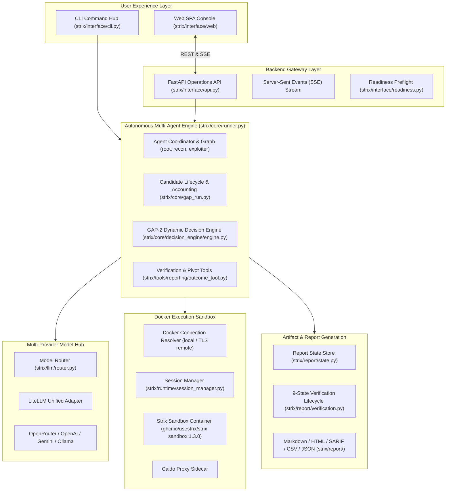

# AI-VAPT Developer & Engineering Guide

**Target Audience:** Core Contributors, Integration Engineers, and Security Researchers  
**Repository Branch:** `ai-vapt-full-application`  

---

## 1. Architecture Overview

AI-VAPT integrates the autonomous multi-agent execution capabilities of Strix with GAP-1 candidate triage, GAP-2 dynamic hypothesis pivoting, multi-provider model routing, a real-time FastAPI gateway, and strict 9-state verification contracts.



---

## 2. Directory Layout

```text
ai_vapt_framework/
├── .env.example                      # Template environment variables
├── setup.sh                          # Portable first-time setup
├── start.sh                          # Everyday service startup
├── stop.sh                           # Clean service teardown
├── Makefile                          # Development commands (lint, format, type-check)
├── pyproject.toml                    # Project configuration, dependencies, tool settings
├── containers/
│   └── sandbox.Dockerfile            # Reference Dockerfile for sandbox image
├── strix/
│   ├── agents/                       # Agent graph, prompts, factory, subagent management
│   ├── config/                       # Settings models, provider configurations
│   ├── core/
│   │   ├── runner.py                 # Primary autonomous scan execution driver
│   │   ├── execution.py              # Multi-agent turn loop
│   │   ├── gap_run.py                # GAP-1 candidate lifecycle and accounting
│   │   ├── decision_engine/          # GAP-2 dynamic state machine and scope validator
│   │   ├── scanner/                  # Active scanner, fuzzer, and authentication manager
│   │   └── diagnostics.py            # System health and diagnostic checks
│   ├── interface/
│   │   ├── api.py                    # FastAPI server routes, SSE streaming, runs
│   │   ├── readiness.py              # Preflight component readiness checks
│   │   ├── cli.py                    # CLI entry point
│   │   └── web/                      # HTML5/CSS3/Vanilla JS single-page web console
│   ├── llm/
│   │   ├── router.py                 # Multi-provider model identifier normalization
│   │   └── provider_validation.py    # In-memory API credential validation
│   ├── report/
│   │   ├── verification.py           # 9-state verification enum and contract validation
│   │   ├── state.py                  # Thread-safe run report state and disk writer
│   │   ├── builder.py                # HTML & Markdown report renderers
│   │   └── sarif.py                  # SARIF 2.1.0 output generator
│   ├── runtime/
│   │   ├── docker_connection.py      # Docker local socket and TLS DOCKER_HOST connection
│   │   ├── docker_client.py          # Docker client wrapper with image checking
│   │   └── session_manager.py        # Sandbox container and Caido proxy lifecycle
│   └── tools/                        # Agent tool definitions (bash, web, outcome, reporting)
├── strix_runs/                       # Persistent run directories and assessment artifacts
└── tests/                            # Comprehensive automated test suites (2,770+ tests)
```

---

## 3. Developer Workflow

### 3.1 Initial Setup
```bash
./setup.sh
```
This initializes `.venv` using `uv` or `pip`, installs all dependencies in editable mode, and creates `.env`.

### 3.2 Running Quality Checks
We enforce strict linting, type-checking, and security audits:

```bash
# Format code using ruff
make format

# Lint code with auto-fixes
make lint

# Run type-checking (mypy)
uv run mypy strix/

# Run security static analysis (bandit)
make security

# Run all checks at once
make check-all
```

### 3.3 Running Automated Tests
```bash
# Run the entire test suite
uv run pytest

# Run a specific test module
uv run pytest tests/test_multi_model_router.py -v

# Run GAP-1 and GAP-2 integration tests
uv run pytest tests/test_phase6_core_runner_gap_integration.py -v

# Run verification lifecycle tests
uv run pytest tests/test_verification_lifecycle.py tests/test_vapt_lifecycle_verification.py -v
```

---

## 4. Key Architectural Contracts

### 4.1 GAP-1 Candidate Accounting Invariant
Any operation updating candidate states in `GapRun` or `DecisionEngine` **must** strictly preserve the candidate accounting equation:
$$\text{dispatched} = \text{investigated} + \text{not\_tested} + \text{blocked}$$
- `dispatched`: Total candidates in the queue.
- `investigated`: Candidates probed (`VALIDATED`, `INCONCLUSIVE`, or `ABANDONED`).
- `not_tested`: Candidates pending investigation.
- `blocked`: Candidates rejected due to scope boundaries or system constraints.

### 4.2 GAP-2 Dynamic Pivoting Contract
- No synthetic loops or simulated pivots are permitted.
- Dynamic pivots occur **only** when a candidate's probe attempts reach $k$ (`max_attempts`, default 2), fail, and an authorized, in-scope alternative candidate is selected.
- If no alternative candidate exists, the investigation terminates gracefully.

### 4.3 9-State Finding Verification Contract
Findings submitted via agent outcome tools (`record_vulnerability_outcome`) or programmatic state builders must satisfy the verification contract before receiving `Verified` status:
1. `reproducible_request`: Non-empty, valid HTTP request string.
2. `reproducible_response`: Non-empty, observed HTTP response slice.
3. `verification_procedure`: Concrete, human- or machine-executable procedure steps.
4. `demonstrated_impact`: Concrete observed impact (e.g. database banner, DOM execution, extracted tokens), not generic taxonomy text.
5. `evidence_timestamp`: Valid ISO 8601 UTC timestamp.

If any element is missing, the finding is demoted to `unconfirmed` or `inconclusive`.

### 4.4 Model Identifier Routing
When adding or updating model providers in `strix/llm/router.py`:
- All OpenRouter models **must** retain their `openrouter/` prefix (e.g. `openrouter/nvidia/nemotron-3.5-lightning:free`). LiteLLM requires this prefix to recognize OpenRouter as the target provider.
- Never hardcode API keys or secret credentials. Read keys exclusively from environment variables or runtime header overrides.
