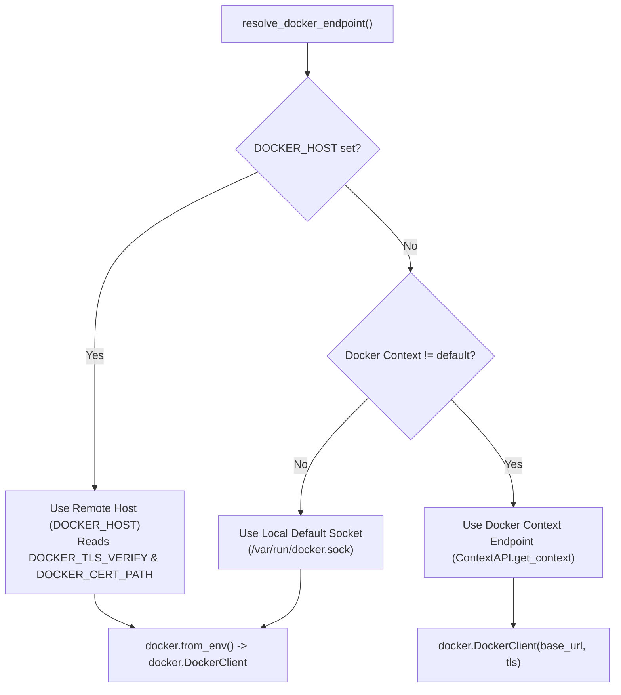

# AI-VAPT Docker Runtime & Sandbox Guide

**Target Audience:** Platform Engineers, Security Researchers, DevOps  
**Applies to:** AI-VAPT Autonomous Execution Engine  

---

## 1. Role of Docker in AI-VAPT

AI-VAPT relies on Docker to provide an isolated, disposable execution environment for autonomous security assessment. When autonomous mode is selected, AI-VAPT does **not** execute offensive penetration testing tools directly on the host machine. Instead, it provisions an ephemeral sandbox container running the official Strix sandbox image:

```text
ghcr.io/usestrix/strix-sandbox:1.3.0
```

Inside this container, the multi-agent engine:
1. Executes network reconnaissance tools (Nmap, Naabu, Ffuf).
2. Interacts with web targets via an embedded HTTP interception proxy (Caido).
3. Executes controlled active verification probes (SQLi, XSS, SSRF, IDOR).
4. Captures raw HTTP request/response evidence and terminal outputs.

---

## 2. Docker Architecture & Connection Resolution

The Docker connection is managed by [`strix/runtime/docker_connection.py`](file:///workspaces/ai_vapt_framework/strix/runtime/docker_connection.py). The runtime resolves the target Docker daemon dynamically without requiring code modifications:



### 2.1 Connection Resolution Rules
- **Environment Variable (`DOCKER_HOST`)**: Highest priority. Used for remote Docker hosts and cloud VMs.
- **Docker Context**: If an active Docker context is selected via `docker context use <name>`.
- **Default Local Socket**: Standard `/var/run/docker.sock` on Linux/macOS or named pipe on Windows.

---

## 3. The Sandbox Container Image

### 3.1 Canonical Image
- **Image Identifier**: `ghcr.io/usestrix/strix-sandbox:1.3.0`
- **Configurable via**: `STRIX_IMAGE` environment variable in `.env`.
- **Base OS**: Kali Linux rolling with pre-installed offensive security toolchains (curl, nmap, ffuf, caido-cli, python3, chromium).

### 3.2 Image Lifecycle Contract
1. **No Unnecessary Rebuilds**: The official pre-built image is pulled directly from GitHub Container Registry (`ghcr.io`). It must not be rebuilt locally unless modifying core container tooling.
2. **Existence Pre-Check**: In `strix/runtime/docker_client.py:206`:
   ```python
   if not self.image_exists(image):
       repo, tag = parse_repository_tag(image)
       self.docker_client.images.pull(repo, tag=tag or None, all_tags=False)
   ```
   If the image is already present in the local or remote Docker daemon, it is never re-downloaded.
3. **Automated Pulling**: `./setup.sh` checks for the image and pulls it automatically if the Docker daemon is accessible.

---

## 4. Local vs. Remote Docker Deployment

### 4.1 Local Docker (Linux, macOS, WSL2)
When running on standard workstations or dedicated VMs:
1. Ensure Docker Engine or Docker Desktop is running.
2. Ensure your user has permissions to access the Docker socket:
   ```bash
   sudo usermod -aG docker $USER
   newgrp docker
   ```
3. Run `./setup.sh` to verify that `Local Docker daemon is running and reachable via local socket`.

### 4.2 Remote Docker Host over TLS (GitHub Codespaces, Cloud Sandboxes)
GitHub Codespaces containers cannot run Docker-in-Docker due to restricted Linux kernel capabilities (`CapEff = 0`). The recommended solution is connecting to an external Ubuntu VM over mutual TLS:

1. Follow [`AI_VAPT_REMOTE_DOCKER_VM_SETUP.md`](file:///workspaces/ai_vapt_framework/AI_VAPT_REMOTE_DOCKER_VM_SETUP.md) to generate CA, server, and client certificates.
2. Copy client certificates to the client:
   ```bash
   mkdir -p ~/.docker/certs-client
   scp user@<vm-ip>:~/docker-certs/{ca.pem,cert.pem,key.pem} ~/.docker/certs-client/
   chmod 600 ~/.docker/certs-client/key.pem
   chmod 644 ~/.docker/certs-client/*.pem
   ```
3. Set environment variables in `.env`:
   ```bash
   DOCKER_HOST=tcp://<vm-ip>:2376
   DOCKER_TLS_VERIFY=1
   DOCKER_CERT_PATH=/home/vscode/.docker/certs-client
   ```
4. Verify connectivity:
   ```bash
   docker info
   ./setup.sh
   ```

---

## 5. Sandbox Networking & Target Resolution

When the sandbox container runs against a target on `localhost` or `127.0.0.1`, network resolution requires special handling because `127.0.0.1` inside the container refers to the container itself, not the host machine.

AI-VAPT automatically injects host resolution:
- Rewrites `http://localhost:<port>` to `http://host.docker.internal:<port>`.
- Passes `--add-host=host.docker.internal:host-gateway` to the container during creation.
- Allows containerized tools to seamlessly reach applications running on the host machine.

---

## 6. Security Principles

1. **Never Expose Unauthenticated Docker TCP Endpoints**: Exposing port 2375 without TLS allows unauthenticated root code execution on the Docker host. Port 2376 with TLS client verification (`--tlsverify`) must always be used.
2. **No Host Filesystem Mounts**: Sandbox containers are granted only an isolated workspace volume. The host root filesystem is never mounted into assessment containers.
3. **No Unrestricted Sockets**: We do not mount `/var/run/docker.sock` inside the sandbox container. Sandboxes cannot spawn sibling containers.
4. **Target Scope Enclosure**: The GAP-2 decision engine actively validates candidate URLs against `authorized_targets`. Probes attempting to target out-of-scope or private cloud infrastructure are blocked.

---

## 7. Diagnostics & Verification Commands

```bash
# Test 1: Check Docker CLI version
docker --version

# Test 2: Verify daemon connection (local or remote)
docker info

# Test 3: Verify sandbox image is present
docker image inspect ghcr.io/usestrix/strix-sandbox:1.3.0 --format '{{.Id}} ({{.Size}} bytes)'

# Test 4: Run a lightweight test container
docker run --rm hello-world

# Test 5: Verify AI-VAPT preflight detection
./setup.sh
```
