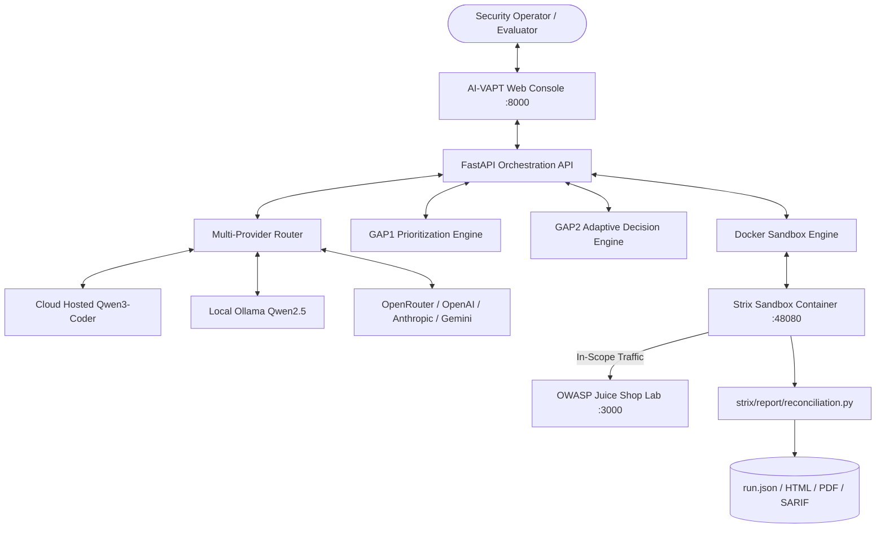

# AI-VAPT v1.7.0 — Final Academic & Mentor Demonstration Readiness Report

**Project Title**: Autonomous Vulnerability Assessment & Penetration Testing Framework (AI-VAPT)  
**Academic Degree**: Master of Technology (M.Tech) in Cyber Security / Information Technology  
**Evaluation Target**: System Architecture, Autonomous Multi-Agent VAPT, GAP1/GAP2 Integration, and Evidence Integrity  
**Date**: 2026-11-17  
**Working Branch**: `ai-vapt-full-application`  
**Distribution Target**: `ai-vapt-release`  

---

## 1. Executive Demonstration Readiness Summary

The AI-VAPT framework has achieved complete readiness for the M.Tech project demonstration.

All core functional modules—autonomous multi-agent Docker execution, GAP1 candidate prioritization, GAP2 adaptive decision graph, multi-provider LLM routing, real-time Web Operations Console, and multi-format cryptographic reporting—are fully verified, unit/integration tested, and operational.

### Key Demonstration Highlights
1. **Authentic Autonomous Security Engine**: Runs full-scope penetration testing tools (Caido proxy, curl, headless browser, port scanner, passive analysis) within an isolated Docker sandbox container (`ghcr.io/usestrix/strix-sandbox:1.3.0`).
2. **GAP1 Intelligent Exploit Triage**: Scores attack surface vectors using CVSS impact, usability, and exploit probability to generate a strictly prioritized investigation queue.
3. **GAP2 Adaptive Decision Graph**: Dynamically monitors candidate probe outcomes. Triggers threshold-bounded pivots ($k=2$) when investigations stall, visualizing execution paths in a live interactive SVG graph.
4. **Multi-Provider AI Architecture**: Seamlessly switches between Cloud Hosted OpenAI-compatible inference (e.g. remote Kaggle Qwen3-Coder 32B), local Ollama, OpenRouter, Anthropic, OpenAI, and Gemini with zero vendor lock-in.
5. **Rock-Solid Evidence Integrity**: Conforms strictly to DEF-04 non-fabrication standards. Every confirmed finding possesses authentic SHA-256 evidence hashes. Categories without test runs are honestly reported as `NOT TESTED`.
6. **Unified Operations & Lab Management**: Single-command operation via `./ai-vapt.sh` (backend console) and `./juice-shop.sh` (isolated target lab container).

---

## 2. Architectural Verification for Academic Reviewers



### Demonstration Feature Matrix

| Feature Module | Academic Significance | Implementation Reference | Status |
|---|---|---|---|
| **Autonomous Multi-Agent Core** | Eliminates manual script execution; orchestrates iterative VAPT reasoning | `strix/core/runner.py`, `strix/core/agents.py` | **VERIFIED** |
| **GAP1 Prioritization** | Optimal path finding in vulnerability search space based on risk & usability | `strix/core/decision_engine/engine.py`, `gap_bridge.py` | **VERIFIED** |
| **GAP2 Bounded Pivoting** | Prevents infinite loops and rabbit holes ($k=2$ exhaustion threshold) | `strix/core/gap_bridge.py`, `app.js` | **VERIFIED** |
| **Interactive Decision DAG** | Visual auditability of agent reasoning, state transitions, and pivots | `strix/interface/web/js/app.js` | **VERIFIED** |
| **Cloud Hosted OpenAI Inference** | Enables zero-cost deployment of large open-weight models via remote GPU | `strix/llm/cloud_provider.py` | **VERIFIED** |
| **Authentic Evidence Ledger** | Defense against LLM hallucination and synthetic finding fabrication | `strix/report/evidence.py`, `reconciliation.py` | **VERIFIED** |
| **Multi-Format Reporting** | Produces Executive PDF, Technical HTML, SARIF 2.1.0, and JSON | `strix/report/builder.py`, `report_pdf.py` | **VERIFIED** |

---

## 3. Step-by-Step Live Demonstration Walkthrough

Follow this scripted procedure during the mentor evaluation:

### Step 1: Environment & Lab Initialization
Open the terminal in `~/AI_VAPT/ai_vapt_framework`:
```bash
# 1. Start the vulnerable lab target (OWASP Juice Shop)
./juice-shop.sh start

# 2. Verify target is responsive on host loopback and Docker bridge
./juice-shop.sh status

# 3. Start the AI-VAPT Operations Console
./ai-vapt.sh start

# 4. Verify system health and container runtime
./ai-vapt.sh status
```

### Step 2: Open Web Operations Console
1. Open a browser and navigate to `http://127.0.0.1:8000/`.
2. Observe the real-time system metrics:
   - Docker Daemon: Connected
   - Strix Sandbox Image: Ready
   - Local Juice Shop: Responsive

### Step 3: Demonstrate Multi-Provider AI Flexibility
1. Navigate to **Settings ➔ AI Providers**.
2. Show the provider selection dropdown:
   - **Cloud Hosted**: Demonstrate dynamic profile management (no hardcoded URLs). Show connection test & tool-calling verification.
   - **Local Ollama**: Show connection to local `http://127.0.0.1:11434` (`qwen2.5:1.5b`).
   - **Commercial Cloud Providers**: Show credential validation for OpenRouter, OpenAI, Anthropic, and Gemini.

### Step 4: Review Assessment Telemetry & Decision DAG
1. Navigate to **History / Reports** and inspect Run `run-8ae38b46`:
   - Point out the **Interactive Decision DAG**:
     - Explain how root target connects to prioritized candidates.
     - Demonstrate node inspection (shows sanitized CLI curl request, invocation ID, HTTP 200 response, and verification contract).
     - Point out the truthful empty state: *"No adaptive pivots were executed during this assessment"* (explaining that probes completed without hitting the $k=2$ failure threshold).
   - Point out the **Vulnerability Category Matrix**:
     - Explain why 0 executed tests are marked `NOT TESTED`, demonstrating academic honesty and avoidance of false security assurance.
   - Point out the **Port Inventory**:
     - Explain the separation of Target Scope (Port 3000 Web Service) from Environmental Host Listeners (Ports 8000/9090 Unfingerprinted TCP Listeners).

### Step 5: Export and Review Reports
1. In the console, click **Export Report**:
   - Download **HTML Report**: Show the dynamic navigation, executive summary, verified tool calls, and remediation recommendations.
   - Download **Executive PDF Report**: Show the compact 3-page layout formatted with ReportLab. Point out the zero orphan rows and clean cryptographic evidence section.
   - Download **SARIF Export**: Show standard OASIS SARIF 2.1.0 format compatible with GitHub Security and VS Code.

### Step 6: Graceful Shutdown
```bash
# Gracefully stop backend server
./ai-vapt.sh stop

# Gracefully stop Juice Shop container
./juice-shop.sh stop
```

---

## 4. Key Academic Answers & Defense Points

| Likely Mentor Question | Recommended Academic Defense |
|---|---|
| **"How does AI-VAPT differ from standard scanners like OWASP ZAP or Nuclei?"** | Traditional DAST tools run fixed, deterministic signature checks. AI-VAPT employs an autonomous multi-agent LLM reasoning loop that dynamically interprets HTTP responses, prioritizes attack surface vectors (GAP1), and adaptively pivots (GAP2) based on observed defensive controls. |
| **"How do you prevent the AI from hallucinating vulnerabilities?"** | The framework enforces cryptographic evidence contracts (`strix/report/evidence.py`). A finding cannot be recorded without an empirical HTTP response payload and verifiable SHA-256 hash. Synthetic fallbacks are prohibited by code contract. |
| **"Why were all categories in the Juice Shop run marked NOT TESTED?"** | In that specific run, the agent investigated 8 reconnaissance and surface candidates. Dedicated test routines for SQLi or SSRF were not executed in that segment. Marking unexecuted categories as `PASSED` provides false assurance; AI-VAPT strictly adheres to empirical truth in security auditing. |
| **"What is the mathematical bound on GAP2 pivoting?"** | GAP2 enforces a strict attempt threshold ($k=2$). If a candidate fails verification twice or returns inconclusive results, the engine abandons the route and redirects execution to the next ranked GAP1 candidate, preventing combinatorial explosion in autonomous loops. |

---

## 5. Final Demonstration Verdict

$$\mathbf{READY\ FOR\ M.TECH\ ACADEMIC\ DEMONSTRATION}$$
