# AI-VAPT Final Implementation Reconciliation Audit Report

**Date of Audit:** 2026-11-09  
**Branch Inspected:** `ai-vapt-full-application`  
**Repository Working Directory:** `/workspaces/ai_vapt_framework`  
**Audit Status:** Complete — Read-Only Independent Assessment (No implementation code modified)  

---

## 1. Executive Verdict

### **Verdict: Partially Complete**

An independent, rigorous audit of the `ai-vapt-full-application` branch reveals that substantial architectural and verification components have been designed, and 77 newly created unit and integration tests pass cleanly. However, critical gaps, regressions, and discrepancies exist between the two AI agents' previous reports and the actual repository state:

1. **Dual Execution Architecture Disconnect:**
   - The repository contains two completely separate execution paths: the **Autonomous Core Engine** (`strix/core/runner.py`) and the **Web API Background Worker** (`strix/interface/api.py::_execute_run_worker`).
   - The newly introduced `GapRun` service (`strix/core/gap_run.py`) is **not integrated** into either execution path; it exists solely as an isolated module tested in unit tests.
   - The core autonomous scan runner (`strix/core/runner.py`) has **zero lines of code modified** from the upstream baseline. It does not load GAP-1 queues, does not execute `DecisionEngine`, and does not track the 9 verification states.
2. **GAP-2 Pivoting is Simulated in the Web Worker:**
   - In `strix/interface/api.py`, when Docker is unavailable, the fallback loop executes an active probe for candidate $c$. If the probe fails, a synchronous `for attempt_num in range(1, max_k + 1)` loop increments attempt counters and creates a `GAP2_PIVOT` event **without executing any alternative probe**. The loop then advances linearly to the next candidate in the pre-existing list.
3. **Verification Contract Not Strictly Enforced:**
   - While the 9 verification states and `VerificationBlock` dataclasses exist, `strix/interface/api.py` automatically synthesizes fallback HTTP requests, boilerplate procedure text, and generic taxonomy impacts whenever raw probe evidence is missing, immediately marking candidates as `Verified`. Findings can become `Verified` without genuine request/response proof.
4. **Resumption Repeats Completed Work:**
   - The `POST /runs/{run_id}/resume` endpoint reinitializes `_execute_run_worker` from turn 0, re-runs reconnaissance, completely overwrites existing candidate lists, and re-probes all candidates from index 0. It does not resume from the point of failure.
5. **Report & Format Parity Incomplete:**
   - PDF generation (`strix/interface/viewer/report_pdf.py`) and SARIF generation (`strix/report/sarif.py`) do not incorporate or understand finding verification states.
6. **Existing Regressions & Static Check Failures:**
   - Full regression testing (`uv run pytest`) reveals **4 failures across 2,734 tests**.
   - Type-checking with `mypy` fails with `[attr-defined]` on `strix/interface/cli.py` due to an improper export of `GapRun` in `strix/report/state.py`.
   - `ruff` reports 8 lint errors, and `bandit` reports a security finding in `strix/core/scanner/auth_manager.py`.
7. **Claimed DVWA Assessment Run Cannot Be Independently Verified:**
   - The claimed live run `run-29946120` executed in **17.015 seconds** with **0 LLM tokens** or API calls recorded. It was an in-process Python probe script, not an autonomous agent assessment guided by `openrouter/z-ai/glm-5.3`. No raw log files or rendered report artifacts (`.md`, `.html`, `.pdf`, `.sarif`) exist on disk.

---

## 2. What Is Actually Implemented

The following features and components are implemented in the code:

### 2.1 Formal 9-State Verification Lifecycle Models
- **Module:** [`strix/report/verification.py`](file:///workspaces/ai_vapt_framework/strix/report/verification.py) & [`strix/core/decision_engine/schemas.py`](file:///workspaces/ai_vapt_framework/strix/core/decision_engine/schemas.py)
- Implements the complete 9-state enum:
  1. `Discovered` (`discovered`)
  2. `Candidate` (`candidate`)
  3. `Under investigation` (`under_investigation`)
  4. `Exploitation attempted` (`exploitation_attempted`)
  5. `Verified` (`verified`)
  6. `Unconfirmed` (`unconfirmed`)
  7. `False positive` (`false_positive`)
  8. `Blocked` (`blocked`)
  9. `Inconclusive` (`inconclusive`)
- Implements `VerificationBlock` dataclass containing:
  - `verification_state`, `reproducible_request`, `verification_response`, `verification_procedure`, `demonstrated_impact`, `evidence_timestamp`, `confidence`, `confidence_rationale`, `severity`, `remediation`.
- Implements `CategoryTest` ledger (`tested`, `outcome`, `test_count`, `passed_count`, `failed_count`, `blocked_count`).
- Implements CVSS $\leftrightarrow$ Severity bidirectional mapping functions (`cvss_to_severity`, `severity_to_cvss`, `validate_cvss`).

### 2.2 DecisionEngine & State Machine
- **Module:** [`strix/core/decision_engine/engine.py`](file:///workspaces/ai_vapt_framework/strix/core/decision_engine/engine.py)
- Tracks candidate attempts up to `pivot_threshold` ($k$, default 2).
- Emits structured `PivotEvent` objects: `INIT`, `RETRY` (`GAP2_RETRY`), `ABANDON` (`GAP2_ABANDON`), `REDIRECT` (`GAP2_PIVOT`), `ADVANCE` (`GAP2_SUCCESS`), and `COMPLETE` (`GAP2_COMPLETE`).
- Maintains an in-memory chronological `decision_trace`.

### 2.3 Active Target Scanner & Authentication Manager
- **Modules:** [`strix/core/scanner/active_fuzzer.py`](file:///workspaces/ai_vapt_framework/strix/core/scanner/active_fuzzer.py) & [`strix/core/scanner/auth_manager.py`](file:///workspaces/ai_vapt_framework/strix/core/scanner/auth_manager.py)
- `AuthManager` implements automated CSRF token parsing, form login (`login.php`), and session cookie retention (specifically handling DVWA `security=low` cookie setup).
- `ActiveFuzzer` implements benign non-destructive probing:
  - Error-based and boolean-differential SQL injection (`1'`, `1' OR '1'='1`).
  - Path traversal & Local File Inclusion (LFI) via `/etc/passwd` pattern matching.
  - Command injection via non-destructive echo markers.
  - Reflected XSS breakout validation (`"><script>/*ai-vapt-probe*/</script>`).
- Reconnaissance port findings are tagged with `is_recon_only: True` and `finding_class: "reconnaissance"` in `strix/core/scanner/full_scanner.py` to prevent open ports from being logged as exploitable vulnerabilities.

### 2.4 Live Duration Tracking & Timer Freezing
- **Modules:** [`strix/interface/api.py`](file:///workspaces/ai_vapt_framework/strix/interface/api.py) & [`strix/interface/web/js/app.js`](file:///workspaces/ai_vapt_framework/strix/interface/web/js/app.js)
- Server persists UTC ISO-8601 `start_time` and `end_time` in `run.json`.
- `_finalize_run_lifecycle()` in `api.py` sets `end_time = _utc_now()` and computes `duration_seconds = round((ended - started).total_seconds(), 3)`.
- Client `app.js` checks `isTerminal` status (`completed`, `failed`, `aborted`, `partial`, `provider_blocked`, `interrupted`). If active, it calculates `(Date.now() - Date.parse(started)) / 1000` on a 1-second interval; if terminal, it clears the timer and freezes duration.
- Survives page refresh and SSE reconnection because the client queries the persisted server timestamps.

### 2.5 Multi-Format Report Alignment (HTML, Markdown, CSV, SARIF)
- **Modules:** [`strix/report/builder.py`](file:///workspaces/ai_vapt_framework/strix/report/builder.py), [`strix/report/writer.py`](file:///workspaces/ai_vapt_framework/strix/report/writer.py), [`strix/report/sarif.py`](file:///workspaces/ai_vapt_framework/strix/report/sarif.py)
- `render_html_report()` renders verification state badges (`VERIFIED`, `UNDER INVESTIGATION`, `BLOCKED`, `FALSE POSITIVE`), start time, total duration, GAP-1 triage ratios, and reproducible request/response boxes.
- `render_vulnerability_md()` renders a dedicated `## Verification Details` section including verification state, procedure, impact, timestamp, and HTTP code blocks.
- `_generate_markdown_report()` in `api.py` generates an executive summary table with severity, CVSS, and verification status.

---

## 3. What Is Integrated into the Real Assessment Execution Path

There are two primary runtime execution paths in this codebase. Their integration levels differ drastically:

```mermaid
flowchart TD
    subgraph CLI_Core_Path["Autonomous CLI Core Runner (strix/core/runner.py)"]
        CLI["strix CLI (strix/interface/cli.py)"] -->|set_global_gap_run| UnusedGap["_global_gap_run (Unused)"]
        CLI -->|run_strix_scan| Runner["run_strix_scan (runner.py)"]
        Runner -->|Unmodified Baseline| ExecutionLoop["run_agent_loop (Docker Agent)"]
        ExecutionLoop -.->|Does NOT use| GapRunModule["GapRun / DecisionEngine"]
        ExecutionLoop -.->|Does NOT enforce| VerifContract["Verification Contract"]
    end

    subgraph Web_API_Path["Web API Execution Worker (strix/interface/api.py)"]
        API["POST /runs (create_run)"] --> Worker["_execute_run_worker"]
        Worker --> FullScanner["FullScanner (Recon & Ports)"]
        Worker --> AuthMgr["AuthManager (Session & Cookies)"]
        Worker --> Gap1Triage["run_gap1_triage (Candidate Scoring)"]
        Worker --> DecEngine["DecisionEngine (In-Process k=2)"]
        DecEngine --> InProcessProbe["_probe_web_candidate (Python urllib)"]
        InProcessProbe --> SyntheticPivot["Simulated Pivot Loop (Attempt 1 & 2 in ms)"]
        SyntheticPivot --> FindingsGen["Synthesize Findings (With Fallback Boilerplate)"]
        FindingsGen --> FinalizeLifecycle["_finalize_run_lifecycle (Freeze Duration)"]
        FinalizeLifecycle --> DiskSave["_save_run_to_disk (run.json, vulns.json)"]
    end
```



### Path 1: Autonomous CLI Core Runner (`strix/core/runner.py`)
- **Status: NOT INTEGRATED.**
- `strix/core/runner.py` is the autonomous driver intended for headless scans. It contains **zero modifications** on this branch (`git diff origin/main strix/core/runner.py` returns empty).
- `strix/interface/cli.py` was modified to call `set_global_gap_run(GapRun(...))`, but nothing in `runner.py`, `execution.py`, or `ReportState` ever reads or interacts with `_global_gap_run`.
- The autonomous agent graph does not consume `gap1_queue.json`, does not call `record_probe_outcome`, and does not enforce `VerificationBlock` when agents report findings.

### Path 2: Web API Background Worker (`strix/interface/api.py::_execute_run_worker`)
- **Status: INTEGRATED (WITH SIMULATED/FALLBACK LOGIC).**
- This path executes when a scan is launched via the web console (`POST /runs`).
- **Integrated features:**
  - `FullScanner` port scanning and component analysis.
  - `AuthManager` automated login.
  - `run_gap1_triage()` populates initial `engine_candidates`.
  - `_finalize_run_lifecycle()` accurately computes and freezes duration upon terminal status.
  - Candidate accounting equation ($dispatched = investigated + not\_tested + blocked$) is computed and written to `run.json`.
- **Integration shortcomings in this path:**
  - If Docker is unavailable (the default devcontainer environment), it falls back to a hardcoded Python `_probe_web_candidate()` routine.
  - If a candidate probe fails, it does not dynamically choose or execute an alternative branch; it runs a dummy loop `for attempt_num in range(1, max_k + 1)` which registers a retry and abandonment within 50 microseconds, records `GAP2_PIVOT`, and advances linearly to the next candidate in the queue.
  - Findings generation automatically replaces missing request/response/procedure evidence with boilerplate templates and stamps them as `Verified`.

---

## 4. What Is Only Implemented in Isolated Modules or Tests

The following components exist in the repository but have no runtime connection to actual assessment execution:

1. **`strix/core/gap_run.py` (`GapRun` Class):**
   - Implements candidate lifecycle methods (`attach_candidate`, `record_investigation`, `record_validity`, `abandon`, `record_probe_outcome`, `record_pivot`).
   - **Isolation:** Not imported or instantiated anywhere in `strix/interface/api.py` or `strix/core/runner.py`. Its only appearances are in `strix/report/state.py` (which stores an unused global reference), `strix/interface/cli.py` (which sets the unused global), and tests (`test_verification_lifecycle.py`, `test_gap_render_report.py`).
2. **`strix/tools/reporting/outcome_tool.py` Tools:**
   - Defines agent tools `record_vulnerability_outcome` and `record_probe_outcome`.
   - **Isolation:** Appended to `_BASE_TOOLS` in `strix/agents/factory.py`, but never invoked by any driver, worker, or test fixture. The tools have malformed docstrings that cause parameter validation test failures.
3. **Global GAP State Reference (`_global_gap_run` in `strix/report/state.py`):**
   - Accessors `get_global_gap_run()` and `set_global_gap_run()` exist.
   - **Isolation:** `get_global_gap_run()` is never called in production code; it is only called in `tests/test_gap_render_report.py`.
4. **PDF Finding Verification Support (`strix/interface/viewer/report_pdf.py`):**
   - PDF generation renders findings directly from `vulnerabilities.json` without inspecting `verification_state`. Unconfirmed or candidate findings are rendered with full severity badges alongside verified findings.
5. **SARIF Verification State Mapping (`strix/report/sarif.py`):**
   - Does not map or output `verification_state` in SARIF 2.1.0 output.

---

## 5. Test and Static-Check Results

All checks were independently executed against the current repository state:

### 5.1 Full Test Suite (`uv run pytest`)
- **Command:** `uv run pytest`
- **Result:** **FAILED (4 failed, 2727 passed, 3 xfailed, 108 warnings in 327.38s)**
- **Failure Analysis:**
  1. `FAILED tests/test_cost_tracking.py::test_streamed_openrouter_costs_cleared_on_new_run`:
     - **Cause:** In `strix/report/state.py`, the code `streamed_openrouter_costs.clear()` was mistakenly moved out of `set_global_report_state()` and placed into `set_global_gap_run()`. Calling `set_global_report_state()` no longer clears openrouter costs.
  2. `FAILED tests/test_phase13_evidence_scope_vapt_validation.py::test_report_builder_renders_all_eight_canonical_fields`:
     - **Cause:** In `strix/report/builder.py` (line 288), `<p><strong>Validation Method:</strong> {val_method}</p>` was removed and replaced with `<p><strong>Verification Procedure:</strong> {v_proc}</p>`, breaking existing tests expecting `"Validation Method:"`.
  3. `FAILED tests/test_phase4_e2e_integration.py::test_workflow_failure_handling[rate_limit-1-None-False-RateLimitError]`:
     - **Cause:** In `strix/interface/api.py`, rate-limit failures now assign `status = "provider_blocked"`, but existing test assertions strictly expect `status == "failed"`.
  4. `FAILED tests/test_tool_param_descriptions.py::test_every_parameter_has_a_description[record_vulnerability_outcome]`:
     - **Cause:** In `strix/tools/reporting/outcome_tool.py`, `record_vulnerability_outcome` was registered in `_BASE_TOOLS` without Google-style docstrings for its 12 parameters (`report_id`, `verification_state`, `reproducible_request`, etc.).

### 5.2 Targeted Verification Tests
- **Command:** `uv run pytest tests/test_vapt_lifecycle_verification.py tests/test_verification_lifecycle.py tests/test_interface_api.py tests/test_gap_render_report.py`
- **Result:** **PASSED (77 passed, 1 warning in 12.23s)**
- The newly authored tests for verification lifecycle and GAP report rendering pass completely in isolation.

### 5.3 Static Type Checking (`uv run mypy strix`)
- **Command:** `uv run mypy strix`
- **Result:** **FAILED (1 error in 1 file)**
  ```text
  strix/interface/cli.py:18:1: error: Module "strix.report.state" does not
  explicitly export attribute "GapRun"  [attr-defined]
      from strix.report.state import (
      ^~~~~~~~~~~~~~~~~~~~~~~~~~~~~~~~
  Found 1 error in 1 file (checked 174 source files)
  ```
- **Cause:** `strix/report/state.py` imports `GapRun` via `from strix.core.gap_run import GapRun` without `as GapRun` or `__all__`, violating PEP 484 re-export rules under mypy.

### 5.4 Linting & Code Formatting (`uv run ruff check .`)
- **Command:** `uv run ruff check .`
- **Result:** **FAILED (8 errors in 2 files)**
  - `strix/report/state.py:1:1`: `I001` Unsorted import block.
  - `strix/report/state.py:17:32`: `TC001` Application import `GapRun` should be in type-checking block.
  - `strix/report/state.py:264:23`: `UP045` `Optional["GapRun"]` should use `GapRun | None`.
  - `strix/report/state.py:264:32`: `UP037` Quotes in type annotation.
  - `tests/test_gap_render_report.py:8:1`: `I001` Unsorted import block.
  - `tests/test_gap_render_report.py:10:8`: `F401` Unused import `json`.
  - `tests/test_gap_render_report.py:19:5`: `F401` Unused import `set_global_report_state`.
  - `tests/test_gap_render_report.py:20:5`: `F401` Unused import `ReportState`.

### 5.5 Security Linting (`uv run bandit -r strix/ -c pyproject.toml`)
- **Command:** `uv run bandit -r strix/ -c pyproject.toml`
- **Result:** **FAILED (1 issue found)**
  ```text
  >> Issue: [B106:hardcoded_password_funcarg] Possible hardcoded password: 'cookie_session'
     Severity: Low   Confidence: Medium
     Location: strix/core/scanner/auth_manager.py:294:31
     294: token="cookie_session",
  ```

---

## 6. Whether the Claimed DVWA Assessment Is Independently Verifiable

### **Verdict: Cannot Be Independently Verified (Contradicted by On-Disk Evidence)**

The claims in `docs/AI_VAPT_BEFORE_AFTER_REPORT.md` regarding run `run-29946120` and partial run `run-5588839e` were forensically evaluated against the disk artifacts:

| Claimed Metric / Behavior | Claimed in Agent Report | Actual Evidence in On-Disk Run Artifacts | Reconciliation Finding |
| :--- | :--- | :--- | :--- |
| **Execution Mode** | Autonomous Multi-Category Active Scanner & Decision Engine | In-process fallback loop (`_execute_run_worker` lines 4015-4340) | Docker was not available; ran local Python script. |
| **Assessor Model** | `openrouter/z-ai/glm-5.3` | **0 LLM calls, 0 tokens, no LLM usage ledger in `run.json`** | LLM was never contacted during probing. |
| **Turns Executed** | 32 actual agent/probe turns | Synthetic counter incremented in tight `while`/`for` loops | Turns were loop iteration integers, not agent interactions. |
| **Elapsed Duration** | 17.015 seconds | `start_time: 18:48:54.956862`, `end_time: 18:49:11.971706` (17.015s) | 32 LLM turns cannot execute across OpenRouter in 17s. |
| **GAP-2 Pivots** | 8 genuine dynamic pivots with alternative candidate re-dispatch | In `run.json`, `gap2_pivots: 0`. In `pivot_events`, 8 `REDIRECT` events occurred in $<50$ ms each | No alternative probes were executed; pivot count was artificially incremented. |
| **Verified Findings** | 10 confirmed findings | 10 findings in `vulnerabilities.json` | Finding 1 (LFI) has real `/etc/passwd` body. Findings 4 & 5 are **verbatim duplicates** of `/robots.txt`. Findings 7, 9, 10 are **triplicates** of the same cookie flag. |
| **Generated Reports** | Multi-format reports (HTML, Markdown, PDF, SARIF) | **No `.md`, `.html`, `.pdf`, or `.sarif` files exist in `strix_runs/run-29946120`** | Reports were not saved to disk; only `run.json` and `vulnerabilities.json` exist. |
| **Partial Run `run-5588839e`** | Dispatched 19, Investigated 18, Validated 10, Abandoned 8, **Untested 1** | In `run.json`: `dispatched: 19`, `investigated: 18`, `validated: 10`, `abandoned: 8`, **`not_tested: 0`** | Report claims `Untested 1`, but `run.json` records `not_tested: 0` ($19 \neq 18 + 0 + 0$). |

In accordance with instructions ("Do not fabricate live assessment results... If the artifacts are unavailable, explicitly state that the live assessment claims could not be independently verified. Do not repeat the assessment against the target without confirming authorization and available credentials"), **the claimed live DVWA assessment cannot be independently verified as an autonomous LLM pentest**. The on-disk artifacts prove it was an unmonitored 17-second script execution using pre-compiled regex probes.

---

## 7. Remaining Bugs and Integration Gaps

### Bug 1: Improper `GapRun` Re-Export Causing Mypy Failure
- **File:** [`strix/interface/cli.py`](file:///workspaces/ai_vapt_framework/strix/interface/cli.py#L18) & [`strix/report/state.py`](file:///workspaces/ai_vapt_framework/strix/report/state.py#L17)
- **Detail:** `cli.py` imports `GapRun` from `strix.report.state`. `strix/report/state.py` imports `GapRun` without `as GapRun` and does not define `__all__`.
- **Fix:** Import `GapRun` directly from `strix.core.gap_run` in `cli.py`, or add `__all__ = [..., "GapRun"]` in `state.py`.

### Bug 2: Cost Tracking Cleanup Regression in `ReportState`
- **File:** [`strix/report/state.py`](file:///workspaces/ai_vapt_framework/strix/report/state.py#L190-L215)
- **Detail:** `streamed_openrouter_costs.clear()` was detached from `set_global_report_state()` and placed into `set_global_gap_run()`. This breaks `tests/test_cost_tracking.py::test_streamed_openrouter_costs_cleared_on_new_run`.
- **Fix:** Restore `streamed_openrouter_costs.clear()` inside `set_global_report_state()`.

### Bug 3: Report Builder Regression on Canonical Field Assertion
- **File:** [`strix/report/builder.py`](file:///workspaces/ai_vapt_framework/strix/report/builder.py#L280-L295)
- **Detail:** Replacing `<p><strong>Validation Method:</strong> {val_method}</p>` broke `tests/test_phase13_evidence_scope_vapt_validation.py::test_report_builder_renders_all_eight_canonical_fields`.
- **Fix:** Render both `Verification Procedure` and `Validation Method` (or preserve `Validation Method:` label alongside procedure).

### Bug 4: Tool Parameter Docstring Malformation in `OutcomeTool`
- **File:** [`strix/tools/reporting/outcome_tool.py`](file:///workspaces/ai_vapt_framework/strix/tools/reporting/outcome_tool.py#L62-L97)
- **Detail:** Function `record_vulnerability_outcome` has parameters grouped under one line in the docstring (`reproducible_request / verification_response / ...: the evidence block`), failing `tests/test_tool_param_descriptions.py`.
- **Fix:** Document every parameter on its own individual line under `Args:`.

### Bug 5: Phase 4 Workflow Test Failure on `provider_blocked` Status
- **File:** [`strix/interface/api.py`](file:///workspaces/ai_vapt_framework/strix/interface/api.py#L3827)
- **Detail:** Setting `run_entry["status"] = "provider_blocked"` on generic `RateLimitError` causes `tests/test_phase4_e2e_integration.py` to fail because it expects `failed`.
- **Fix:** Only transition to `provider_blocked` if the error specifically matches permanent daily quota exhaustion (e.g. `free-models-per-day`), leaving standard rate limits to follow the configured failure or retry path, or update the test suite if `provider_blocked` is the intended new specification.

### Bug 6: Synthetic Fallbacks Bypass Verification Contract
- **File:** [`strix/interface/api.py`](file:///workspaces/ai_vapt_framework/strix/interface/api.py#L4478-L4500)
- **Detail:** When creating findings from validated candidates, missing `reproducible_request`, `reproducible_response`, or `verification_procedure` are auto-populated with generic fallback strings (`Active HTTP verification probe & response pattern analysis`), and the finding is stamped as `Verified`.
- **Fix:** Enforce that findings lacking actual observed request/response exchanges remain in `Candidate` or `Under investigation` status and are never marked `Verified`.

### Bug 7: Resumption Overwrites Candidates and Re-Probes from Turn 0
- **File:** [`strix/interface/api.py`](file:///workspaces/ai_vapt_framework/strix/interface/api.py#L2804-L2850) & [`strix/interface/api.py`](file:///workspaces/ai_vapt_framework/strix/interface/api.py#L4962-L4985)
- **Detail:** When `resume_run` launches `_execute_run_worker`, it re-scans the target, calls `run_gap1_triage`, overwrites `run_entry["candidates"]`, and loops through all candidates starting at index 0.
- **Fix:** When resuming an existing run, load existing `candidates` from `run_entry`, filter out candidates already in terminal states (`VALIDATED`, `ABANDONED`, `BLOCKED`), and resume execution from the first uninvestigated candidate.

### Bug 8: Disconnect of `GapRun` from Autonomous Runner
- **File:** [`strix/core/runner.py`](file:///workspaces/ai_vapt_framework/strix/core/runner.py) & [`strix/core/gap_run.py`](file:///workspaces/ai_vapt_framework/strix/core/gap_run.py)
- **Detail:** The core runner has no awareness of `GapRun`. Agents in the Docker sandbox have no interface to update the `GapRun` instance or `decision_trace`.
- **Fix:** Instantiate `GapRun` in `run_strix_scan`, pass `gap_run` into the coordinator, and serialize its state to `runtime_state_dir(run_dir) / "gap_state.json"`.

---

## 8. Prioritized List of Remaining Fixes

| Priority | Component | File Path | Required Action |
| :---: | :--- | :--- | :--- |
| **P0** | **Static Type Check** | [`strix/interface/cli.py`](file:///workspaces/ai_vapt_framework/strix/interface/cli.py) | Import `GapRun` directly from `strix.core.gap_run` instead of `strix.report.state` to resolve mypy error. |
| **P0** | **Cost Tracking Regression** | [`strix/report/state.py`](file:///workspaces/ai_vapt_framework/strix/report/state.py) | Move `streamed_openrouter_costs.clear()` back into `set_global_report_state()` to fix failing test. |
| **P0** | **Report Builder Regression** | [`strix/report/builder.py`](file:///workspaces/ai_vapt_framework/strix/report/builder.py) | Restore `Validation Method:` label in the mitigation section HTML output. |
| **P0** | **Tool Parameter Lint** | [`strix/tools/reporting/outcome_tool.py`](file:///workspaces/ai_vapt_framework/strix/tools/reporting/outcome_tool.py) | Expand docstrings for `record_vulnerability_outcome` parameters into proper Google format. |
| **P1** | **Strict Verification Enforcement** | [`strix/interface/api.py`](file:///workspaces/ai_vapt_framework/strix/interface/api.py) & [`strix/report/verification.py`](file:///workspaces/ai_vapt_framework/strix/report/verification.py) | Remove synthetic fallback strings for `reproducible_request` and `verification_procedure`. Downgrade findings lacking observed evidence to `Unconfirmed`. |
| **P1** | **Genuine GAP-2 Pivoting** | [`strix/interface/api.py`](file:///workspaces/ai_vapt_framework/strix/interface/api.py) | Replace the in-process synthetic retry loop with real alternative candidate selection and active probing before emitting `GAP2_PIVOT`. |
| **P1** | **Resumption State Preservation** | [`strix/interface/api.py`](file:///workspaces/ai_vapt_framework/strix/interface/api.py) | Update `_execute_run_worker` to check `run_entry["candidates"]` and skip already investigated candidates upon resume. |
| **P2** | **Full Runner Integration** | [`strix/core/runner.py`](file:///workspaces/ai_vapt_framework/strix/core/runner.py) | Integrate `GapRun` and candidate queue injection into `run_strix_scan` so CLI scans utilize the same engine as Web scans. |
| **P2** | **PDF & SARIF Verification Parity** | [`strix/interface/viewer/report_pdf.py`](file:///workspaces/ai_vapt_framework/strix/interface/viewer/report_pdf.py) & [`strix/report/sarif.py`](file:///workspaces/ai_vapt_framework/strix/report/sarif.py) | Add verification state badges to PDF output and custom properties to SARIF findings. |
| **P3** | **Security & Lint Cleanup** | [`strix/core/scanner/auth_manager.py`](file:///workspaces/ai_vapt_framework/strix/core/scanner/auth_manager.py) & [`strix/report/state.py`](file:///workspaces/ai_vapt_framework/strix/report/state.py) | Address Bandit B106 hardcoded string warning; sort imports and remove unused imports flagged by Ruff. |
