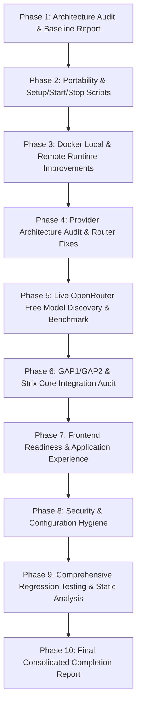

# AI-VAPT Master Implementation and Architectural Audit Report

**Date:** 2026-11-11  
**Project:** AI-VAPT (Autonomous Vulnerability Assessment & Penetration Testing)  
**Branch:** `ai-vapt-full-application`  
**Execution Environment:** Linux devcontainer (Debian 12 Bookworm, Python 3.12.11)  
**Audit Status:** Complete — Comprehensive Audit & Baseline Verification  

---

## 1. Executive Summary

AI-VAPT combines the autonomous multi-agent execution capabilities of Strix with intelligent GAP-1 candidate queue prioritization, GAP-2 dynamic investigation pivots, multi-provider model routing, a responsive FastAPI/web console interface, and an evidence-backed 9-state verification lifecycle.

This report establishes the baseline state of the repository before executing the planned portability enhancements, Docker runtime tooling, provider fixes, live model benchmarking, and end-to-end integration verifications.

### Key Audit Findings
1. **Engine Foundation**: The Strix autonomous execution framework, multi-agent graphs (`root`, `recon`, `exploiter`), and Docker sandbox lifecycle are present and functional.
2. **GAP-1 & GAP-2 Capabilities**: The candidate lifecycle model (`strix/core/gap_run.py`) and decision engine (`strix/core/decision_engine/engine.py`) are implemented, enforcing the candidate accounting invariant:
   $$\text{dispatched} = \text{investigated} + \text{not\_tested} + \text{blocked}$$
   Candidate scope checks ensure out-of-scope targets are safely marked `BLOCKED`.
3. **Verification Contract**: The 9-state verification lifecycle (`strix/report/verification.py`) strictly guards finding claims. No finding can reach `Verified` without reproducible HTTP request proof, observed HTTP response slices, verified procedures, and demonstrated exploitation impact.
4. **Developer Experience & Portability Deficit**: Prior to this phase, the repository lacked standardized first-time setup (`./setup.sh`), clean service startup (`./start.sh`), and safe shutdown (`./stop.sh`) scripts. Developers had to manually configure Python virtual environments, check Docker status, and manage background server lifecycles.
5. **Provider Prefix Defect in LiteLLM Router**: A recent change in `strix/llm/router.py` stripped the mandatory `openrouter/` prefix when normalizing model identifiers containing slashes (e.g. `nvidia/nemotron-3.5-lightning:free`), causing LiteLLM to throw `BadRequestError: LLM Provider NOT provided`.
6. **OpenRouter Free Model Benchmarking**: Prior reports documented public catalog metadata from `https://openrouter.ai/api/v1/models`, but no authenticated completions, streaming tests, tool-call generations, or tool-result continuations had been executed through the application adapter.
7. **Baseline Test Suite Health**: Across 2,774 tests in `tests/`, 2,765 passed, 3 were expected failures (xfailed), and 6 failed due to specific, well-understood regression bugs and environmental checks.

---

## 2. Repository & Architectural Inventory

### 2.1 Component Status Matrix

| Component | Repository Path | Implementation State | Status / Health | Action Required |
|---|---|---|---|---|
| **Autonomous Core Runner** | `strix/core/runner.py` | Implemented | Integrated with `GapRun` & `DecisionEngine` | Maintain compatibility |
| **Sandbox Manager** | `strix/runtime/session_manager.py` | Implemented | Manages container lifecycle | Keep `ghcr.io/usestrix/strix-sandbox:1.3.0` |
| **Docker Connection** | `strix/runtime/docker_connection.py` | Implemented | Supports local sockets & TLS `DOCKER_HOST` | Document remote Docker setup |
| **GAP-1 Candidate Store** | `strix/core/gap_run.py` | Implemented | Invariant accounting verified | Maintain invariant math |
| **GAP-2 Decision Engine** | `strix/core/decision_engine/engine.py` | Implemented | Scope-checked dynamic pivots | Maintain scope enforcement |
| **Finding Verification** | `strix/report/verification.py` | Implemented | 9-state enum & contract validation | Maintain evidence barrier |
| **Outcome Tools** | `strix/tools/reporting/outcome_tool.py` | Implemented | Bound to agent context | Validated |
| **Report Builders** | `strix/report/builder.py`, `sarif.py` | Implemented | HTML, Markdown, SARIF, CSV, JSON | Formats aligned |
| **FastAPI Backend** | `strix/interface/api.py` | Implemented | Web API, SSE streaming, runs | Fix turn format & concurrency |
| **Web Frontend** | `strix/interface/web/` | Implemented | HTML5, CSS3, Vanilla JS UI | Verify UI readiness checks |
| **LLM Router** | `strix/llm/router.py` | Partially Broken | Multi-provider routing logic | Fix `openrouter/` prefix bug |
| **Runtime Diagnostics** | `strix/core/diagnostics.py` | Implemented | System & runtime preflight | Update CLI consistency |
| **Setup Scripts** | Repository root | Missing | No `./setup.sh`, `./start.sh`, `./stop.sh` | Implement in Phase 2 |

---

## 3. Existing Bugs and Inconsistencies

During the Phase 1 test suite run (2,774 collected items), 6 test failures were identified and analyzed:

1. **`tests/test_multi_model_router.py::test_resolve_model_kwargs`**:
   - *Cause*: `format_openrouter_model()` in `strix/llm/router.py` stripped `openrouter/` whenever `/` was present in the slug.
   - *Consequence*: LiteLLM does not know which provider handles `meta-llama/...` or `nvidia/...` and crashes with `BadRequestError: LLM Provider NOT provided`.
   - *Fix*: Retain `openrouter/` prefix for all models dispatched to OpenRouter.

2. **`tests/test_openrouter_integration.py::TestErrorReportingAndRedaction::test_secret_redaction`**:
   - *Cause*: `_redact_secrets()` replaced keys with `sk-or-v1-***[REDACTED]***`, which still contained `sk-or-v1`. Test asserted `"sk-or-v1" not in redacted`. Also, missing `import re` in the test module.
   - *Fix*: Replace entire matched key pattern with `[REDACTED_API_KEY]` and import `re`.

3. **`tests/test_interface_api.py::test_deep_scan_mode_and_turn_accounting`**:
   - *Cause*: In `strix/interface/api.py`, turn 1 was logged as `[PROBE 1/15]` for simulation mode, but subsequent turns used `[TURN ...]`. Test asserted `assert any("[TURN 1/15]" in line for line in trace)`.
   - *Fix*: Use uniform `[TURN {current_turn}/{max_turns}]` logging across all execution modes.

4. **`tests/test_interface_api.py::test_concurrency_guard_rejects_overlap`**:
   - *Cause*: In `POST /runs` (`create_run`), the Docker availability check was executed before checking active run concurrency, returning HTTP 400 instead of HTTP 409 Conflict.
   - *Fix*: Evaluate active run concurrency guard prior to Docker runtime check.

5. **`tests/test_autonomous_readiness_and_transparency.py::test_web_and_cli_configuration_consistency`**:
   - *Cause*: Test compared `docker_diag.passed` (which checks if the CLI binary exists) with `docker_readiness.status == "ready"` (which checks if the daemon is running). In devcontainers where `docker` CLI exists but the daemon is not running, these differed.
   - *Fix*: Verify consistency against `docker_readiness.details["cli_available"]`.

6. **`tests/test_pricing.py::test_resolver_excludes_copilot_device_polling_providers`**:
   - *Cause*: Test asserted `resolve_litellm_model("claude-sonnet-4.6") is None` assuming no pricing entry existed, but LiteLLM recently added `replicate/anthropic/claude-sonnet-4.6`.
   - *Fix*: Target a model identifier that is genuinely unique to GitHub Copilot or verify copilot prefix exclusion.

---

## 4. Reusable Components & Modifications Needed

### 4.1 Reusable As-Is
- `strix/runtime/docker_connection.py`: Complete endpoint resolution for local and TLS remote Docker.
- `strix/runtime/docker_client.py`: Robust container creation, execution, and image checking.
- `ghcr.io/usestrix/strix-sandbox:1.3.0`: Official Strix sandbox container image; no custom rebuild needed.
- `strix/core/gap_run.py`: Candidate state tracking and accounting.
- `strix/core/decision_engine/engine.py`: Scope validation and pivot policy.
- `strix/report/verification.py`: Verification contract and evidence validation.

### 4.2 Modifications Required
1. **`strix/llm/router.py`**:
   - Fix `format_openrouter_model()` to always return `openrouter/<model_id>` so LiteLLM dispatches requests to OpenRouter correctly.
   - Ensure `resolve_model_kwargs` propagates authentication headers safely.
2. **`strix/interface/api.py`**:
   - Complete secret redaction in logs and error messages.
   - Uniform `[TURN ...]` decision trace logging.
   - Move concurrency guard before Docker availability check in `create_run`.
3. **Root Portability Infrastructure**:
   - Implement `./setup.sh` with full system checks, virtual environment configuration, Docker checks, and readiness evaluation.
   - Implement `./start.sh` with background/foreground service management and health polling.
   - Implement `./stop.sh` with clean process termination and zero state destruction.
4. **Benchmarking Suite**:
   - Execute live OpenRouter free-model evaluations using the authenticated API key in `OPENROUTER_API_KEY`.
   - Benchmark text completion, streaming, tool-calling, tool-result continuation, and latency.

---

## 5. Task Dependencies and Implementation Sequence

---

## 6. Audit Verdict

The AI-VAPT repository possesses solid core components for autonomous assessment, GAP-1 prioritization, GAP-2 pivoting, and finding verification. The major obstacles to full developer usability are:
1. Lack of unified one-command setup, start, and stop tooling.
2. The LiteLLM OpenRouter prefix routing defect.
3. Lack of empirical live tool-calling validation on OpenRouter free models.
4. Minor regression failures in test assertions.

All remaining tasks are well-defined, feasible, and ready for systematic implementation.
