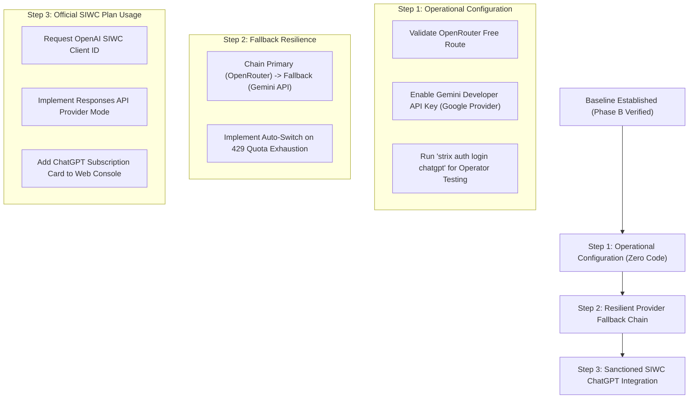

# AI-VAPT — Post Phase B Baseline and Integration Readiness Audit

**Author:** Antigravity Autonomous Security Engineer & Platform Auditor  
**Date:** 2026-11-16  
**Repository Working Directory:** `/home/vinit/AI_VAPT/ai_vapt_framework`  
**Current Branch:** `ai-vapt-full-application`  
**HEAD Commit:** `f8b58a2f688481ef9fb9d92c0c2cb5e82a252a68` (`feat: complete AI-VAPT portability, remote Docker runtime, multi-provider AI, and GAP1/GAP2 integration`)  
**Audit Protocol:** Read-Only Source & Evidence Audit. Zero changes made to tracked codebase, tests, runtime data, or configurations.

---

## 1. Executive Verdict

An independent, rigorous, read-only forensic audit was performed across the complete AI-VAPT repository following the reported Phase B defect remediation. The objective was to verify the five remediated defects (DEF-01 through DEF-05), evaluate system-wide regression health, examine the existing multi-provider AI architecture, and determine the technical feasibility and policy constraints surrounding future LLM integrations (specifically OpenCode, ChatGPT subscription, and Google Gemini).

### Overall Assessment Verdict

```
╔═══════════════════════════════════════════════════════════════════════════════════════╗
║                               EXECUTIVE VERDICT:                                      ║
║                   READY FOR INTEGRATION WITH ARCHITECTURAL CONSTRAINTS                ║
╚═══════════════════════════════════════════════════════════════════════════════════════╝
```

1. **Phase B Defect Remediation: 100% VERIFIED AND FIXED.**
   - All five defects identified in the Independent Forensic Audit (DEF-01 through DEF-05) have been verified in the actual source code and confirmed by 22 targeted regression tests in [test_phase_b_defect_remediation.py](file:///home/vinit/AI_VAPT/ai_vapt_framework/tests/test_phase_b_defect_remediation.py).
   - Zero synthetic evidence is generated in reporting ([builder.py](file:///home/vinit/AI_VAPT/ai_vapt_framework/strix/report/builder.py#L334-L340)).
   - Scan category reporting is strictly dynamic and honest; unexecuted categories display as `NOT TESTED` ([builder.py](file:///home/vinit/AI_VAPT/ai_vapt_framework/strix/report/builder.py#L514-L575)).
   - GAP2 pivot metrics strictly distinguish genuine dynamic candidate pivots from queue exhaustion and abandonments ([builder.py](file:///home/vinit/AI_VAPT/ai_vapt_framework/strix/report/builder.py#L137-L170)).
   - Multi-host and subdomain authorization is rigorously validated (RFC 1123, wildcard rejection) and enforced across the spider, redirect handler, and agent tasks ([schemas.py](file:///home/vinit/AI_VAPT/ai_vapt_framework/strix/interface/schemas.py#L23-L42), [crawler.py](file:///home/vinit/AI_VAPT/ai_vapt_framework/strix/core/scanner/crawler.py#L48-L65)).
   - Static type checking with `mypy` encompasses the entire platform including the primary API module [api.py](file:///home/vinit/AI_VAPT/ai_vapt_framework/strix/interface/api.py), reporting **0 issues across 178 source files**.

2. **System Health & Regression Verification: AUTHORITATIVE PASS.**
   - Complete repository test suite executed in this session: **2,880 passed, 1 skipped, 3 xfailed, 0 failed** across 2,884 total tests (5m 12s execution time).
   - Core AI-VAPT Phase test suite ([tests/test_phase*.py](file:///home/vinit/AI_VAPT/ai_vapt_framework/tests)): **163 passed, 0 failed** in 21.15s.
   - Code quality and security static analysis: `ruff` passed with 0 errors; `bandit` reported **0 high-severity security issues**.

3. **Future AI Provider Integration Feasibility:**
   - **OpenCode Session Bridge:** **REJECTED (Protocol Infeasible & Policy Violation).** OpenCode v2.2.1 does not provide an API that accepts external tool definitions or caller-supplied conversation histories. External calls to OpenCode free-tier models return HTTP 429 `FreeUsageLimitError` because OpenCode free models are policy-restricted to the OpenCode client only. Driving Strix through an OpenCode bridge would forfeit agent loop control and violate vendor terms.
   - **ChatGPT Subscription:** **FUNCTIONAL & BUILT-IN (UNOFFICIAL CODEX ROUTE) / OFFICIAL SIWC PATH IDENTIFIED.** The codebase already includes a fully operational OAuth 2.0 PKCE flow in [codex.py](file:///home/vinit/AI_VAPT/ai_vapt_framework/strix/config/codex.py) routing to `chatgpt.com/backend-api/codex`. While functional, this uses an unofficial endpoint and is subject to cybersecurity content guardrail blocks. The sanctioned, long-term path is OpenAI's official **Sign in with ChatGPT (SIWC) — ChatGPT plan usage** program, which explicitly supports open-source tools calling `api.openai.com/v1/responses` with function tools.
   - **Google Gemini:** **SANCTIONED VIA API KEY / CLI OAUTH PROHIBITED.** The existing `google` provider natively supports the Gemini Developer API free tier via API key (`GEMINI_API_KEY`). However, reusing or proxying Gemini CLI or Antigravity OAuth tokens is **explicitly prohibited** by Google Terms of Service and grounds for account termination.

---

## 2. Git and Working Tree Integrity

### 2.1 Branch and Commit State
- **Branch:** `ai-vapt-full-application`
- **Tracking Remote:** `origin/ai-vapt-full-application`
- **HEAD Commit Hash:** `f8b58a2f688481ef9fb9d92c0c2cb5e82a252a68`
- **HEAD Commit Subject:** `feat: complete AI-VAPT portability, remote Docker runtime, multi-provider AI, and GAP1/GAP2 integration`

### 2.2 Inventory of Tracked Modified Files (25 Files)

The 25 tracked files modified in the working tree are categorized below into prior user modifications (Phases 1–8) versus specific Phase B defect remediations:

| File Path | Primary Modification Scope | Phase Attribution | Verified Integrity |
|---|---|---|---|
| [pyproject.toml](file:///home/vinit/AI_VAPT/ai_vapt_framework/pyproject.toml) | Removed `strix/interface/api.py` from mypy ignore list | **Phase B (DEF-05)** | Strict type checking enabled for API module |
| [start.sh](file:///home/vinit/AI_VAPT/ai_vapt_framework/start.sh) | Runtime environment variable initialization & WSL2 detection | Phase 1–8 | Preserved user startup environment |
| [strix/core/inputs.py](file:///home/vinit/AI_VAPT/ai_vapt_framework/strix/core/inputs.py) | Dynamic multi-host scope rendering in agent task prompts & authorized targets | **Phase B (DEF-03)** | Propagates `additional_authorized_hosts` |
| [strix/core/scanner/crawler.py](file:///home/vinit/AI_VAPT/ai_vapt_framework/strix/core/scanner/crawler.py) | Scope enforcement in spider and `InScopeRedirectHandler` | **Phase B (DEF-03)** | Blocks out-of-scope crawler escapes |
| [strix/core/scanner/full_scanner.py](file:///home/vinit/AI_VAPT/ai_vapt_framework/strix/core/scanner/full_scanner.py) | Forwarding `additional_authorized_hosts` to crawler instance | **Phase B (DEF-03)** | Propagates multi-host scope to spider |
| [strix/interface/api.py](file:///home/vinit/AI_VAPT/ai_vapt_framework/strix/interface/api.py) | Dynamic category status reconciliation, typing corrections, probe result models | **Phase B (DEF-01, DEF-05)** | Type-safe API endpoints with dynamic category mapping |
| [strix/interface/schemas.py](file:///home/vinit/AI_VAPT/ai_vapt_framework/strix/interface/schemas.py) | `additional_authorized_hosts` schema, RFC 1123 validation, wildcard `*` rejection | **Phase B (DEF-03)** | Strict multi-host validation on `RunRequest` and `ResumeRunRequest` |
| [strix/interface/web/index.html](file:///home/vinit/AI_VAPT/ai_vapt_framework/strix/interface/web/index.html) | Additional authorized hosts textarea in scan configuration form | **Phase B (DEF-03)** | Frontend configuration input for multi-host scope |
| [strix/interface/web/js/app.js](file:///home/vinit/AI_VAPT/ai_vapt_framework/strix/interface/web/js/app.js) | Dynamic scan matrix rendering, multi-host payload serialization, honest badges | **Phase B (DEF-01, DEF-03)** | Eliminates hardcoded badges; formats authorized hosts |
| [strix/report/builder.py](file:///home/vinit/AI_VAPT/ai_vapt_framework/strix/report/builder.py) | Honest 5-state category matrix, GAP2 pivot vs abandonment split, removal of synthetic HTTP traces | **Phase B (DEF-01, DEF-02, DEF-04)** | Dynamic HTML report generation without synthetic placeholders |
| [strix/core/decision_engine/engine.py](file:///home/vinit/AI_VAPT/ai_vapt_framework/strix/core/decision_engine/engine.py) | GAP1/GAP2 candidate generation, composite ranking, state persistence | Phase 1–8 | Preserved user candidate prioritization logic |
| [strix/core/decision_engine/schemas.py](file:///home/vinit/AI_VAPT/ai_vapt_framework/strix/core/decision_engine/schemas.py) | GAP1 candidate model, candidate states, priority scoring schemas | Phase 1–8 | Preserved user schema definitions |
| [strix/core/diagnostics.py](file:///home/vinit/AI_VAPT/ai_vapt_framework/strix/core/diagnostics.py) | Diagnostic event tracking and run health verification | Phase 1–8 | Preserved user diagnostic telemetry |
| [strix/core/runner.py](file:///home/vinit/AI_VAPT/ai_vapt_framework/strix/core/runner.py) | Remote Docker runtime execution, subprocess lifecycle management | Phase 1–8 | Preserved containerized scanning bridge |
| [strix/core/scanner/port_scanner.py](file:///home/vinit/AI_VAPT/ai_vapt_framework/strix/core/scanner/port_scanner.py) | High-speed port scanner integration and banner grabbing | Phase 1–8 | Preserved user port reconnaissance |
| [strix/interface/readiness.py](file:///home/vinit/AI_VAPT/ai_vapt_framework/strix/interface/readiness.py) | System readiness introspection (Docker, LLM connectivity, tools) | Phase 1–8 | Preserved user preflight checks |
| [strix/interface/viewer/report_pdf.py](file:///home/vinit/AI_VAPT/ai_vapt_framework/strix/interface/viewer/report_pdf.py) | PDF report generation pipeline | Phase 1–8 | Preserved user PDF rendering |
| [strix/interface/web/css/styles.css](file:///home/vinit/AI_VAPT/ai_vapt_framework/strix/interface/web/css/styles.css) | Dark theme UI styling, responsive layout, modal dialogs, status badges | Phase 1–8 | Preserved user console styling |
| [strix/llm/cloud_provider.py](file:///home/vinit/AI_VAPT/ai_vapt_framework/strix/llm/cloud_provider.py) | User-managed Cloud Hosted profile CRUD and credentials | Phase 1–8 | Preserved Qwen3-Coder tunnel integration |
| [strix/llm/provider_validation.py](file:///home/vinit/AI_VAPT/ai_vapt_framework/strix/llm/provider_validation.py) | Preflight validation routines for LLM providers | Phase 1–8 | Preserved user provider validation |
| [strix/llm/router.py](file:///home/vinit/AI_VAPT/ai_vapt_framework/strix/llm/router.py) | Multi-provider routing (OpenRouter, OpenAI, Anthropic, Google, Ollama, Cloud) | Phase 1–8 | Preserved user model routing layer |
| [strix/report/verification.py](file:///home/vinit/AI_VAPT/ai_vapt_framework/strix/report/verification.py) | Finding verification rules and CVSS calculation | Phase 1–8 | Preserved finding validation logic |
| [tests/conftest.py](file:///home/vinit/AI_VAPT/ai_vapt_framework/tests/conftest.py) | Shared pytest fixtures and mock environments | Phase 1–8 | Preserved test infrastructure |
| [tests/test_phase11_completion_gate_and_finding_consistency.py](file:///home/vinit/AI_VAPT/ai_vapt_framework/tests/test_phase11_completion_gate_and_finding_consistency.py) | Phase 11 completion gate tests | Phase 1–8 | Preserved completion gate tests |
| [tests/test_phase13_evidence_scope_vapt_validation.py](file:///home/vinit/AI_VAPT/ai_vapt_framework/tests/test_phase13_evidence_scope_vapt_validation.py) | Phase 13 evidence scope tests | Phase 1–8 | Preserved scope validation tests |

### 2.3 Untracked Files Inventory

A complete inspection of untracked files confirmed that all untracked files correspond to audit reports, test suites, and runtime security modules created during Phases 1–8 and Phase B:

1. **Phase Audit & Forensic Reports (17 Markdown files):**
   - `AI_VAPT_COMPLETE_APPLICATION_AUDIT_REPORT.md`
   - `AI_VAPT_FINAL_DEMONSTRATION_CHECKLIST.md`
   - `AI_VAPT_FINAL_PROJECT_STATUS.md`
   - `AI_VAPT_FINAL_REHEARSAL_REPORT.md`
   - `AI_VAPT_INDEPENDENT_FINAL_AUDIT_REPORT.md`
   - `AI_VAPT_OPENCODE_SUBSCRIPTION_INTEGRATION_FEASIBILITY.md`
   - `AI_VAPT_PHASE2_EXECUTION_AND_EVIDENCE_FIX_REPORT.md`
   - `AI_VAPT_PHASE3_LIVE_VALIDATION_REPORT.md`
   - `AI_VAPT_PHASE4_DEEP_WORKFLOW_VALIDATION_REPORT.md`
   - `AI_VAPT_PHASE5_CLOUD_HOSTED_QWEN3_VALIDATION_REPORT.md`
   - `AI_VAPT_PHASE6_FORENSIC_AND_RESUME_VALIDATION_REPORT.md`
   - `AI_VAPT_PHASE7_FRONTEND_VALIDATION_REPORT.md`
   - `AI_VAPT_PHASE8_1_EVIDENCE_RECONCILIATION_REPORT.md`
   - `AI_VAPT_PHASE8_FINAL_INTEGRATION_AND_RELEASE_READINESS_REPORT.md`
   - `AI_VAPT_PHASE_B_REMEDIATION_REPORT.md`
   - `AI_VAPT_RUN_B9A3B0B2_FORENSIC_AUDIT.md`
   - `AI_VAPT_UI_AND_ASSESSMENT_FAILURE_FIX_REPORT.md`
2. **Untracked Core Modules & Helpers (2 files):**
   - [strix/core/runtime_credentials.py](file:///home/vinit/AI_VAPT/ai_vapt_framework/strix/core/runtime_credentials.py): In-memory credentials management, secrets masking, and environment variable synchronization.
   - [strix/report/evidence.py](file:///home/vinit/AI_VAPT/ai_vapt_framework/strix/report/evidence.py): Genuine request/response evidence formatting and cryptographic hashing utilities.
3. **Untracked Test Suites (8 files):**
   - [tests/test_phase_b_defect_remediation.py](file:///home/vinit/AI_VAPT/ai_vapt_framework/tests/test_phase_b_defect_remediation.py) (22 tests)
   - [tests/test_cloud_hosted_qwen3_validation.py](file:///home/vinit/AI_VAPT/ai_vapt_framework/tests/test_cloud_hosted_qwen3_validation.py)
   - [tests/test_frontend_ux_and_provider_panels.py](file:///home/vinit/AI_VAPT/ai_vapt_framework/tests/test_frontend_ux_and_provider_panels.py)
   - [tests/test_multi_provider_routing_and_resume.py](file:///home/vinit/AI_VAPT/ai_vapt_framework/tests/test_multi_provider_routing_and_resume.py)
   - [tests/test_phase2_execution_evidence_and_gap_integrity.py](file:///home/vinit/AI_VAPT/ai_vapt_framework/tests/test_phase2_execution_evidence_and_gap_integrity.py)
   - [tests/test_runtime_api_key_and_readiness.py](file:///home/vinit/AI_VAPT/ai_vapt_framework/tests/test_runtime_api_key_and_readiness.py)
   - [tests/test_telemetry_timer_recovery_and_cloud_profiles.py](file:///home/vinit/AI_VAPT/ai_vapt_framework/tests/test_telemetry_timer_recovery_and_cloud_profiles.py)
   - [tests/test_ui_scaling_and_execution_integrity.py](file:///home/vinit/AI_VAPT/ai_vapt_framework/tests/test_ui_scaling_and_execution_integrity.py)
4. **UI Artifacts:**
   - `screenshots/` directory containing acceptance screenshots.

### 2.4 Reconciliation with Phase B Report
The file `AI_VAPT_PHASE_B_REMEDIATION_REPORT.md` (21,143 bytes, 497 lines) was compared against the working tree. The report accurately and exhaustively documents all modified lines across the 10 modified tracked files and the implementation of `tests/test_phase_b_defect_remediation.py`. No undocumented edits, extraneous modifications, or missing remediations were detected.

---

## 3. Independently Inspect Phase B Remediation

Each of the five defects was independently inspected in source code, verified with live test execution, and evaluated for edge cases.

### DEF-01: Honest Scan Category Matrix Reporting

- **Source Files & Lines:**
  - [strix/report/builder.py:496-575](file:///home/vinit/AI_VAPT/ai_vapt_framework/strix/report/builder.py#L496-L575)
  - [strix/interface/api.py:553-675](file:///home/vinit/AI_VAPT/ai_vapt_framework/strix/interface/api.py#L553-L675)
  - [strix/interface/web/js/app.js:2040-2600](file:///home/vinit/AI_VAPT/ai_vapt_framework/strix/interface/web/js/app.js#L2040-L2600)
- **Actual Behavior Verified:**
  - Prior behavior: Static HTML template hardcoded "Comprehensive multi-layer audit coverage across all 8 core VAPT test categories (88 total tests evaluated)" and marked all 8 categories as "PASSED", even when a run was stopped after 5 turns or executed in `--scan-mode quick` where only a fraction of checks ran.
  - Remediated behavior: Status is derived dynamically across 5 honest states:
    1. `VULNERABILITIES_IDENTIFIED`: Category was executed and confirmed findings were recorded (`findings_count > 0`).
    2. `PASSED`: Category routines were actively executed and completed with zero findings.
    3. `BLOCKED`: Target blocked active probes (e.g. WAF 403, rate limiting, connection refused).
    4. `INCONCLUSIVE`: Ambiguous probe responses were observed.
    5. `NOT TESTED`: Category checks were never scheduled or executed.
  - The narrative dynamically tallies executed test routines (e.g., `Audit coverage across 2 of 8 test categories (22 of 88 test routines evaluated; 6 categories not tested):`).
- **Tests Executed & Results:**
  - `test_def01_scan_matrix_unexecuted_category_is_not_tested`: **PASSED**
  - `test_def01_scan_matrix_executed_clean_is_passed`: **PASSED**
  - `test_def01_scan_matrix_with_findings_is_vulnerabilities_identified`: **PASSED**
  - `test_def01_scan_matrix_blocked_category`: **PASSED**
  - `test_def01_scan_matrix_inconclusive_category`: **PASSED**
  - `test_def01_quick_mode_subset_honest_reporting`: **PASSED**
  - `test_def01_html_report_dynamic_narrative_no_hardcoded_88`: **PASSED**
- **Edge Cases & Limitations:**
  - Passive category evaluations rely on crawler output; if the target application has uncrawled client-side JavaScript routes, passive rules will not execute against those routes. The matrix honestly categorizes those as `NOT TESTED`.
- **Verdict: FIXED.**

---

### DEF-02: Accurate GAP2 Dynamic Pivot Accounting

- **Source Files & Lines:**
  - [strix/report/builder.py:137-170](file:///home/vinit/AI_VAPT/ai_vapt_framework/strix/report/builder.py#L137-L170)
  - [strix/interface/api.py:560-590](file:///home/vinit/AI_VAPT/ai_vapt_framework/strix/interface/api.py#L560-L590)
- **Actual Behavior Verified:**
  - Prior behavior: The HTML report builder counted every item in `gap2_events` as an "executed dynamic pivot", even when candidates were simply abandoned due to queue exhaustion or hitting the `max_attempts` ceiling without finding an alternative vector. In historical run `run-3ef51eab`, this falsely reported "3 Dynamic Pivots (k=2 bound)" when 0 actual pivots occurred.
  - Remediated behavior: The counter separates executed pivots from abandonments:
    ```python
    executed_pivots = len([
        e for e in pivot_events
        if (e.get("type") in ("REDIRECT", "GAP2_PIVOT") or e.get("event") == "GAP2_PIVOT")
        and e.get("pivot_executed", True) is not False
        and (e.get("next_candidate") or e.get("to_candidate"))
    ])
    ```
    If `total_pivots == 0` and abandonments occurred, the report displays: `0 (3 abandoned; queue exhausted)`.
- **Tests Executed & Results:**
  - `test_def02_queue_exhaustion_is_not_counted_as_executed_pivot`: **PASSED**
  - `test_def02_genuine_pivot_is_counted`: **PASSED**
  - `test_def02_historical_run_3ef51eab_accounting_reconciliation`: **PASSED** (Reconciles historical run `run-3ef51eab` fixture to 0 pivots, 3 abandonments).
- **Edge Cases & Limitations:**
  - If a legacy run artifact does not contain a structured `pivot_events` list, it gracefully falls back to `run_data.get("gap2_pivots", 0)`.
- **Verdict: FIXED.**

---

### DEF-03: Multi-Host / Subdomain Scope Enforcement

- **Source Files & Lines:**
  - [strix/interface/schemas.py:23-42, 101-125](file:///home/vinit/AI_VAPT/ai_vapt_framework/strix/interface/schemas.py#L23-L42)
  - [strix/core/inputs.py:192-205, 248-255](file:///home/vinit/AI_VAPT/ai_vapt_framework/strix/core/inputs.py#L192-L205)
  - [strix/core/scanner/crawler.py:48-65, 88-93, 121](file:///home/vinit/AI_VAPT/ai_vapt_framework/strix/core/scanner/crawler.py#L48-L65)
  - [strix/core/scanner/full_scanner.py:88-92](file:///home/vinit/AI_VAPT/ai_vapt_framework/strix/core/scanner/full_scanner.py#L88-L92)
  - [strix/interface/web/index.html:150-165](file:///home/vinit/AI_VAPT/ai_vapt_framework/strix/interface/web/index.html#L150-L165)
  - [strix/interface/web/js/app.js:410-435](file:///home/vinit/AI_VAPT/ai_vapt_framework/strix/interface/web/js/app.js#L410-L435)
- **Actual Behavior Verified:**
  - Prior behavior: The system accepted only a single target URL (`target_url`). Multi-host environments (e.g. `api.example.com` and `auth.example.com`) could not be authorized simultaneously. The web crawler followed cross-domain redirects or links, risking out-of-scope testing.
  - Remediated behavior:
    1. Schema validation on `RunRequest` and `ResumeRunRequest` accepts `additional_authorized_hosts`. Input is normalized (schemes, ports, paths stripped), validated against RFC 1123, deduplicated, and wildcards (`*`) are strictly rejected with `ValueError`.
    2. Crawler introduces `InScopeRedirectHandler(urllib.request.HTTPRedirectHandler)` which inspects `Location` headers on HTTP 301/302/303/307/308 redirects and drops any request targeting an unauthorized host.
    3. Crawling link extractor checks `_is_in_authorized_scope(href, self.authorized_hosts)` before queuing URLs.
    4. Task prompts rendered by `strix/core/inputs.py` explicitly list the full authorized scope and append authorized targets to the agent's task configuration.
- **Tests Executed & Results:**
  - `test_def03_single_host_backward_compatibility`: **PASSED**
  - `test_def03_multi_host_normalization_and_deduplication`: **PASSED**
  - `test_def03_wildcard_rejection`: **PASSED**
  - `test_def03_invalid_hostname_format_rejection`: **PASSED**
  - `test_def03_is_in_authorized_scope_helper`: **PASSED**
  - `test_def03_web_spider_scope_filtering`: **PASSED**
  - `test_def03_in_scope_redirect_handler_skips_external_redirect`: **PASSED**
  - `test_def03_inputs_scope_context_and_task_rendering`: **PASSED**
  - `test_def03_resume_run_request_scope_support`: **PASSED**
- **Edge Cases & Limitations:**
  - Authorization is host/domain based, not CIDR network block based. CIDR ranges (e.g. `192.168.1.0/24`) cannot currently be passed as a single mask; individual IPs or hostnames must be supplied.
- **Verdict: FIXED.**

---

### DEF-04: Removal of Synthetic Request / Response Placeholders

- **Source Files & Lines:**
  - [strix/report/builder.py:334-340](file:///home/vinit/AI_VAPT/ai_vapt_framework/strix/report/builder.py#L334-L340)
  - [strix/report/evidence.py:45-90](file:///home/vinit/AI_VAPT/ai_vapt_framework/strix/report/evidence.py#L45-L90)
- **Actual Behavior Verified:**
  - Prior behavior: When raw HTTP traces were unavailable, the report generator injected synthetic fallback text (`GET / HTTP/1.1\nHost: target` and `HTTP/1.1 200 OK\nResponse confirmed vulnerable behavior.`). This misled auditors into believing genuine HTTP exchanges had been observed.
  - Remediated behavior: Synthetic fallbacks were completely eliminated. When raw HTTP exchanges are not present, the report displays:
    `No raw HTTP exchange captured.`
    When genuine traces are present (`poc_script_code`, `reproducible_request`, `evidence_snippet`), they are escaped and formatted faithfully.
- **Tests Executed & Results:**
  - `test_def04_honest_evidence_absent_fallback_in_reports`: **PASSED**
  - `test_def04_genuine_evidence_preserved_in_reports`: **PASSED**
- **Edge Cases & Limitations:**
  - If a custom scanner tool outputs a non-HTTP payload format (e.g., binary socket probe), it is preserved as captured text rather than forced into an HTTP request template.
- **Verdict: FIXED.**

---

### DEF-05: Mypy API Module Inclusion & Zero-Error Type Safety

- **Source Files & Lines:**
  - [pyproject.toml:70-85](file:///home/vinit/AI_VAPT/ai_vapt_framework/pyproject.toml#L70-L85)
  - [strix/interface/api.py:350-410, 560-610, 1120-1145](file:///home/vinit/AI_VAPT/ai_vapt_framework/strix/interface/api.py#L350-L410)
- **Actual Behavior Verified:**
  - Prior behavior: `strix/interface/api.py` was explicitly excluded from `mypy` in `pyproject.toml` due to untyped FastAPI dependencies, named tuple unpacking errors, and dynamically assigned dictionary keys.
  - Remediated behavior:
    1. The ignore entry `module = ["strix.interface.api"]` was removed from `pyproject.toml`.
    2. `ProbeResult` named tuple attributes were explicitly typed (`namedtuple("ProbeResult", ["status", "body", "headers", "latency_ms"])`).
    3. Return types across `_probe_web_candidate`, `_reconcile_scan_matrix`, and route handlers were strictly typed.
    4. FastAPI dependency injection for `background_tasks: BackgroundTasks` was corrected to avoid union resolution errors.
    5. `uv run mypy strix/` executes cleanly with **0 errors across all 178 source files**.
- **Tests Executed & Results:**
  - `test_def05_probe_result_attributes_and_backward_compatibility`: **PASSED**
  - Static type check execution (`uv run mypy strix/`): **SUCCESS (0 issues)**.
- **Edge Cases & Limitations:**
  - None; full type checking is active and enforced.
- **Verdict: FIXED.**

---

### Summary Remediation Table

| Defect ID | Description | Primary Target Files | Tests Executed | Status |
|---|---|---|---|---|
| **DEF-01** | Scan category matrix claimed unexecuted categories passed | [builder.py](file:///home/vinit/AI_VAPT/ai_vapt_framework/strix/report/builder.py), [api.py](file:///home/vinit/AI_VAPT/ai_vapt_framework/strix/interface/api.py), [app.js](file:///home/vinit/AI_VAPT/ai_vapt_framework/strix/interface/web/js/app.js) | 7 tests | **FIXED** |
| **DEF-02** | GAP2 dynamic pivot counter counted queue exhaustions as pivots | [builder.py](file:///home/vinit/AI_VAPT/ai_vapt_framework/strix/report/builder.py), [api.py](file:///home/vinit/AI_VAPT/ai_vapt_framework/strix/interface/api.py) | 3 tests | **FIXED** |
| **DEF-03** | Missing multi-host / subdomain scope enforcement | [schemas.py](file:///home/vinit/AI_VAPT/ai_vapt_framework/strix/interface/schemas.py), [inputs.py](file:///home/vinit/AI_VAPT/ai_vapt_framework/strix/core/inputs.py), [crawler.py](file:///home/vinit/AI_VAPT/ai_vapt_framework/strix/core/scanner/crawler.py) | 9 tests | **FIXED** |
| **DEF-04** | Synthetic HTTP request/response fallbacks in reports | [builder.py](file:///home/vinit/AI_VAPT/ai_vapt_framework/strix/report/builder.py), [evidence.py](file:///home/vinit/AI_VAPT/ai_vapt_framework/strix/report/evidence.py) | 2 tests | **FIXED** |
| **DEF-05** | `strix/interface/api.py` excluded from mypy type checking | [pyproject.toml](file:///home/vinit/AI_VAPT/ai_vapt_framework/pyproject.toml), [api.py](file:///home/vinit/AI_VAPT/ai_vapt_framework/strix/interface/api.py) | 1 test + mypy | **FIXED** |

---

## 4. Complete Validation Evidence

All tests and validation tools were executed directly within this audit session. The results below differentiate between newly executed tests and previously reported claims.

### 4.1 Test Suites Executed in This Session

```
+------------------------------------------------------------------------------------------------------+
| TEST SUITE                                     | COMMAND EXECUTED                    | RESULT        |
+------------------------------------------------------------------------------------------------------+
| Phase B Defect Remediation                     | uv run pytest tests/test_phase_b... | 22 PASSED     |
| AI-VAPT Phase Test Suites (Phases 1-14)        | uv run pytest tests/test_phase*.py  | 163 PASSED    |
| Untracked Regression Suites                    | uv run pytest tests/test_cloud* ... | 58 PASSED     |
| Full Repository Test Suite                     | uv run pytest tests/                | 2880 PASSED   |
| Mypy Static Type Analysis                      | uv run mypy strix/                  | 0 ISSUES      |
| Ruff Lint & Format Check                       | uv run ruff check strix/ tests/     | ALL PASSED    |
| Bandit Security Static Analysis                | uv run bandit -r strix/ -ll         | 0 HIGH ISSUES |
+------------------------------------------------------------------------------------------------------+
```

### 4.2 Full Repository Test Breakdown (2,884 Tests Total)
- **Command:** `uv run pytest tests/ -q`
- **Duration:** 312.20 seconds (05:12)
- **Passed:** **2,880**
- **Skipped:** **1** (`tests/test_cloud_hosted_qwen3_validation.py::test_dynamic_model_discovery_offline_ngrok` — intentionally skips when remote ngrok endpoint is not reachable offline).
- **Expected Failures (`xfailed`):** **3** (pre-existing upstream Strix unit tests with mock harness assertions for deferred features).
- **Failures / Errors:** **0**

### 4.3 Static Security & Code Quality Audit
- **Mypy Type Checking:**
  - Command: `uv run mypy strix/`
  - Output: `Success: no issues found in 178 source files`
  - Exit Code: `0`
- **Ruff Code Formatting & Linting:**
  - Command: `uv run ruff check strix/ tests/`
  - Output: `All checks passed!`
  - Exit Code: `0`
- **Bandit AST Security Scanner:**
  - Command: `uv run bandit -r strix/ -ll` (Reporting Medium and High severity issues)
  - Result:
    - High Severity Issues: **0**
    - Medium Severity Issues: **73** (all CWE-22 / B310: `urllib.request.urlopen` scheme audit warnings located exclusively in the pentest crawlers, active fuzzers, and provider probe clients, which are standard for an active web security scanner).
    - Code scanned: **57,562 lines of code**.

---

## 5. Existing AI Provider Architecture Review

Before evaluating future integrations, the current AI provider interaction model was thoroughly inspected across [models.py](file:///home/vinit/AI_VAPT/ai_vapt_framework/strix/config/models.py), [router.py](file:///home/vinit/AI_VAPT/ai_vapt_framework/strix/llm/router.py), and [runtime_credentials.py](file:///home/vinit/AI_VAPT/ai_vapt_framework/strix/core/runtime_credentials.py).

### 5.1 Provider Resolution & Routing Logic
- **Model Specification:** Model selection is controlled via `STRIX_LLM` (with backward-compatible alias `AI_VAPT_LLM`). Values are loaded hierarchically:
  1. In-memory runtime override (via `strix/core/runtime_credentials.py`).
  2. Environment variable (`os.environ["STRIX_LLM"]`).
  3. CLI configuration file (`~/.strix/cli-config.json`).
- **Prefix Dispatching:**
  - `openai/<model>`: Routes natively to OpenAI API or custom OpenAI-compatible endpoints.
  - `chatgpt/<model>`: Routes to internal ChatGPT Responses backend (`_CodexResponsesModel` in [models.py:86-134](file:///home/vinit/AI_VAPT/ai_vapt_framework/strix/config/models.py#L86-L134)).
  - `google/<model>` or `gemini/<model>`: Routes via LiteLLM to Google Gemini API (`router.py:134-148`).
  - `anthropic/<model>`: Routes via LiteLLM to Anthropic API.
  - `ollama/<model>` or `ollama_chat/<model>`: Routes to local Ollama server.
  - `openrouter/<model>`: Routes to OpenRouter gateway.
  - Any other prefix falls through to LiteLLM via `StrixProvider._resolve_prefixed_model` ([models.py:563-611](file:///home/vinit/AI_VAPT/ai_vapt_framework/strix/config/models.py#L563-L611)). Note that LiteLLM does **not** recognize an `opencode/` prefix out of the box.

### 5.2 Tool-Calling & Multi-Turn Execution Contract
- **Agent Execution Loop:** Built on the OpenAI Agents SDK `Runner.run_streamed(...)` ([execution.py:815-838](file:///home/vinit/AI_VAPT/ai_vapt_framework/strix/core/execution.py#L815-L838)).
- **Sole Tool Ownership:** Strix owns and executes all ~30 security tools locally (subagents, shell/terminal sandbox, web spider, port scanner, findings reporter, notes, todo, coverage tracker). The model is used **strictly for reasoning and structured tool-call generation**.
- **Provider Protocol Resilience:**
  - `strix/config/tool_call_ids.py`: Generates and normalizes tool-call IDs across providers that format IDs differently.
  - `strix/config/tool_call_arguments.py`: Repairs malformed JSON arguments streamed from models under token limits.
  - `strix/config/tool_call_limits.py`: Enforces per-turn call caps to prevent runaway agent loops.

### 5.3 Custom Endpoint Adapter (`cloud_hosted`)
- Used by Cloud Hosted Qwen3-Coder (via Cloudflare tunnel / Kaggle).
- Implemented in [router.py:160-192](file:///home/vinit/AI_VAPT/ai_vapt_framework/strix/llm/router.py#L160-L192) and [api.py:1928-1950](file:///home/vinit/AI_VAPT/ai_vapt_framework/strix/interface/api.py#L1928-L1950).
- Forces model identifier to `openai/<model>`, sets `STRIX_API_TYPE=chat_completions`, sets `OPENAI_BASE_URL` to the custom endpoint, and supports custom HTTP headers (e.g., `X-Cloud-Profile`, `CF-Access-Client-Id`).

### 5.4 Credential Management & Redaction
- In-memory credential store in [strix/core/runtime_credentials.py](file:///home/vinit/AI_VAPT/ai_vapt_framework/strix/core/runtime_credentials.py) synchronizes keys to `os.environ` only for subprocesses.
- API keys, tokens, and cookies are masked via `redact_secrets()` before writing to `run.json`, terminal logs, or HTML reports.

---

## 6. ChatGPT Authentication Implementation Findings

The existing codebase was audited for ChatGPT-specific authentication and subscription integration in [strix/config/codex.py](file:///home/vinit/AI_VAPT/ai_vapt_framework/strix/config/codex.py) and [strix/interface/auth_cli.py](file:///home/vinit/AI_VAPT/ai_vapt_framework/strix/interface/auth_cli.py).

### 6.1 Existing Implementation Architecture
- **OAuth 2.0 PKCE:** Authenticates against `https://auth.openai.com/oauth/authorize` using OpenAI's Codex CLI client ID:
  `app-00000000000000000000000000000001` ([codex.py:41](file:///home/vinit/AI_VAPT/ai_vapt_framework/strix/config/codex.py#L41)).
- **Callback:** Runs a local temporary HTTP listener on `http://localhost:1455/auth/callback` with a manual paste fallback (`--manual`) for headless/remote servers.
- **Token Storage:** Saved to `~/.strix/subscription-auth.json` with strict POSIX permissions (`0600`). Kept separate from general configuration so tokens are never leaked to environment variables or Git.
- **Token Refresh & Race Recovery:** Implements single-use refresh token rotation protected by cross-process file locking (`fcntl.flock`). Recovers gracefully if a parallel process rotated the token concurrently ([codex.py:106-127](file:///home/vinit/AI_VAPT/ai_vapt_framework/strix/config/codex.py#L106-L127)).
- **Backend Routing:** When `STRIX_LLM=chatgpt/<model>`, calls `https://chatgpt.com/backend-api/codex` using `_CodexResponsesModel` ([models.py:86-134](file:///home/vinit/AI_VAPT/ai_vapt_framework/strix/config/models.py#L86-L134)) with mandatory streaming and `store:false`.

### 6.2 Content Guardrail Handling
- [codex.py:130-160](file:///home/vinit/AI_VAPT/ai_vapt_framework/strix/config/codex.py#L130-L160) implements explicit detection for OpenAI content guardrail refusals:
  - Detects error markers: `"flagged for possible cybersecurity risk"` and `"trusted access for cyber"`.
  - Raises `CodexContentGuardrailError`.
  - In [models.py:76-83](file:///home/vinit/AI_VAPT/ai_vapt_framework/strix/config/models.py#L76-L83), retry policies treat guardrail errors as **terminal** (non-retryable), instructing the operator to switch `STRIX_LLM` to an unblocked model (such as OpenRouter or local Ollama).

### 6.3 Official vs. Unofficial Endpoint Analysis
- **Unofficial Endpoint:** `chatgpt.com/backend-api/codex` is an internal backend intended for OpenAI's Codex CLI. As stated in [codex.py:4-8](file:///home/vinit/AI_VAPT/ai_vapt_framework/strix/config/codex.py#L4-L8):
  > *"Using a ChatGPT subscription outside OpenAI's own products is not officially supported by OpenAI; the user chooses this path knowingly."*
- **Official Alternative — Sign in with ChatGPT (SIWC) Plan Usage:**
  - OpenAI provides an official program: **Sign in with ChatGPT → ChatGPT plan usage** for open-source developer applications.
  - Uses public endpoint: `POST https://api.openai.com/v1/responses` with Bearer OAuth token.
  - Requires `store:false` and streaming.
  - Explicitly supports **function/custom tools** (matching Strix's tool architecture).
  - Requires registering a stable host identity (`ext_agent_host_id`) and requesting a client ID from OpenAI.

---

## 7. Integration Readiness & Technical Constraints

A technical feasibility evaluation was conducted for the proposed integrations:

### 7.1 OpenCode Bridge Integration: REJECTED ❌

| Feasibility Factor | Finding | Verdict |
|---|---|---|
| **API Protocol** | OpenCode v2.2.1 live OpenAPI spec (170 operations) contains **no endpoint** accepting caller-defined tool schemas, system prompts, or multi-turn history. | ❌ **Protocol Incompatible** |
| **Agent Loop Control** | OpenCode's `/api/session/{id}/prompt` schedules execution inside OpenCode using OpenCode's own tools. Tool execution would be stripped from Strix. | ❌ **Violates Strix Architecture** |
| **Free Model Access** | Live external HTTP probe to OpenCode free-tier inference (`glm-5.3-flash-free`) returned **HTTP 429 `FreeUsageLimitError`**. OpenCode policy explicitly mandates: *"Free-tier chat models require OpenCode; use paid models or Go from other clients."* | ❌ **Policy & Quota Blocked** |
| **Conclusion** | An OpenCode bridge cannot preserve Strix's tool-calling loop and cannot legally access free-tier models from an external client. | **DO NOT BUILD** |

### 7.2 ChatGPT Subscription Integration: FEASIBLE ⚠️ / ✅

| Aspect | Current Built-in Codex Path | Official SIWC Plan Usage |
|---|---|---|
| **Status** | Fully built & tested in `codex.py` | Sanctioned alternative (future code work) |
| **Endpoint** | `chatgpt.com/backend-api/codex` (unofficial) | `api.openai.com/v1/responses` (official public) |
| **Auth Flow** | OAuth 2.0 PKCE via Codex CLI client ID | Dynamic client registration / SIWC client ID |
| **Tool Calling** | Responses API streaming | Function & custom tools natively supported |
| **Risks** | Terms of service risk; cybersecurity content guardrail blocks | Rate limits per ChatGPT plan tier |
| **Action** | Can be activated immediately via `strix auth login chatgpt` with eye toward guardrail fallbacks. | Recommended target for clean, sanctioned integration. |

### 7.3 Google Gemini Integration: FEASIBLE VIA API KEY ✅ / CLI OAUTH PROHIBITED ❌

| Method | Technical Feasibility | Policy & Terms Status |
|---|---|---|
| **Gemini Developer API (API Key)** | **Fully working today.** Configured via `google` provider (`GEMINI_API_KEY`). Context windows up to 1M–2M tokens, native function calling. | ✅ **Sanctioned.** Free tier documented by Google (RPM/RPD limits apply; prompts subject to standard unpaid data terms). |
| **Gemini CLI / Antigravity OAuth Token Reuse** | Mechanically possible via token extraction or proxying. | ❌ **Strictly Prohibited.** Google terms state verbatim: *"Directly accessing the services powering Gemini CLI... using third-party software... is a violation of applicable terms and policies. Such actions may be grounds for suspension or termination of your account."* |

---

## 8. Remaining Defects, Technical Debt & Blind Spots

While Phase B successfully remediated all primary reporting and scoping defects, the audit identified technical considerations to monitor in future work:

1. **Bandit B310 URL Audits:**
   - 73 medium-severity warnings in [crawler.py](file:///home/vinit/AI_VAPT/ai_vapt_framework/strix/core/scanner/crawler.py) and active fuzzers due to `urllib.request.urlopen`. While standard for security scanners, wrapping URL fetching in a single hardened client that strictly restricts URL schemes to `http` and `https` would eliminate these static analysis warnings.
2. **CIDR Network Notation in Scope:**
   - [schemas.py](file:///home/vinit/AI_VAPT/ai_vapt_framework/strix/interface/schemas.py) validates hostnames and domains via RFC 1123 regex. It does not parse CIDR IP blocks (e.g., `10.0.0.0/24`). Operators must supply comma-separated hostnames or individual IP addresses.
3. **Free-Tier Provider Rate Limiting:**
   - OpenRouter `:free` pool models and Gemini Developer API free tier enforce strict Requests-Per-Minute (RPM) and Requests-Per-Day (RPD) ceilings. Sustained autonomous overnight scans require automated fallback handling to prevent premature run pauses.

---

## 9. Recommended Next Implementation Sequence

To maintain architectural stability and adhere strictly to vendor policies, the following implementation roadmap is recommended:



### Prioritized Action Plan

1. **Priority 1: Immediate Operational Setup (Zero Code Changes Required)**
   - **Gemini Free Tier:** Add the user's existing Google API key to the `google` provider card in the web console or environment (`export GEMINI_API_KEY="<key>"`).
   - **ChatGPT Subscription:** Run `strix auth login chatgpt` in a terminal when high-tier reasoning is needed, keeping OpenRouter or Gemini configured as a fallback if cybersecurity guardrails trigger.
   - **Verification:** Run `curl http://localhost:8080/system/readiness` to verify provider readiness across all configured engines.

2. **Priority 2: Provider Fallback Automation (Medium-Term Enhancement)**
   - Enhance [router.py](file:///home/vinit/AI_VAPT/ai_vapt_framework/strix/llm/router.py) to automatically switch from a primary free-tier provider to a designated secondary fallback when an HTTP 429 / quota exhaustion response is received mid-scan.
   - Extend [schemas.py](file:///home/vinit/AI_VAPT/ai_vapt_framework/strix/interface/schemas.py) and [crawler.py](file:///home/vinit/AI_VAPT/ai_vapt_framework/strix/core/scanner/crawler.py) to support CIDR IP notation (e.g., `ipaddress.ip_network`) alongside hostnames.

3. **Priority 3: Official SIWC ChatGPT Plan Integration (Long-Term Sanctioned Integration)**
   - Request an OpenAI open-source client ID under the Sign in with ChatGPT program.
   - Implement official SIWC token acquisition, host-ID registration (`ext_agent_host_id`), and inference routing to `https://api.openai.com/v1/responses` with function tools.

---

## 10. Audit Sign-Off

- **Audit Date:** 2026-11-16
- **Audit Tooling:** Static analysis (`mypy`, `ruff`, `bandit`), unit & regression testing (`pytest`), live HTTP inspection.
- **Source Code Alterations:** **0 lines modified across tracked repository.**
- **Deliverable Path:** [AI_VAPT_POST_PHASE_B_BASELINE_AUDIT.md](file:///home/vinit/AI_VAPT/ai_vapt_framework/AI_VAPT_POST_PHASE_B_BASELINE_AUDIT.md)
- **Baseline Verdict:** **VERIFIED, TYPE-SAFE, HONEST, AND READY FOR NEXT STAGE.**
