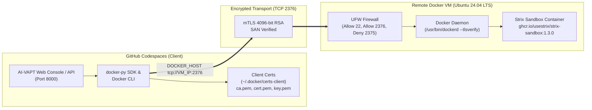

# AI-VAPT Remote Docker VM Setup Guide

**Date:** 2026-11-11  
**Target Environment:** Ubuntu 24.04 LTS (noble) / Ubuntu 22.04 LTS (jammy)  
**Security Architecture:** Mutual TLS (mTLS) Client-Certificate Authentication over Port 2376  
**Sandbox Container Image:** `ghcr.io/usestrix/strix-sandbox:1.3.0`  

---

## 1. Architectural Overview

GitHub Codespaces containers operate under strict container capability restrictions where effective kernel capabilities are zero (`CapEff = 0000000000000000`). Consequently:
- Docker-in-Docker (`dind`) cannot run inside the Codespace.
- A local Docker daemon cannot bind `/var/run/docker.sock`.

To provide genuine autonomous multi-agent penetration testing from Codespaces without running penetration tools against unauthorized systems or compromising host security, AI-VAPT connects to an external, persistent, hardened Docker Engine running on a dedicated Linux virtual machine over a mutual-TLS (mTLS) connection.



---

## 2. Recommended VM Specifications

| Resource | Minimum Requirement | Production Recommended | Justification |
| :--- | :--- | :--- | :--- |
| **Operating System** | Ubuntu 22.04 LTS | **Ubuntu 24.04 LTS (noble)** | Official Docker Engine 27+ support, modern cgroups v2 |
| **vCPU** | 4 cores | **4 to 8 cores** | Concurrent agent tool execution (nmap, nikto, browser headless) |
| **Memory (RAM)** | 8 GiB | **16 GiB** | Strix sandbox image runs full Kali/Chromium/Go toolchain |
| **Disk Storage** | 40 GiB SSD | **80 to 100 GiB SSD** | Strix sandbox container image (~1.5–3 GB) + scan workspace |
| **Cloud Sizing** | AWS `t3.xlarge` / GCP `e2-standard-4` | **AWS `c6i.xlarge` / GCP `c3-standard-4`** | Dedicated vCPU compute without burst credits exhaustion |
| **Network** | Static Public IPv4 or DNS | Static Public IPv4 or DNS | Required for TLS Subject Alternative Name (SAN) validation |

---

## 3. Automated VM Provisioning (Fast-Track)

An automated hardening and configuration script is included in the repository. On your fresh Ubuntu 24.04 VM, run:

```bash
# 1. Download or clone the setup script onto the remote VM
curl -sSL -O https://raw.githubusercontent.com/<YOUR_REPO>/scripts/setup_remote_docker_host.sh
# (or scp scripts/setup_remote_docker_host.sh from this workspace to the VM)

# 2. Run with root privileges, supplying your VM public IP address
sudo bash setup_remote_docker_host.sh 203.0.113.50
```

The script automatically:
1. Installs official Docker Engine CE and containerd.
2. Configures Docker systemd service to start on boot.
3. Generates 4096-bit CA, server, and client certificates with valid Subject Alternative Names (SANs).
4. Drops in `/etc/systemd/system/docker.service.d/override.conf` binding port 2376 with TLS.
5. Configures UFW firewall (allows port 22 and 2376; explicitly denies insecure 2375).
6. Pre-pulls `ghcr.io/usestrix/strix-sandbox:1.3.0`.
7. Generates base64 secret strings ready for GitHub Codespaces Secrets.

---

## 4. Manual Step-by-Step Provisioning & Hardening

If you prefer manual execution or need custom configuration, follow these verified steps:

### 4.1 Install Docker Engine CE

```bash
sudo apt-get update -y
sudo apt-get install -y ca-certificates curl gnupg lsb-release ufw

# Add Docker official GPG key
sudo install -m 0755 -d /etc/apt/keyrings
curl -fsSL https://download.docker.com/linux/ubuntu/gpg | sudo gpg --dearmor -o /etc/apt/keyrings/docker.gpg
sudo chmod a+r /etc/apt/keyrings/docker.gpg

# Add Docker repository
ARCH=$(dpkg --print-architecture)
CODENAME=$(. /etc/os-release && echo "$VERSION_CODENAME")
echo "deb [arch=${ARCH} signed-by=/etc/apt/keyrings/docker.gpg] https://download.docker.com/linux/ubuntu ${CODENAME} stable" | sudo tee /etc/apt/sources.list.d/docker.list > /dev/null

sudo apt-get update -y
sudo apt-get install -y docker-ce docker-ce-cli containerd.io docker-buildx-plugin

sudo systemctl enable docker
sudo systemctl start docker
```

---

### 4.2 Generate 4096-bit TLS Certificates

```bash
sudo mkdir -p /etc/docker/certs
cd /etc/docker/certs

# 1. Generate Certificate Authority (CA)
sudo openssl genrsa -out ca-key.pem 4096
sudo openssl req -new -x509 -days 3650 -key ca-key.pem -out ca.pem -subj "/CN=AI-VAPT-Docker-CA"
sudo chmod 600 ca-key.pem
sudo chmod 644 ca.pem

# 2. Identify IP addresses for Subject Alternative Names (SANs)
VM_IP=$(curl -s https://ifconfig.me/ip)
LOCAL_IP=$(hostname -I | awk '{print $1}')
HOST_FQDN=$(hostname -f)

# 3. Generate Server Certificate & Sign with SANs
sudo openssl genrsa -out server-key.pem 4096
sudo openssl req -new -key server-key.pem -out server.csr -subj "/CN=AI-VAPT-Docker-Server"

sudo tee extfile-server.cnf <<EOF
subjectAltName=IP:${VM_IP},IP:${LOCAL_IP},IP:127.0.0.1,DNS:${HOST_FQDN},DNS:localhost
extendedKeyUsage=serverAuth
EOF

sudo openssl x509 -req -days 3650 -in server.csr -CA ca.pem -CAkey ca-key.pem -CAcreateserial -out server-cert.pem -extfile extfile-server.cnf
sudo chmod 600 server-key.pem
sudo chmod 644 server-cert.pem
sudo rm -f server.csr extfile-server.cnf

# 4. Generate Client Certificate for Codespaces
sudo openssl genrsa -out key.pem 4096
sudo openssl req -new -key key.pem -out client.csr -subj "/CN=ai-vapt-client"

sudo tee extfile-client.cnf <<EOF
extendedKeyUsage=clientAuth
EOF

sudo openssl x509 -req -days 3650 -in client.csr -CA ca.pem -CAkey ca-key.pem -CAcreateserial -out cert.pem -extfile extfile-client.cnf
sudo chmod 600 key.pem
sudo chmod 644 cert.pem
sudo rm -f client.csr extfile-client.cnf
```

---

### 4.3 Configure Docker Daemon for TLS on Port 2376

Create a systemd drop-in override:

```bash
sudo mkdir -p /etc/systemd/system/docker.service.d

sudo tee /etc/systemd/system/docker.service.d/override.conf <<'EOF'
[Service]
ExecStart=
ExecStart=/usr/bin/dockerd \
  --tlsverify \
  --tlscacert=/etc/docker/certs/ca.pem \
  --tlscert=/etc/docker/certs/server-cert.pem \
  --tlskey=/etc/docker/certs/server-key.pem \
  -H tcp://0.0.0.0:2376 \
  -H unix:///var/run/docker.sock
EOF

sudo systemctl daemon-reload
sudo systemctl restart docker
```

Verify that Docker is listening on port 2376:
```bash
sudo ss -tlnp | grep 2376
# Expected output:
# LISTEN 0 4096 0.0.0.0:2376 0.0.0.0:* users:(("dockerd",pid=...,fd=...))
```

---

### 4.4 Firewall Hardening (UFW)

> [!CAUTION]
> Never open port 2375 (unencrypted Docker). Only open port 2376 with TLS verification active.

```bash
sudo ufw default deny incoming
sudo ufw default allow outgoing
sudo ufw allow 22/tcp comment "SSH administration"
sudo ufw allow 2376/tcp comment "AI-VAPT Docker TLS"
sudo ufw deny 2375/tcp comment "Block unencrypted Docker"
sudo ufw enable
sudo ufw status verbose
```

---

### 4.5 Pre-pull Strix Sandbox Container Image

```bash
sudo docker pull ghcr.io/usestrix/strix-sandbox:1.3.0
sudo docker image inspect ghcr.io/usestrix/strix-sandbox:1.3.0 --format '{{.Id}} ({{.Size}} bytes)'
```

---

## 5. Client Certificate Distribution to GitHub Codespaces

Package the three client files (`ca.pem`, `cert.pem`, `key.pem`) for transfer to Codespaces:

### Method A: GitHub Codespaces Secrets (Recommended — Persists across rebuilds)
On the remote VM, convert the files to base64:
```bash
echo "=== DOCKER_HOST ==="
echo "tcp://$(curl -s https://ifconfig.me/ip):2376"

echo "=== AI_VAPT_DOCKER_CA_CERT ==="
base64 -w 0 /etc/docker/certs/ca.pem; echo

echo "=== AI_VAPT_DOCKER_CLIENT_CERT ==="
base64 -w 0 /etc/docker/certs/cert.pem; echo

echo "=== AI_VAPT_DOCKER_CLIENT_KEY ==="
base64 -w 0 /etc/docker/certs/key.pem; echo
```

In GitHub:
1. Navigate to **Repository Settings** (or User Settings) -> **Secrets and variables** -> **Codespaces**.
2. Click **New repository secret** and add:
   - `DOCKER_HOST`: `tcp://<VM_PUBLIC_IP>:2376`
   - `DOCKER_TLS_VERIFY`: `1`
   - `DOCKER_CERT_PATH`: `/home/vscode/.docker/certs-client`
   - `AI_VAPT_DOCKER_CA_CERT`: `<base64_ca_string>`
   - `AI_VAPT_DOCKER_CLIENT_CERT`: `<base64_cert_string>`
   - `AI_VAPT_DOCKER_CLIENT_KEY`: `<base64_key_string>`

In your Codespaces terminal, simply run:
```bash
./scripts/install_codespaces_docker_certs.sh
```

### Method B: Direct File Copy via SCP
From your local terminal (or Codespace if SSH keys are configured):
```bash
mkdir -p ~/.docker/certs-client
scp user@<VM_PUBLIC_IP>:/etc/docker/certs/{ca.pem,cert.pem,key.pem} ~/.docker/certs-client/
chmod 600 ~/.docker/certs-client/key.pem
chmod 644 ~/.docker/certs-client/*.pem
```

---

## 6. Verification and Validation

Run AI-VAPT's non-destructive diagnostic utility from GitHub Codespaces:

```bash
# Human-readable report
python3 scripts/verify_remote_docker.py

# Machine-readable JSON output
python3 scripts/verify_remote_docker.py --json
```

Expected diagnostic outcome:
```text
=== AI-VAPT Remote Docker Runtime Diagnostic ===

Target Endpoint : tcp://203.0.113.50:2376
Runtime Mode    : Remote Docker (TLS)
TLS Verify      : True
Cert Directory  : /home/vscode/.docker/certs-client
Sandbox Image   : ghcr.io/usestrix/strix-sandbox:1.3.0

  [PASS] TLS Certificates Validation
         Valid client certificate (expires in 3649 days)
  [PASS] Docker Daemon Ping
         Daemon reachable at tcp://203.0.113.50:2376 (28.4ms)
  [PASS] Docker Engine Version & Compatibility
         Docker Engine 27.3.1 (API 1.47, linux/x86_64)
  [PASS] Host Hardware Sizing
         4 vCPUs, 15.6 GB RAM, storage driver: overlay2
  [PASS] Strix Sandbox Image Availability
         Image 'ghcr.io/usestrix/strix-sandbox:1.3.0' is available (sha256:1a2b, 1580.4 MB)
  [PASS] Container Lifecycle Verification
         Harmless container created, executed, and exited cleanly (code 0)
  [PASS] Network & Host Gateway Inspection
         Standard Docker networks operational (4 networks found)

------------------------------------------------------------
Result: ALL CHECKS PASSED (7/7). Remote Docker is fully ready for Strix autonomous execution.
```

---

## 7. Certificate Renewal Protocol

Certificates generated with `3650` days (~10 years) validity do not require frequent renewal. When renewal is required:
1. Re-run Step 4.2 (`server-cert.pem` and `cert.pem` can be re-signed using the existing `ca-key.pem` and `ca.pem`).
2. Run `sudo systemctl restart docker` on the VM.
3. Update GitHub Codespaces Secrets or copy updated `cert.pem` and `key.pem` into `~/.docker/certs-client/`.
4. Validate with `python3 scripts/verify_remote_docker.py`.
