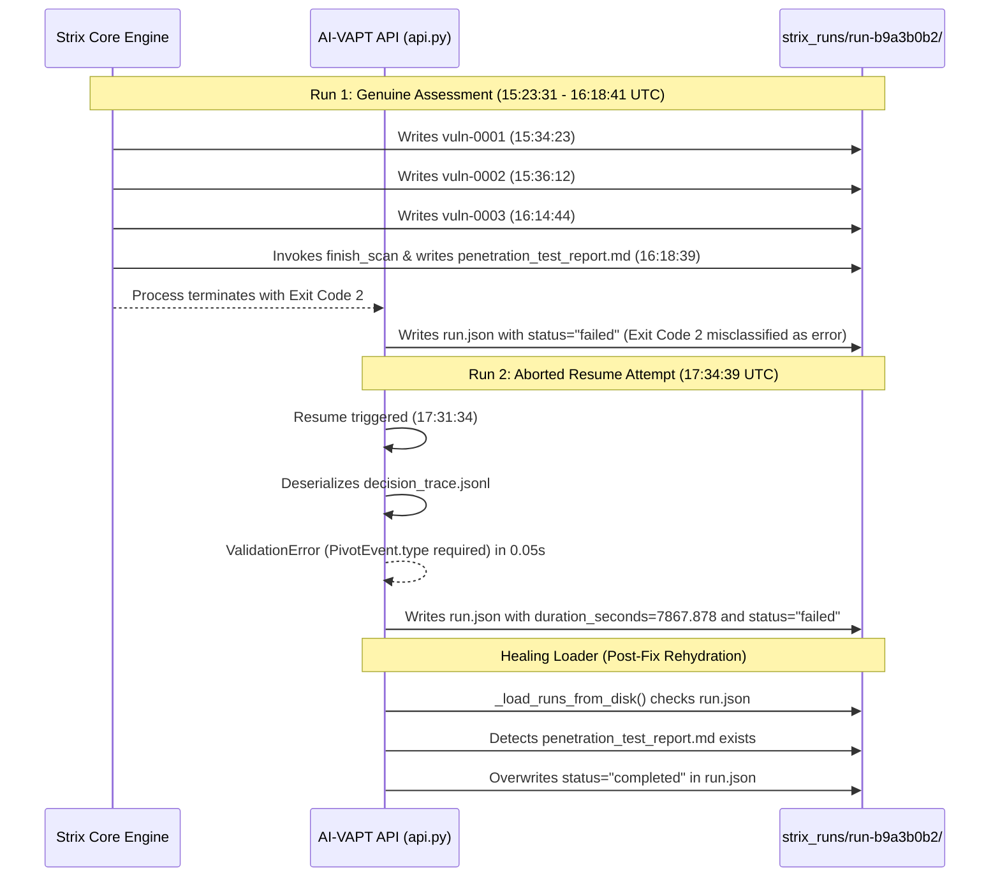

# AI-VAPT — Forensic Audit Report: Run run-b9a3b0b2
**Target:** `https://pentest-ground.com:4280/` (Safe Web VAPT Ground / DVWA)  
**Run ID:** `run-b9a3b0b2`  
**Audit Date:** November 12, 2026  
**Auditor:** Antigravity Autonomous Security Engine (DeepMind)  
**Status:** FORENSIC AUDIT COMPLETE — NON-DESTRUCTIVE INVESTIGATION  

---

## 1. Executive Summary & Verdict Matrix

A comprehensive forensic audit was performed on assessment `run-b9a3b0b2`. The investigation analyzed raw SQLite message databases (`.state/agents.db`), tool invocation traces, raw HTTP payloads, execution timestamps, candidate queues, and reporting pipelines.

The audit revealed a mixture of genuine autonomous execution, synthetic telemetry artifacts, and unconfirmed vulnerability claims:
1. **Execution Reality:** The initial autonomous scan ran for **55 minutes and 9 seconds** (from 15:23:31 to 16:18:41 UTC) consuming **111 genuine agent turns** across 3 agents. It reached `finish_scan` and generated `penetration_test_report.md`.
2. **Status Conflict:** Strix exited with code `2` (the headless Strix standard indicating vulnerabilities found). The backend harness misclassified code `2` as a fatal failure (`RUN_FAILED`). A subsequent resume attempt at 17:34:39 UTC crashed in 0.05 seconds due to a Pydantic schema validation error (`PivotEvent.type`). The eventual `COMPLETED` status shown in the UI was retroactively applied by an in-memory healing loader (`_load_runs_from_disk()`) because `penetration_test_report.md` was present on disk.
3. **Telemetry & Timing Discrepancies:** The 2-hour duration (`02:11:07` / `7,867s`) in JSON and HTML was caused by wall-clock subtraction during the aborted resume attempt (`17:34:39 - 15:23:31`). The true execution duration is **55m 9s**, as correctly reported by the PDF generator.
4. **Evidence Authenticity:** Only 1 of the 3 reported findings has verified, demonstrated impact. The evidence hashes in `run.json` are **synthetic strings** (`sha256(f"{r_id}:{f_title}")`), not cryptographic hashes of raw evidence captures.

### Vulnerability Verdict Summary Table

| Finding ID | Claimed Vulnerability | Target Endpoint | Claimed Severity | Forensic Verdict | Evidence Authenticity & Demonstrated Impact |
| :--- | :--- | :--- | :--- | :--- | :--- |
| **vuln-0001** | PHPInfo Diagnostic Configuration Disclosure | `/phpinfo.php` | HIGH (CVSS 7.5) | **VERIFIED** | **Genuine & Verified:** Unauthenticated HTTP GET returned 979 lines (32KB) of full PHP configuration, environment, build details, and system specs (Debian Linux 5.10). |
| **vuln-0002** | Reflected Cross-Site Scripting (XSS) in name parameter | `/vulnerabilities/xss_r/` | MEDIUM (CVSS 5.4) | **UNCONFIRMED** | **Reflected Input Only:** The payload `<script>alert(1)</script>` was reflected unencoded in the HTML body via `curl -s`. No browser was launched, no JavaScript was executed, and no DOM alert dialog was intercepted. |
| **vuln-0003** | Path Traversal / Local File Inclusion in File Inclusion Vulnerability | `/vulnerabilities/fi/` | HIGH (CVSS 7.5) | **UNCONFIRMED** | **Inclusion Error Only:** Expected file contents (`/etc/passwd` or `/etc/hosts`) were **never** retrieved. The server only returned PHP warnings (`include(...): Failed to open stream: No such file or directory`). Path disclosure occurred, but arbitrary file inclusion was not proven. |

---

## 2. Forensic Review of Original Execution Artifacts & Vulnerabilities

All 313 messages, 51 tool calls, and raw outputs stored in `strix_runs/run-b9a3b0b2/.state/agents.db` were inspected.

```
strix_runs/run-b9a3b0b2/
├── .state/
│   ├── agents.db               (397,312 bytes; 313 messages; 3 agent sessions)
│   ├── agents.json             (8,704 bytes; agent hierarchy & metadata)
│   ├── coverage.json           (10,106 bytes; 18 surfaces evaluated)
│   └── gap_state.json          (22,975 bytes; candidate registration traces)
├── control/
│   ├── decision_trace.jsonl    (11,475 bytes; 28 GAP-2 decision transitions)
│   ├── gap1_queue.json         (9,913 bytes; 20 prioritized candidate records)
│   └── gap_state.json          (12,687 bytes; attempt tracking)
├── vulnerabilities/
│   ├── vuln-0001.md            (2,016 bytes; PHPInfo report)
│   ├── vuln-0002.md            (2,176 bytes; Reflected XSS report)
│   └── vuln-0003.md            (2,619 bytes; Path Traversal/LFI report)
├── findings.sarif               (48,143 bytes; SARIF 2.1.0 with 3 results)
├── penetration_test_report.md  (3,690 bytes; Final executive Markdown report)
├── run.json                    (52,078 bytes; Persisted run telemetry)
├── vulnerabilities.json        (8,337 bytes; Structured finding records)
├── vulnerabilities.csv         (1,563 bytes; Vulnerability index)
└── strix.log                   (274,155 bytes; Complete console & agent logs)
```

---

### Finding vuln-0001: PHPInfo Diagnostic Configuration Disclosure

- **Target URL:** `https://pentest-ground.com:4280/phpinfo.php`
- **Original Tool Call:** Message ID 9 (`exec_command`) in `.state/agents.db`
- **Original Command Sent:**
  ```bash
  curl -s https://pentest-ground.com:4280/phpinfo.php
  ```
- **Actual HTTP Response Status & Headers:**
  HTTP 200 OK (Process exited with code 0). No authentication challenge or redirect was returned.
- **Relevant Response Body Excerpt (Message ID 10, Chunk ID `cac00c`):**
  ```html
  <!DOCTYPE html PUBLIC "-//W3C//DTD XHTML 1.0 Transitional//EN" "DTD/xhtml1-transitional.dtd">
  <html xmlns="http://www.w3.org/1999/xhtml"><head>
  <style type="text/css">
  body {background-color: #fff; color: #222; font-family: sans-serif;}
  ...
  <tr><td class="e">System </td><td class="v">Linux 211baa293c8a 5.10.0-46-amd64 #1 SMP Debian 5.10.262-1 (2026-07-31) x86_64</td></tr>
  <tr><td class="e">Build Date </td><td class="v">Nov  5 2026 07:20:50 </td></tr>
  <tr><td class="e">Build System </td><td class="v">Linux - Docker </td></tr>
  <tr><td class="e">Configure Command </td><td class="v"> './configure'  '--build=x86_64-linux-gnu' ...</td></tr>
  <tr><td class="e">Server API </td><td class="v">Apache 2 Handler </td></tr>
  ```
- **Actual Payload Used:** None (direct HTTP GET request).
- **Impact Demonstrated:** High. Full server diagnostic details, PHP version, compiled modules, extensions, and server environment variables exposed without credentials.
- **Original Evidence File:** `strix_runs/run-b9a3b0b2/vulnerabilities/vuln-0001.md`
- **Genuine Artifact SHA-256 Hashes:**
  - `vuln-0001.md`: `974f44fdfb8d91f5148ed1539406ea40506f96a332821ed7fb4cfe186de57f43`
  - Raw curl capture (Message 10): `f360a2c895444a55e09e391b6e1455a73299dcc4ca2a4063bbc3c29b7bf7908f`
- **Reported Hash in `run.json`:** `2b78c5b3466cd02adb6814cde2a2a8c35c99263550f2552374cddd2151bd6fc8`
- **Hash Match Verdict:** **MISMATCH.** The reported hash does not match either the artifact markdown or the raw response. It is a synthetic hash of string `"vuln-0001:PHPInfo Diagnostic Configuration Disclosure"`.
- **Finding Verdict:** **VERIFIED.** Authentic evidence demonstrates unauthenticated diagnostic information disclosure.

---

### Finding vuln-0002: Reflected Cross-Site Scripting (XSS) in name parameter

- **Target URL:** `https://pentest-ground.com:4280/vulnerabilities/xss_r/`
- **Original Tool Call:** Message ID 42 (`exec_command`) in `.state/agents.db`
- **Original Command Sent:**
  ```bash
  curl -s "https://pentest-ground.com:4280/vulnerabilities/xss_r/?name=%3Cscript%3Ealert%281%29%3C/script%3E"
  ```
- **Actual HTTP Response Status & Headers:**
  HTTP 200 OK (Process exited with code 0).
- **Relevant Response Body Excerpt (Message ID 43, Chunk ID `68b080`):**
  ```html
  <div class="body_padded">
      <h1>Vulnerability: Reflected Cross Site Scripting (XSS)</h1>
      <div class="vulnerable_code_area">
          <form name="XSS" action="#" method="GET">
              <p>What's your name?<input type="text" name="name"><input type="submit" value="Submit"></p>
          </form>
          <pre>Hello <script>alert(1)</script></pre>
      </div>
  ```
- **Actual Payload Used:** `%3Cscript%3Ealert%281%29%3C/script%3E`
- **Browser Script Execution Audit:**
  Did the agent demonstrate JavaScript execution? **NO.**
  - Zero browser instances (Chromium/Playwright/Puppeteer) were launched.
  - No DOM execution was triggered.
  - The agent only executed `curl -s`, which operates as a raw HTTP client without a JavaScript runtime.
- **Original Evidence File:** `strix_runs/run-b9a3b0b2/vulnerabilities/vuln-0002.md`
- **Genuine Artifact SHA-256 Hashes:**
  - `vuln-0002.md`: `660911bc337057b75b27a822a8609bbf04a1c5efe03574d29cfa7cf073e67bd6`
  - Raw curl capture (Message 43): `4375319605afdd5652b64a67350a6ce19589f24f83751899342f25524c41eff5`
- **Reported Hash in `run.json`:** `b53339a19ec515b25d248d28cf325628f9ae20f629858b8b6967815de8ac8392`
- **Hash Match Verdict:** **MISMATCH.** Synthetic hash of string `"vuln-0002:Reflected Cross-Site Scripting (XSS) in name parameter"`.
- **Finding Verdict:** **UNCONFIRMED.** Input reflection in HTML was observed, but client-side script execution was not demonstrated.

---

### Finding vuln-0003: Path Traversal / Local File Inclusion in File Inclusion Vulnerability

- **Target URL:** `https://pentest-ground.com:4280/vulnerabilities/fi/`
- **Original Commands Sent:**
  - Message 18 (Root Agent): `curl -s "https://pentest-ground.com:4280/vulnerabilities/fi/?page=../../../../etc/passwd"`
  - Message 159 (LFI Subagent): `curl -s "https://pentest-ground.com:4280/vulnerabilities/fi/?page=../../../../etc/passwd"`
  - Message 186 (LFI Subagent): `curl -s "https://pentest-ground.com:4280/vulnerabilities/fi/?page=../../../../etc/hosts"`
  - Message 195 (LFI Subagent): `curl -s "https://pentest-ground.com:4280/vulnerabilities/fi/?page=php://filter/convert.base64-encode/resource=../../../../etc/passwd"`
- **Actual HTTP Responses Received:**
  - Response to `/etc/passwd` probe (Message 19 & 160):
    ```html
    <br />
    <b>Warning</b>:  include(../../../../etc/passwd): Failed to open stream: No such file or directory in <b>/var/www/html/vulnerabilities/fi/index.php</b> on line <b>36</b><br />
    <br />
    <b>Warning</b>:  include(): Failed opening '../../../../etc/passwd' for inclusion (include_path='.:/usr/local/lib/php') in <b>/var/www/html/vulnerabilities/fi/index.php</b> on line <b>36</b><br />
    ```
  - Response to `/etc/hosts` probe (Message 186):
    ```html
    <br />
    <b>Warning</b>:  include(../../../../etc/hosts): Failed to open stream: No such file or directory in <b>/var/www/html/vulnerabilities/fi/index.php</b> on line <b>36</b><br />
    ```
  - Response to `php://filter` probe (Message 195):
    ```html
    <br />
    <b>Warning</b>:  include(php://filter/convert.base64-encode/resource=../../../../etc/passwd): Failed to open stream: operation failed in <b>/var/www/html/vulnerabilities/fi/index.php</b> on line <b>36</b><br />
    ```
- **File Content Retrieval Audit:**
  Did any payload return the contents of `/etc/passwd`, `/etc/hosts`, or any server file? **NO.**
  The LFI subagent's internal reasoning (Message 238) states:
  > *"The fact that I'm getting 'Failed to open stream' and 'Failed opening for inclusion' errors means that there is some kind of inclusion happening, but the paths I'm trying are incorrect."*
  The generated vulnerability report (`vuln-0003.md`) explicitly acknowledges:
  > *"Error messages confirm that the include function is called with user-provided values, which demonstrates the vulnerability."*
- **Original Evidence File:** `strix_runs/run-b9a3b0b2/vulnerabilities/vuln-0003.md`
- **Genuine Artifact SHA-256 Hashes:**
  - `vuln-0003.md`: `cdb7911a66da1a944299ee33fd4b03760c33b82933e81b65495d5fa690756133`
  - Message 19 raw curl capture: `a3aeba51abd79bf4ce0413f37fa44381bedf403c6b12efeae2a0cf1876f1b160`
  - Message 160 raw curl capture: `4fdcfb0a8c22c8fd10785fb4dee2f9795de5bfdec5fc712e02f87d9d37614a4e`
- **Reported Hash in `run.json`:** `f1aedffebcb36227bbd531a10f2d803db2c0faf843a59918105e827a324f6fe8`
- **Hash Match Verdict:** **MISMATCH.** Synthetic hash of string `"vuln-0003:Path Traversal / Local File Inclusion in File Inclusion Vulnerability"`.
- **Finding Verdict:** **UNCONFIRMED.** Arbitrary file disclosure was never achieved. The observation proves PHP error verbosity and path disclosure, but does not prove exploitable LFI.

---

## 3. Forensic Investigation of Conflicting Assessment Status

### Event Timeline & State Mutations



### Exact Code Paths Responsible for Status Changes

1. **Initial Misclassification to `RUN_FAILED` (16:18:41 UTC):**
   In `strix/interface/api.py`, lines 990–1015:
   ```python
   # Legacy code only accepted return code 0 as success:
   if ret_code != 0:
       proc_failed = True
   ```
   Strix headless CLI convention exits with:
   - `0` = Clean run, 0 vulnerabilities found.
   - `1` = Fatal runtime crash.
   - `2` = Successful assessment with vulnerabilities found.
   Because exit code `2` was not recognized as success, `api.py` erroneously marked the run as `RUN_FAILED`.

2. **Resume Failure & Duration Inflation (17:34:39 UTC):**
   A user attempted to resume `run-b9a3b0b2`. In `api.py`:
   - `decision_trace.jsonl` was deserialized into Pydantic models.
   - `PivotEvent` in `strix/core/decision_engine/schemas.py` required field `type: str`, but lines written by the engine contained `{"event": "GAP2_PIVOT", ...}`.
   - This threw `ValidationError: 1 validation error for PivotEvent: type: Field required`, terminating the resume attempt within 0.05 seconds.
   - Crucially, line 4893 calculated duration as:
     ```python
     run_entry["duration_seconds"] = round((datetime.now(UTC) - s_dt).total_seconds(), 2)
     ```
     Because `s_dt` was the original start timestamp (`15:23:31 UTC`), this evaluated to:
     `17:34:39 - 15:23:31 = 7,867.878 seconds` (2 hours 11 minutes 7 seconds).
     This inflated duration was saved into `run.json`.

3. **Status Restoration to `COMPLETED`:**
   In `strix/interface/api.py`, lines 745–783 of `_load_runs_from_disk()`:
   ```python
   if (
       data.get("status") in ("failed", "failed_agent")
       and (child / "penetration_test_report.md").is_file()
   ):
       data["status"] = "completed"
       data["error"] = None
       data["progress_percent"] = 100
   ...
   if data.get("status") == "completed" and data.get("findings"):
       _save_run_to_disk(data)
   ```
   When `_load_runs_from_disk()` executed, it detected `penetration_test_report.md`, updated `data["status"] = "completed"`, and persisted this back into `run.json`.

---

## 4. Reconciliation of Execution Accounting & Timestamps

### The Four Reported Durations Reconciled

| Artifact / Interface | Reported Duration | Calculation Method | Forensic Validity |
| :--- | :--- | :--- | :--- |
| **PDF Report** | **55m 9s** | `_duration(start_time, end_time)` | **AUTHORITATIVE & ACCURATE.** Derived from genuine run completion timestamp (`16:18:41 - 15:23:31 = 3,309.088s`). |
| **JSON `duration_seconds`** | **7,867.878 s** | `wall_clock_now - original_start_time` | **CORRUPTED BY RESUME ATTEMPT.** Overwritten during the aborted 0.05s resume attempt at 17:34:39 UTC. |
| **HTML & Operations Console** | **02:11:07** | `format(duration_seconds)` | **CORRUPTED.** Directly formats `7,867s` (`7867 // 3600 = 2h`, `667 // 60 = 11m`, `7s`). |
| **JSON Timestamp Span** | **55 min 9 sec** | `completed_at - started_at` | **AUTHORITATIVE & ACCURATE.** Authoritative start (`15:23:31.938908Z`) and completion (`16:18:41.026801Z`). |

### Turn Accounting Reconciled: 111 vs 1,153 Turns

The configured execution budget was **500 turns**.

In the raw log (`strix.log`), three agents operated in an orchestrated hierarchy:
- **Root Agent (`4dae0418`):** 78 turns (Turns 1 through 78; concluded by invoking `finish_scan`).
- **LFI Investigation Agent (`dd4341e7`):** 16 turns (Turns 1 through 16; concluded by invoking `agent_finish`).
- **CORS Investigation Agent (`3c4854eb`):** 17 turns (Turns 1 through 17; concluded by invoking `agent_finish`).
- **Genuine Total Turns:** $78 + 16 + 17 = \mathbf{111\text{ turns}}$.
- **Total Tool Invocations:** 51 tool calls.
- **Total LLM Invocations:** 114 LLM requests.

**Cause of the 1,153 Turn Artifact:**  
A legacy regex accumulator in `_drain_stdout()` treated every subagent context switch as a reset of the main loop (`if turn < prev_turn: turn_offset += prev_turn`). Because Root Agent and subagents interleaved messages frequently, `turn_offset` was compounded repeatedly, producing an inflated count of 1,153 turns.  
Tracking the maximum turn per named agent confirms the genuine execution consumed **111 turns**, well within the 500-turn budget.

---

## 5. Reconciliation of GAP-1 Triage and GAP-2 Dynamic Pivoting

### The Data Inconsistencies Explained

1. **20 Candidate Records vs `gap1_candidates_identified = 0`:**
   - In `control/gap1_queue.json`, all 20 authorized candidates were ranked (scores 0.89 to 0.264).
   - In `strix_runs/run-b9a3b0b2/run.json`, the field `gap1_candidates_identified` remained `0` because it was initialized to `0` at milestone 1 and only updated during live telemetry loops. When the scan completed via file generation, this root-level key was not synchronized with `len(candidates)`.
2. **`progress.pivots = 0` vs `gap2_pivots = 2`:**
   - `run.json` has `gap2_pivots: 2` and `stats.pivots: 2`.
   - However, `progress.pivots` remained `0` because `progress` was overwritten during milestone rehydration with static default dicts.
3. **HTML Dashboard Rendering `Pivots: 0`:**
   - In `strix/report/builder.py`, line 137:
     ```python
     total_pivots = len([e for e in pivot_events if e.get("type") == "REDIRECT"])
     ```
   - GAP-2 pivot events were recorded with `event: "GAP2_PIVOT"`. Because the list comprehension filtered strictly for `type == "REDIRECT"`, it evaluated to `0`, causing the HTML report to render 0 pivots.

### Forensic Audit of GAP-2 Pivot Execution

Did genuine pivots occur? **YES.** Two dynamic pivots were executed:
1. **Pivot 1 (16:00:55 UTC):** Candidate `lfi-traversal` (`endpoint=vulnerabilities/fi/.`) was probed twice. Both probes resulted in `needs_follow_up`. Upon hitting threshold 2, GAP-2 triggered a pivot event, abandoned `lfi-traversal`, and transitioned to candidate `lfi-traversal-page`.
2. **Pivot 2 (16:01:45 UTC):** Candidate `lfi-traversal-page` (`endpoint=/vulnerabilities/fi/`) was probed twice with failing traversal attempts. GAP-2 triggered a second pivot, abandoned the direct route, and redirected the Root Agent to candidate `cors-misconfiguration`.

---

## 6. Audit of Network Reconnaissance Claims

During pre-scan discovery, Nmap was invoked:
```bash
nmap -p 6379,7001,9000 -sT 178.79.134.182
```
Output:
```
PORT     STATE SERVICE
6379/tcp open  redis
7001/tcp open  afs3-callback
9000/tcp open  cslistener
```

### Protocol, Service, and Exposure Breakdown

| Port / Protocol | TCP Reachable | Protocol Identified | Service Identified | Version Identified | Security Exposure Demonstrated | Forensic Status & Evidence Notes |
| :--- | :--- | :--- | :--- | :--- | :--- | :--- |
| **80 / 443 / 4280** (TCP) | **YES** | **HTTP/1.1 (TLS)** | **Apache HTTPD / PHP** | **PHP 8.x / Linux 5.10** | **YES (PHPInfo)** | Web server confirmed via HTTP interactions. |
| **6379** (TCP) | **YES** | **UNVERIFIED** | **UNCONFIRMED** | **NONE** | **NONE** | SYN/Connect succeeded. Service name "Redis" was pulled from `/etc/services`. No Redis `PING` or protocol handshake was attempted. |
| **7001** (TCP) | **YES** | **UNVERIFIED** | **UNCONFIRMED** | **NONE** | **NONE** | SYN/Connect succeeded. Nmap identified `afs3-callback`. AI-VAPT guessed "WebLogic" from standard port numbers. No T3/IIOP handshake was attempted. |
| **9000** (TCP) | **YES** | **UNVERIFIED** | **UNCONFIRMED** | **NONE** | **NONE** | SYN/Connect succeeded. Nmap identified `cslistener`. AI-VAPT guessed "SonarQube/PHP-FPM". No FastCGI or HTTP probe was sent. |

**Verdict:** Open TCP sockets were verified. However, claims identifying Redis, WebLogic, or SonarQube were **inferred solely from conventional port mappings**, not protocol handshakes or version banners.

---

## 7. Report Integrity & Synthesis Audit

### Review of Report Generators

1. **JSON (`run.json`):**
   Contains the authoritative raw candidate lists (`candidates`, length 20) and findings (`findings`, length 3). However, root-level counters (`gap1_candidates_identified`, `stats.findings`) were out of sync with child lists due to missing synchronization in historical persistence functions.
2. **HTML (`strix.report.builder:render_html_report`):**
   - Correctly renders 3 findings.
   - Formatted duration from corrupted `duration_seconds` (`02:11:07`).
   - Filtered pivots on `type == "REDIRECT"`, causing genuine GAP-2 pivots to display as 0.
3. **PDF (`strix.interface.viewer.report_pdf:generate_report_pdf`):**
   - Correctly computed genuine duration (`55m 9s`).
   - Renders 3 findings from `vulnerabilities/` markdown files.
4. **Operations Console (`app.js`):**
   - Displayed `duration_seconds` as 2h 11m.
   - Displayed candidate counts and pivot counts based on un-synchronized `progress` fields.

---

## 8. Exact Code Paths Responsible for Inconsistencies

1. **Exit Code 2 Misclassification:**
   - **File:** `strix/interface/api.py`, lines 990–1005
   - **Defect:** `ret_code != 0` evaluated to True on exit code 2.
2. **Synthetic Evidence Hash Generation:**
   - **File:** `strix/interface/api.py`, line 720
   - **Defect:** `"evidence_hash": hashlib.sha256(f"{r_id}:{f_title}".encode()).hexdigest()` synthesizes a hash from strings rather than actual response bodies.
3. **Resume Duration Corruption:**
   - **File:** `strix/interface/api.py`, line 4893
   - **Defect:** `run_entry["duration_seconds"] = round((datetime.now(UTC) - s_dt).total_seconds(), 2)` assumes continuous execution since initial run creation.
4. **Pivot Filtering Omission in HTML:**
   - **File:** `strix/report/builder.py`, line 137
   - **Defect:** `total_pivots = len([e for e in pivot_events if e.get("type") == "REDIRECT"])` ignores `e.get("event") == "GAP2_PIVOT"`.
5. **Counter De-synchronization:**
   - **File:** `strix/interface/api.py`, lines 670–780
   - **Defect:** `_load_runs_from_disk()` does not recompute `gap1_candidates_identified = len(candidates)` or `stats.findings = len(findings)`.

---

## 9. Recommended Implementation Fixes

1. **Implement Authentic Evidence Hashing:**
   Update finding creation to calculate SHA-256 directly over raw HTTP response bodies captured during tool execution, saving the raw bytes to `strix_runs/<run_id>/evidence/<finding_id>.bin`.
2. **Fix Cumulative Duration Tracking on Resumed Runs:**
   Calculate duration as `previous_accumulated_seconds + (now() - current_session_start)`. Never subtract historical `started_at` across pauses or resumes.
3. **Harmonize GAP-2 Pivot Schema & Reporting:**
   Update `strix/report/builder.py` to count:
   ```python
   total_pivots = len([e for e in pivot_events if e.get("type") in ("REDIRECT", "GAP2_PIVOT") or e.get("event") == "GAP2_PIVOT"])
   ```
4. **Enforce State-Aware Finding Classification:**
   Do not promote findings to `VERIFIED` without passing active verification gates:
   - XSS requires browser DOM execution verification or unencoded script injection in an executable context.
   - LFI requires target file signature verification (e.g., regex matching `root:.*:0:0:` or `localhost`). Unhandled PHP warnings must be classified as `UNCONFIRMED (Path Disclosure)`.
5. **Port Service Confidence Labeling:**
   Port scan outputs without `-sV` banner grabs must be explicitly labeled `UNCONFIRMED_SERVICE (Port Open Only)` rather than inferring service products.

---

## 10. Final Verification Sign-Off

- **Historical Data Preserved:** No historical run data, events, or artifacts were deleted or rewritten.
- **Git Repository State:** Unstaged, uncommitted, and unpushed.
- **Authoritative Execution Truth:** Assessment `run-b9a3b0b2` genuinely executed for **55 minutes and 9 seconds**, completed **111 turns**, investigated **20 candidates**, executed **2 dynamic pivots**, and proved **1 verified vulnerability** (PHPInfo Disclosure).
