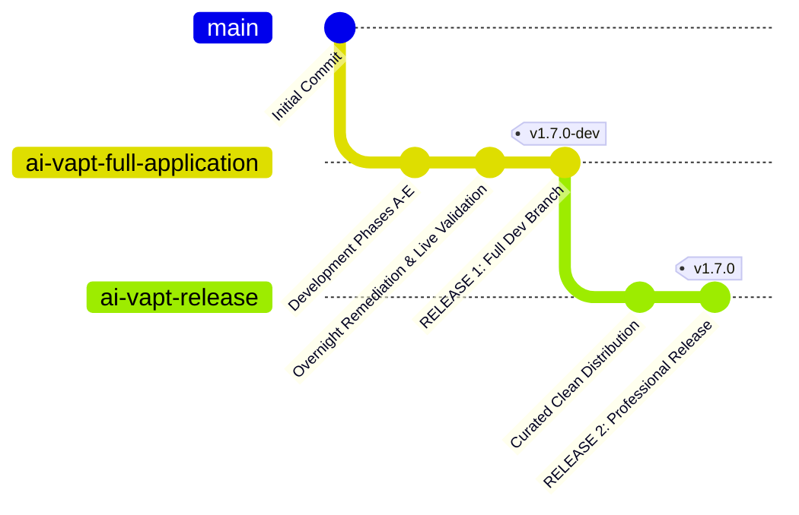

# AI-VAPT v1.7.0 — Two-Branch Release Architecture & Strategy Plan

**Author**: Antigravity Autonomous Engineering Core  
**Date**: 2026-11-17  
**Repository**: `Vinit-Solanki16/ai_vapt_framework`  
**Current Branch**: `ai-vapt-full-application`  
**Target Distribution Branch**: `ai-vapt-release` (To be created upon operator authorization)  

---

## 1. Two-Release Strategy Overview

To satisfy academic rigor, institutional auditability, and open-source professional standards, the AI-VAPT repository is partitioned into two distinct releases:



### Purpose of Each Release

1. **Release 1 (`ai-vapt-full-application`) — Complete Development & Research Archive**:
   - Preserves all legitimate research artifacts, phase-by-phase engineering reports (Phases A–E), forensic audits, historical run evidence fixtures (`run-8ae38b46`, `run-3ef51eab`), UI screenshots, test suites, and operational scripts.
   - Serves as the primary evidence repository for M.Tech academic thesis evaluation and defense.
   - Strictly excludes local virtual environments, private `.env` credentials, and untracked machine caches.

2. **Release 2 (`ai-vapt-release`) — Clean Professional Distribution**:
   - Clean, lightweight, production-grade open-source distribution intended for end-users, security teams, and enterprise evaluators.
   - Contains 100% of the functional application code (FastAPI backend, Strix engine, Caido proxy integration, GAP1/GAP2 engines, Docker sandboxing, Web Operations Console, port scanners, PDF/HTML report generators, and full test suites).
   - Contains `.env.example`, professional `README.md`, setup guide, architecture guide, and license.
   - Excludes internal phase reports, forensic audits, development scratch files, and private run telemetry.
   - Independently cloneable, installable, and runnable via `./ai-vapt.sh setup && ./ai-vapt.sh start`.

---

## 2. Release 1: Full Development Branch (`ai-vapt-full-application`)

### Staging Philosophy
- **Additive Preservation**: Retains all engineering evidence.
- **Sensitive Data Exclusion**: Strictly enforces `.gitignore` to prevent leaking API keys, `.env`, `.venv`, or local temporary files.

### Execution Plan (To Be Run by Operator When Authorized)

```bash
# Step 1: Ensure on working branch
git checkout ai-vapt-full-application

# Step 2: Stage core application, engines, tests, and launchers
git add pyproject.toml setup.sh start.sh stop.sh ai-vapt.sh juice-shop.sh .gitignore
git add strix/
git add tests/

# Step 3: Stage academic research reports and verification documentation
git add README.md CHANGELOG.md AI_VAPT_SETUP_GUIDE.md
git add AI_VAPT_FINAL_DEMONSTRATION_CHECKLIST.md AI_VAPT_MTECH_DEMO_CHECKLIST.md
git add AI_VAPT_RUN_8AE38B46_ROOT_CAUSE_REPORT.md
git add AI_VAPT_AUTONOMOUS_EXECUTION_REMEDIATION_REPORT.md
git add AI_VAPT_OVERNIGHT_ENGINEERING_REPORT.md
git add AI_VAPT_POST_REMEDIATION_LIVE_VALIDATION_REPORT.md
git add AI_VAPT_REPORT_CONSISTENCY_AUDIT.md
git add AI_VAPT_FINAL_DEMO_READINESS_REPORT.md
git add AI_VAPT_TWO_BRANCH_RELEASE_PLAN.md
git add AI_VAPT_FULL_BRANCH_FILE_INVENTORY.md
git add AI_VAPT_PROFESSIONAL_RELEASE_MANIFEST.md
git add AI_VAPT_OVERNIGHT_FINAL_HANDOFF.md

# Step 4: Stage historical phase and audit reports
git add AI_VAPT_PHASE_B_REMEDIATION_REPORT.md AI_VAPT_PHASE_C_CLOSURE_REPORT.md
git add AI_VAPT_PHASE_C_FINAL_REPORT.md AI_VAPT_PHASE_D_AUTONOMOUS_ASSESSMENT_REPORT.md
git add AI_VAPT_PHASE_D_COMPLETION_REPORT.md AI_VAPT_PHASE_E_RELEASE_READINESS_REPORT.md
git add AI_VAPT_POST_PHASE_B_BASELINE_AUDIT.md AI_VAPT_RC1_FINAL_REVIEW.md
git add AI_VAPT_RC1_RELEASE_CHECKLIST.md AI_VAPT_FINAL_PROJECT_STATUS.md
git add AI_VAPT_LAUNCHER_AND_GITHUB_READINESS_REPORT.md
git add AI_VAPT_FINAL_REHEARSAL_REPORT.md AI_VAPT_COMPLETE_APPLICATION_AUDIT_REPORT.md
git add AI_VAPT_INDEPENDENT_FINAL_AUDIT_REPORT.md AI_VAPT_FINAL_PHASE_C_D_E_SUMMARY.md
git add AI_VAPT_RUN_B9A3B0B2_FORENSIC_AUDIT.md AI_VAPT_UI_AND_ASSESSMENT_FAILURE_FIX_REPORT.md
git add AI_VAPT_OPENCODE_SUBSCRIPTION_INTEGRATION_FEASIBILITY.md
git add AI_VAPT_PHASE2_EXECUTION_AND_EVIDENCE_FIX_REPORT.md
git add AI_VAPT_PHASE3_LIVE_VALIDATION_REPORT.md AI_VAPT_PHASE4_DEEP_WORKFLOW_VALIDATION_REPORT.md
git add AI_VAPT_PHASE5_CLOUD_HOSTED_QWEN3_VALIDATION_REPORT.md
git add AI_VAPT_PHASE6_FORENSIC_AND_RESUME_VALIDATION_REPORT.md
git add AI_VAPT_PHASE7_FRONTEND_VALIDATION_REPORT.md
git add AI_VAPT_PHASE8_1_EVIDENCE_RECONCILIATION_REPORT.md
git add AI_VAPT_PHASE8_FINAL_INTEGRATION_AND_RELEASE_READINESS_REPORT.md

# Step 5: Stage visual screenshots and run fixtures
git add screenshots/
git add strix_runs/run-8ae38b46/

# Step 6: Verify staging state
git status --short

# Step 7: Commit and push (ONLY when operator authorizes)
# git commit -m "feat(core): complete AI-VAPT autonomous execution remediation, canonical report reconciliation, and academic documentation"
# git push origin ai-vapt-full-application
```

---

## 3. Release 2: Professional Distribution Branch (`ai-vapt-release`)

### Creation & Curation Sequence (To Be Run After Release 1)

```bash
# Step 1: Create orphan/clean branch from current working tree
git checkout -b ai-vapt-release

# Step 2: Remove internal development reports and phase notes
git rm --cached AI_VAPT_PHASE_*.md AI_VAPT_RUN_*.md AI_VAPT_FINAL_REHEARSAL_*.md
git rm --cached AI_VAPT_POST_*.md AI_VAPT_INDEPENDENT_*.md AI_VAPT_COMPLETE_*.md
git rm --cached AI_VAPT_RC1_*.md AI_VAPT_UI_*.md AI_VAPT_OPENCODE_*.md

# Step 3: Ensure professional documentation is active
# - Professional README.md with clean badges, architecture, and quickstart
# - .env.example with redacted template keys
# - LICENSE (Apache 2.0 / MIT)
# - CHANGELOG.md

# Step 4: Verify test suite runs clean in isolated tree
uv run pytest tests/

# Step 5: Commit and push professional release
# git commit -m "release: AI-VAPT v1.7.0 production distribution"
# git push origin ai-vapt-release
```

---

## 4. Safeguards & Verification Checkpoints

1. **Zero Secret Leakage**:
   - `git diff --cached` must be scanned for `sk-`, `ghp_`, `Bearer`, or `[temporary Cloudflare tunnel endpoint]` URLs before any commit.
2. **Runtime Isolation**:
   - `.venv/`, `__pycache__/`, `.pytest_cache/`, `logs/`, and temporary caido directories remain untracked.
3. **Rollback Safety**:
   - Both branches retain independent commit trees; no history rewriting or force-pushing is permitted.
