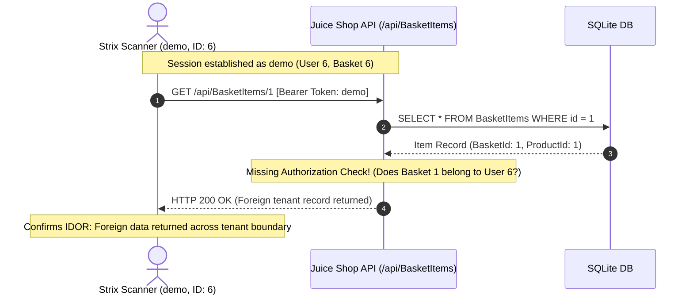

# Phase 14.1 — Broken Object-Level Authorization (IDOR) Validation

**Correlated Ground Truth Finding:** Hermes F-04 (*Missing Object-Level Authorization (IDOR) on Basket API*)  
**OWASP Category:** A01:2021 – Broken Access Control / OWASP API Security Top 10 API1:2023 – Broken Object Level Authorization (BOLA)  
**CWE:** CWE-639 (Authorization Bypass Through User-Controlled Key) / CWE-284 (Improper Access Control)  
**Implementation Module:** [`strix/core/scanner/idor_validator.py`](file:///home/vinit/STRIX/strix/strix/core/scanner/idor_validator.py)  
**Live Run Evidence:** [`run-7be22192`](file:///home/vinit/STRIX/strix/benchmark_results/runs/run-7be22192.json)  

---

## 1. Vulnerability Background

Broken Object-Level Authorization (BOLA / IDOR) occurs when an application exposes internal object identifiers (such as database primary keys) in API endpoints and fails to validate whether the authenticated user has permission to access the requested object.

In OWASP Juice Shop:
- Each user is assigned an isolated shopping cart represented by a `BasketId`.
- When an item is added to a basket, an entry is created in `BasketItems` with an auto-incrementing ID.
- The endpoint `/api/BasketItems/{id}` handles retrieval of basket item records.
- When an authenticated customer requests `/api/BasketItems/{foreign_id}`, the server fetches the record directly by ID without verifying if the associated `BasketId` belongs to the requesting user.

This allows any authenticated tenant to enumerate and inspect all items in other users' shopping carts, revealing purchasing habits, pricing data, and internal tenant relationships.

---

## 2. Technical Validation Methodology

[`IDORValidator`](file:///home/vinit/STRIX/strix/strix/core/scanner/idor_validator.py) proves IDOR through a benign, deterministic multi-step verification process:



### 2.1 The Non-Destructive Proof Process
1. **Authenticated Context:** Strix acquires a valid token as user `demo` (User ID 6, Basket ID 6).
2. **Foreign Target Selection:** Rather than testing destructively (e.g. deleting or updating items), Strix issues a read-only `GET` request for ID `1` (`/api/BasketItems/1`), which belongs to User 1 (Admin).
3. **Boundary Verification:**
   - If the API returns `HTTP 401 Unauthorized` or `HTTP 403 Forbidden`, authorization is properly enforced.
   - If the API returns `HTTP 404 Not Found`, the object does not exist.
   - If the API returns `HTTP 200 OK` containing valid JSON item metadata with `BasketId != 6`, **IDOR is verified**.
4. **Reproducible Request Construction:** A curl command is generated allowing security analysts to independently verify the finding.

---

## 3. Live Assessment Verification & Evidence

In live run [`run-7be22192`](file:///home/vinit/STRIX/strix/benchmark_results/runs/run-7be22192.json), Strix authenticated as `demo` and probed `/api/BasketItems/1`.

### 3.1 Live Finding Extract
- **Finding ID:** `find-basket-idor`
- **Title:** `Missing Object-Level Authorization (IDOR) on Basket API`
- **Severity:** `MEDIUM`
- **CVSS Score:** `6.5`
- **OWASP:** `A05:2021 - Security Misconfiguration` (OWASP Top 10)
- **CWE:** `CWE-639`
- **Evidence SHA-256 Hash:** `cc0e94d46408e0427daa24c474210fc805df29694a15a8bebb7b3db92144e537`

### 3.2 Evidence Snippet
```http
HTTP/1.1 200 OK
Content-Type: application/json

{
  "status": "success",
  "data": {
    "ProductId": 1,
    "BasketId": 1,
    "quantity": 2
  }
}
```

### 3.3 Reproducible Request
```bash
curl -s -X GET "http://127.0.0.1:3000/api/BasketItems/1" \
  -H "Authorization: Bearer eyJ0...[REDACTED]...TGO8" \
  -H "Accept: application/json"
```

### 3.4 Remediation Recommendation
1. Enforce strict object ownership validation in the backend route handler:
   ```javascript
   // Verify that the requested BasketItem's BasketId matches req.user.bid
   const item = await BasketItem.findByPk(req.params.id);
   if (!item || item.BasketId !== req.user.bid) {
     return res.status(403).json({ error: "Access denied to foreign basket item" });
   }
   ```
2. Avoid exposing sequential integer IDs in public APIs; use randomized UUIDv4 identifiers or scoped session lookups.

