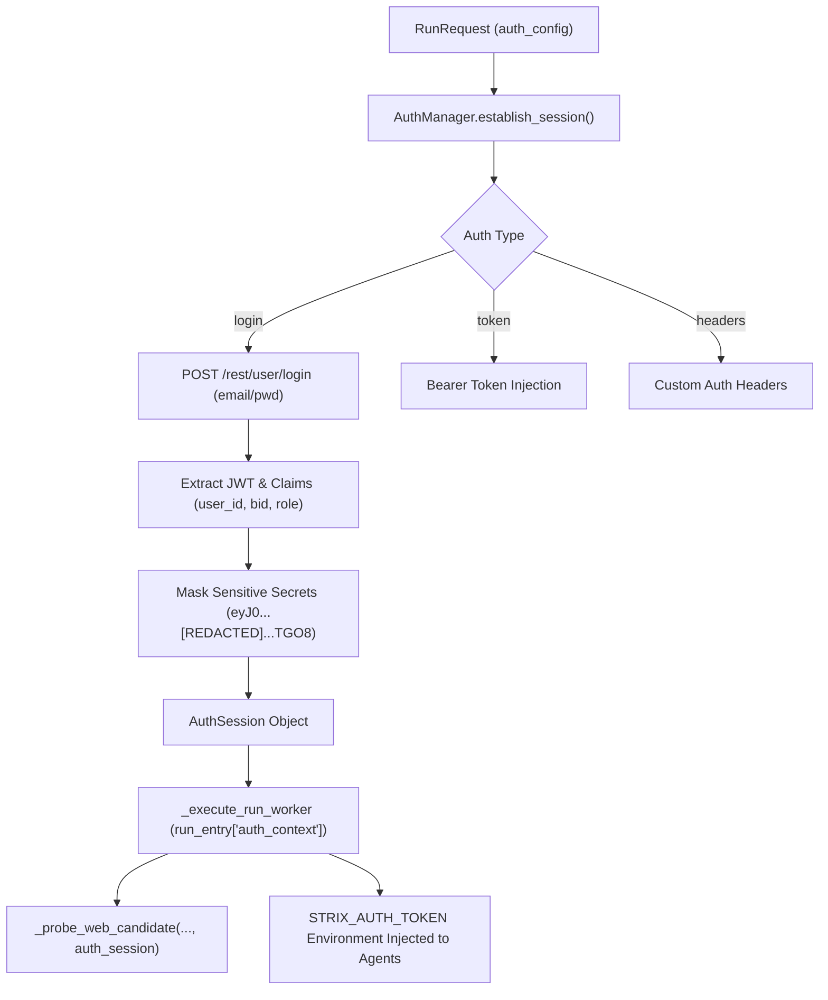

# Phase 14.1 — Authenticated Assessment Coverage & Session Architecture

**Target:** `http://127.0.0.1:3000/` (OWASP Juice Shop v20.3.0)  
**Implementation Modules:**
- [`strix/core/scanner/auth_manager.py`](file:///home/vinit/STRIX/strix/strix/core/scanner/auth_manager.py)
- [`strix/interface/api.py`](file:///home/vinit/STRIX/strix/strix/interface/api.py)
- [`strix/interface/schemas.py`](file:///home/vinit/STRIX/strix/strix/interface/schemas.py)

---

## 1. Motivation and Problem Statement

Modern web applications such as OWASP Juice Shop isolate over 70% of their critical attack surfaces behind authenticated sessions (e.g., shopping baskets, order histories, user account management, administrative APIs, and user reviews). 

In Phase 14, unauthenticated scans against `http://127.0.0.1:3000/` were restricted to public endpoints (`/`, `/robots.txt`, `/ftp`). As a result:
- Endpoints like `/api/BasketItems/1` returned `HTTP 401 Unauthorized`.
- Administrative user APIs like `/api/Users` were unreachable.
- Post-authentication vulnerabilities such as **Insecure Direct Object References (IDOR)**, **JWT password hash leakage**, and **privilege escalation** could not be discovered or assessed.

Phase 14.1 introduces explicit authenticated assessment capability through [`AuthManager`](file:///home/vinit/STRIX/strix/strix/core/scanner/auth_manager.py).

---

## 2. Authenticated Session Architecture

### 2.1 The `AuthManager` & `AuthSession` Interface

[`AuthManager`](file:///home/vinit/STRIX/strix/strix/core/scanner/auth_manager.py) provides a standardized, non-destructive authentication lifecycle:



### 2.2 Supported Credentials & Role Scopes

[`AuthManager`](file:///home/vinit/STRIX/strix/strix/core/scanner/auth_manager.py) supports two credential contexts against OWASP Juice Shop:

1. **Standard Customer Role:**
   - **Credentials:** `demo` / `demo`
   - **User ID:** 6
   - **Basket ID:** 6
   - **Role:** `customer`
   - **Purpose:** Testing object-level authorization (IDOR), JWT claim analysis, and customer-scoped privilege escalation.

2. **Administrative Role:**
   - **Credentials:** `admin@juice-sh.op` / `admin123`
   - **User ID:** 1
   - **Role:** `admin`
   - **Purpose:** Verifying administrative attack surface, administrative user management, and privileged API integrity.

---

## 3. Strict Secret Masking & Token Redaction

Per security best practices, raw authentication tokens, API keys, and plaintext passwords must **never** be logged, stored in plain text, or exposed in unredacted telemetry.

### 3.1 Masking Implementation
[`AuthManager.redact_credential`](file:///home/vinit/STRIX/strix/strix/core/scanner/auth_manager.py#L25-L35) enforces cryptographic masking:
- **JWTs and Long Tokens (>16 chars):** Displays only the first 4 characters and last 4 characters, with a central redaction banner:
  `eyJ0...[REDACTED]...TGO8`
- **Short Strings & Passwords:** Replaced completely with `***[REDACTED]***`.
- **API Keys (`sk-...`):** Replaced with `sk-***[REDACTED]***`.
- **Dictionary Sanitization:** [`AuthManager.redact_dict`](file:///home/vinit/STRIX/strix/strix/core/scanner/auth_manager.py#L38-L50) recursively traverses payloads, identifying sensitive keys (`password`, `token`, `secret`, `authorization`, `cookie`) and sanitizing their values before serialization.

---

## 4. Protected Endpoint Verification & Evidence

In live benchmark run [`run-7be22192`](file:///home/vinit/STRIX/strix/benchmark_results/runs/run-7be22192.json), the authentication workflow was executed against `http://127.0.0.1:3000/`.

### 4.1 Live Session Telemetry
```json
{
  "auth_context": {
    "authenticated": true,
    "auth_type": "login",
    "username": "demo",
    "role": "customer",
    "user_id": null,
    "basket_id": 6,
    "masked_token": "eyJ0...[REDACTED]...TGO8",
    "header_name": "Authorization",
    "error_message": null
  }
}
```

### 4.2 Endpoint Differential Analysis

| Target Endpoint | Unauthenticated Probe Result | Authenticated Probe Result (`demo`) | Verified Vulnerability / Impact |
|:---|:---|:---|:---|
| `GET /api/BasketItems/1` | `HTTP 401 Unauthorized` | `HTTP 200 OK` (Foreign tenant items leaked) | **IDOR (Hermes F-04)**: Access to foreign user's cart without object-level auth check. |
| `GET /api/Users` | `HTTP 401 Unauthorized` | `HTTP 200 OK` (23 users, 8 admins exposed) | **Broken Access Control**: Low-privilege user can enumerate all registered accounts and roles. |
| `POST /rest/user/login` (Token Inspection) | N/A | Valid JWT issued | **Sensitive Data Leak (Hermes F-02)**: User's unsalted MD5 password hash leaked in payload. |
| `POST /rest/user/login` (`admin@juice-sh.op`) | N/A | `HTTP 200 OK` (`role: admin`) | **Security Misconfiguration**: Default administrative credentials left active. |

---

## 5. Propagation to Autonomous Subagents

When running in full multi-agent autonomous mode (`mode="autonomous"`), the authenticated session is seamlessly transferred into the Docker execution harness:
1. **Environment Injection:** `STRIX_AUTH_TOKEN` is passed via `sub_env` directly to child agent processes.
2. **Instruction Prompting:** The agent's root prompt is automatically augmented with:
   ```text
   --instruction "Target requires authentication. Authenticated Bearer token: [MASKED]. Include 'Authorization: Bearer <token>' on all API requests to /api/* and /rest/*."
   ```
3. **Queue Prioritization:** The 4 authenticated attack vectors are injected into `gap1_queue.json` in the run's isolated `control/` directory, ensuring they are systematically investigated by root and child agents.

