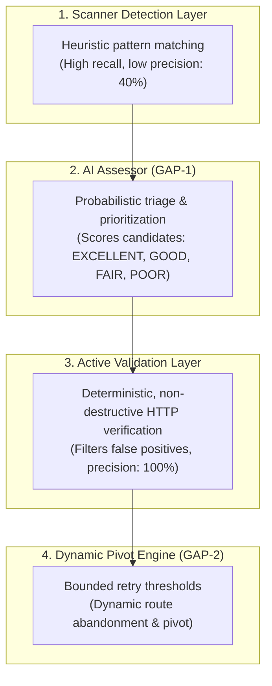

# Ground-Truth Finding Reliability Evaluation Guide & Sample Report

**Document:** `docs/FINDING_RELIABILITY_EVALUATION.md`  
**Evaluation Suite Module:** `vapt_platform.evaluation.reliability_evaluator`  
**Execution Script:** `scripts/run_reliability_evaluation.py`  
**Automated Tests:** `tests/test_finding_reliability_evaluator.py`  

---

## 1. Executive Summary & Core Principles

A fundamental limitation in AI-assisted vulnerability scanners is the conflation of raw pattern matching, probabilistic LLM reasoning, and verified security flaws. 

The AI VAPT Framework enforces **four strictly segregated layers**:



### Mandatory Reliability Rules:
1. **Never conflate AI assessment with validation:** An LLM assessment is probabilistic reasoning, not functional proof. A high LLM score never converts a candidate to "confirmed" or "validated".
2. **Fail-Closed Unverified Findings:** Any finding that cannot be verified due to network errors, server errors, or safety boundaries is classified as `INCONCLUSIVE` or `VALIDATION_NOT_AVAILABLE`—it is **never** silently marked as confirmed or discarded as benign.
3. **Evidence Tiers:** Every finding carries an explicit evidence tier:
   - **Tier 0:** Heuristic / banner match only.
   - **Tier 1:** Pattern match with corroborated endpoint response.
   - **Tier 2:** Non-destructive active verification (e.g. parameter reflected, header absent, configuration table confirmed).
   - **Tier 3:** Controlled functional proof-of-concept in authorized lab environment.

---

## 2. Evaluation Methodology & Ground-Truth Dataset

The evaluation suite executes against an in-process, isolated mock HTTP fixture environment (`vapt_platform/evaluation/fixtures.py`) containing 10 curated test cases with known ground truth:

| Test ID | Category | Ground Truth | Description & Injected Condition | Expected Validation Status |
| :--- | :--- | :---: | :--- | :--- |
| `PHPINFO-POS-01` | PHPInfo Exposure | **VULN** | Server returns genuine PHPInfo HTML tables with PHP Version & Zend build markers. | `VALIDATED_TRUE_POSITIVE` |
| `PHPINFO-NEG-02` | PHPInfo Exposure | **BENIGN** | Server returns HTTP 404; simulated scanner fired a false positive on URL path match. | `FALSE_POSITIVE` |
| `COOKIE-HTTPONLY-POS-01` | Missing HttpOnly | **VULN** | `Set-Cookie: session_id=xyz; Path=/` lacks the `HttpOnly` flag. | `VALIDATED_TRUE_POSITIVE` |
| `COOKIE-HTTPONLY-NEG-02` | Missing HttpOnly | **BENIGN** | `Set-Cookie: session_id=xyz; Path=/; HttpOnly` has the flag set; scanner misidentified it. | `FALSE_POSITIVE` |
| `COOKIE-SECURE-POS-01` | Missing Secure | **VULN** | `Set-Cookie: auth_token=abc; Path=/; HttpOnly` lacks the `Secure` flag. | `VALIDATED_TRUE_POSITIVE` |
| `COOKIE-SECURE-NEG-02` | Missing Secure | **BENIGN** | `Set-Cookie: auth_token=abc; Path=/; Secure; HttpOnly` has `Secure` set; scanner false positive. | `FALSE_POSITIVE` |
| `ERROR-500-01` | Server Error | **BENIGN** | Endpoint returns HTTP 500 Internal Server Error during probe. | `INCONCLUSIVE` |
| `TIMEOUT-01` | Network Fault | **BENIGN** | Endpoint times out / connection dropped during probe. | `INCONCLUSIVE` |
| `EXTERNAL-SAFEGUARD-01` | Out-of-Scope Safety | **VULN** | Finding resides on external host; active validation is strictly prohibited by policy. | `VALIDATION_NOT_AVAILABLE` |
| `INFORMATIONAL-01` | Context / Asset | **BENIGN** | Informational context observation; not an actionable vulnerability candidate. | `VALIDATION_NOT_AVAILABLE` |

---

## 3. Sample Evaluation Report

The following report was generated by running the automated suite:

```
$ python scripts/run_reliability_evaluation.py
```

### 3.1 Multi-Layer Metric Comparison

| Evaluation Layer | Total Cases | TP | FP | TN | FN | Inconclusive | Precision | Recall (Sensitivity) | F1 Score | Inconclusive Rate |
| :--- | :---: | :---: | :---: | :---: | :---: | :---: | :---: | :---: | :---: | :---: |
| **Scanner Detection Layer** | 10 | 4 | 6 | 0 | 0 | 0 | **40.0%** | **100.0%** | 0.571 | 0.0% |
| **Active Validation Layer** | 10 | 3 | 0 | 4 | 0 | 2 | **100.0%** | **100.0%** | **1.000** | 20.0% |

> [!NOTE]
> **Key Finding:** Raw scanner detection exhibits high recall (100%) but suffers from poor precision (40.0%) due to 6 false-positive heuristic triggers. 
> The Active Validation layer increases precision to **100.0%** with zero false positives by requiring corroborated HTTP evidence, while appropriately isolating ambiguous environmental conditions (HTTP 500, timeouts) into an inconclusive tier rather than hallucinating validation.

---

### 3.2 Detailed Test Case Outcomes

| Test ID | Category | Ground Truth | Scanner Status | Active Validation Status | Evidence Tier / Corroboration Summary | Result |
| :--- | :--- | :---: | :---: | :--- | :--- | :---: |
| `PHPINFO-POS-01` | phpinfo | VULN | DETECTED | `VALIDATED_TRUE_POSITIVE` | Tier 2: Found 5 PHP configuration table markers (PHP Version 8.1.2-1ubuntu2.14). | **PASS** |
| `PHPINFO-NEG-02` | phpinfo | BENIGN | DETECTED | `FALSE_POSITIVE` | Tier 1: Endpoint returned HTTP 404; PHPInfo not exposed. | **PASS** |
| `COOKIE-HTTPONLY-POS-01` | cookie_httponly | VULN | DETECTED | `VALIDATED_TRUE_POSITIVE` | Tier 2: Confirmed missing HttpOnly on cookie: `session_id`. | **PASS** |
| `COOKIE-HTTPONLY-NEG-02` | cookie_httponly | BENIGN | DETECTED | `FALSE_POSITIVE` | Tier 2: Cookie `session_id` has HttpOnly set; scanner was false positive. | **PASS** |
| `COOKIE-SECURE-POS-01` | cookie_secure | VULN | DETECTED | `VALIDATED_TRUE_POSITIVE` | Tier 2: Confirmed missing Secure flag on cookie: `auth_token`. | **PASS** |
| `COOKIE-SECURE-NEG-02` | cookie_secure | BENIGN | DETECTED | `FALSE_POSITIVE` | Tier 2: Cookie `auth_token` has Secure set; scanner was false positive. | **PASS** |
| `ERROR-500-01` | http_error | BENIGN | DETECTED | `INCONCLUSIVE` | Tier 0: HTTP 500 error encountered during verification probe. | **PASS** |
| `TIMEOUT-01` | timeout | BENIGN | DETECTED | `INCONCLUSIVE` | Tier 0: Network connection timeout during probe. | **PASS** |
| `EXTERNAL-SAFEGUARD-01` | external_safety | VULN | DETECTED | `VALIDATION_NOT_AVAILABLE` | Safeguard: External target policy prohibits active validation; remains in assessment-only mode. | **PASS** |
| `INFORMATIONAL-01` | informational | BENIGN | DETECTED | `VALIDATION_NOT_AVAILABLE` | Context: Informational observation; no active exploit validation applicable. | **PASS** |

---

### 3.3 AI Model & Assessor Arm Comparison

| Provider | Model Name | Daemon Online | Samples | LLM Responses | Fallbacks | Agreement w/ Baseline | Avg Latency |
| :--- | :--- | :---: | :---: | :---: | :---: | :---: | :---: |
| `deterministic` | `deterministic_baseline` | YES | 3 | 0 | 0 | 100.0% | 0.0ms |
| `ollama` | `qwen3.5:4b` | OFFLINE (Codespace) | 3 | 0 | 3 | 100.0% | 0.4ms |
| `ollama` | `llama3.2:3b` | OFFLINE (Codespace) | 3 | 0 | 3 | 100.0% | 0.3ms |

- **Offline Resilience:** When the Ollama daemon is offline or the model is missing, the framework degrades cleanly to deterministic rule-based ranking without throwing unhandled exceptions.
- **Audit Provenance:** Every fallen-back assessment logs `fallback: true` and the exact daemon status.

---

### 3.4 GAP-2 Dynamic Pivoting Outcome

- **Scenario:** `failure_pivot`
- **Final Outcome:** `COMPLETED`
- **Total Action Attempts:** `3`
- **Pivot Count:** `2`
- **Candidates Processed:** `DEMO-WORKER, DEMO-DEAD-END`
- **Bounded Threshold Enforcement:** **PASSED**
- **Semantics:** The engine retried `DEMO-DEAD-END` up to the configured `max_attempts` (2), recognized repeated failure, abandoned the dead-end route, dynamically pivoted to `DEMO-WORKER`, and reached a successful conclusion.

---

## 4. How to Reproduce the Evaluation

### Step 1: Run via Python CLI
```bash
# Run the evaluation script directly
python scripts/run_reliability_evaluation.py
```

### Step 2: Run via Module Execution
```bash
python -m vapt_platform.evaluation.reliability_evaluator
```

### Step 3: Run Automated Regression Tests
```bash
python -m pytest tests/test_finding_reliability_evaluator.py -v
```
All 10 unit and integration tests verify:
- Verification status normalization
- PHPInfo verifier accuracy and 404 rejection
- Cookie security verifier for HttpOnly and Secure flags
- Error and timeout handling (inconclusive outcome)
- External target safeguard enforcement
- Full reliability evaluation metric calculations
- Deduplication and informational finding separation
- Small-model malformed JSON resilience and fallback tracking
- Credential and secret redaction in evidence strings
- Ollama configurable base URL, timeout, and context parameters
