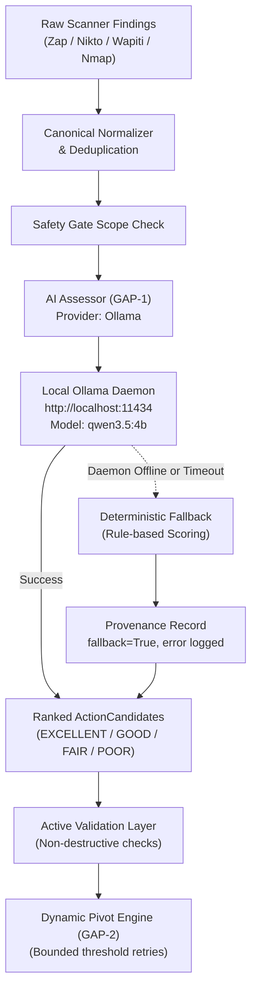

# Local Ollama AI Setup Guide (Windows & WSL2)

**Document:** `docs/OLLAMA_LOCAL_SETUP_WINDOWS.md`  
**Target Environment:** Windows 10/11 (Native & WSL2)  
**Primary Configurable Model:** `qwen3.5:4b`  
**Thesis Baseline Model:** `llama3.2:3b`  

---

## 1. Overview & Architecture

The AI VAPT Framework supports fully local, offline AI-assisted exploit candidate assessment using [Ollama](https://ollama.com). This enables vulnerability assessment, prioritization (GAP-1), and dynamic decision pivots (GAP-2) without sending code, tokens, or network indicators to external cloud APIs.



---

## 2. Windows Installation (Native)

### Step 2.1 — Download & Install Ollama
1. Download **Ollama for Windows** from the official site: [https://ollama.com/download/windows](https://ollama.com/download/windows).
2. Run `OllamaSetup.exe` and follow the on-screen installer.
3. Ollama will start in your Windows system tray.

### Step 2.2 — Verify Installation
Open **PowerShell** or **Command Prompt** and test:
```powershell
ollama --version
# Expected: ollama version is 0.1.x or 0.3.x+
```

Verify that the local REST daemon is listening on port `11434`:
```powershell
Invoke-RestMethod -Uri http://localhost:11434/api/tags
# Or using curl.exe:
curl.exe -s http://localhost:11434/api/tags
```
If you receive a JSON response `{"models":[]}`, the Ollama server is running and healthy.

---

## 3. Pulling Models

### 3.1 Recommended Configurable Local Model: `qwen3.5:4b`
Run:
```powershell
ollama pull qwen3.5:4b
```
- **Size:** ~2.8 GB download
- **Memory Requirements:** ~3.5 GB RAM / VRAM
- **Strengths:** Excellent structured JSON instruction adherence, fast token generation on modern CPUs and GPUs, low memory footprint.

### 3.2 Optional Thesis Baseline Model: `llama3.2:3b`
To reproduce original thesis benchmark arms:
```powershell
ollama pull llama3.2:3b
```
- **Size:** ~2.0 GB download
- **Memory Requirements:** ~2.5 GB RAM / VRAM

Verify pulled models:
```powershell
ollama list
```

---

## 4. Configuring the AI VAPT Framework

The framework dynamically detects Ollama configuration via `.env` or system environment variables.

### 4.1 Configuration Options (`.env`)
Create or edit `.env` in the repository root (`ai_vapt_framework/.env`):

```ini
# --- Local Ollama AI Configuration ---
# Active model selection (default: qwen3.5:4b)
OLLAMA_MODEL=qwen3.5:4b

# Base URL for the Ollama daemon (default: http://localhost:11434)
OLLAMA_BASE_URL=http://localhost:11434

# Request timeout in seconds (default: 45.0)
OLLAMA_TIMEOUT=45.0

# Context window size in tokens (default: 2048)
OLLAMA_NUM_CTX=2048

# Maximum tokens to generate per candidate assessment (default: 512)
OLLAMA_NUM_PREDICT=512
```

### 4.2 PowerShell Session Variables (Alternative)
```powershell
$env:OLLAMA_MODEL = "qwen3.5:4b"
$env:OLLAMA_BASE_URL = "http://localhost:11434"
$env:OLLAMA_TIMEOUT = "45.0"
```

---

## 5. Running the Application with Ollama

### Step 5.1 — Launch Backend API
```powershell
# From the repository root with virtual environment activated:
python -m uvicorn services.api:app --host 127.0.0.1 --port 8000
```

### Step 5.2 — Launch Web Dashboard
In a second terminal:
```powershell
python -m frontend.app
```
Access the dashboard at `http://127.0.0.1:8501` (Streamlit) or `http://127.0.0.1:8000` (FastAPI / Web UI).

### Step 5.3 — Select Provider & Model in UI
1. In the Web UI **Execution Controls**, locate the **AI Assessor Provider** dropdown.
2. Select **`ollama`**.
3. Under **Assessor Model**, select **`qwen3.5:4b (configurable local model default)`** or **`llama3.2:3b (thesis baseline)`**.
4. Click **Start Run**.

---

## 6. WSL2 Setup (When Framework runs inside WSL2)

If your AI VAPT repository is running inside WSL2 while Ollama is installed on Windows:

1. By default, Windows Ollama listens only on `127.0.0.1`. To allow WSL2 access:
   - In Windows PowerShell:
     ```powershell
     [System.Environment]::SetEnvironmentVariable('OLLAMA_HOST', '0.0.0.0:11434', 'User')
     ```
   - Restart Ollama from the system tray.
2. Inside WSL2, configure `OLLAMA_BASE_URL` to point to the Windows host:
   ```bash
   # Add to your .env inside WSL2:
   OLLAMA_BASE_URL=http://host.docker.internal:11434
   # Or using the default gateway IP:
   # OLLAMA_BASE_URL=http://$(ip route show default | awk '{print $3}'):11434
   ```

---

## 7. Deterministic Fallback & Fault Tolerance

The framework implements strict fault tolerance. Under any of the following failure modes:
1. **Ollama daemon not running:** Connection refused on port `11434`.
2. **Model not pulled:** Model `qwen3.5:4b` not found in `ollama list`.
3. **Timeout exceeded:** Generation takes longer than `OLLAMA_TIMEOUT` (45s).
4. **Malformed output:** Small model outputs invalid JSON or unexpected schema.

### Observed System Behavior:
- **No Crash / Fail-Closed:** The pipeline gracefully degrades to deterministic heuristic scoring (CVSS / EPSS / KEV rule-based).
- **Audit Provenance Recorded:** The candidate record marks `fallback: true` and logs the exact diagnostic error message.
- **UI Transparency:** The UI displays a amber/warning step: `FALLBACK USED (ollama offline - fallback used)` instead of misleadingly claiming AI validation.
- **Reports:** Report JSON, HTML, and Markdown render clear fallback tags.

---

## 8. Verification & Diagnostics

To run the automated verification suite to verify your local Ollama configuration:

```bash
# Activate your virtual environment
python -m pytest tests/test_finding_reliability_evaluator.py -v
python -m pytest tests/test_provider_integration_gaps.py -v
```

To run the full ground-truth reliability evaluation:
```bash
python scripts/run_reliability_evaluation.py
```
