# Canonical Application Workflow Architecture — AI VAPT Platform

**Date:** 2026-10-22  
**Branch:** `feature/mentor-demo-readiness`  
**Status:** IMPLEMENTED AND VALIDATED  
**Author:** AI VAPT Engineering & Quality Team  

---

## 1. Executive Summary

The AI-VAPT Platform implements a **single, unified, canonical execution pipeline** encapsulated in `vapt_platform/application.py` (`VAPTApplication`). Every user interface—including the dedicated Web Operations Console (SPA), Streamlit dashboard, FastAPI REST API, and CLI—funnels through this authoritative workflow service.

The architecture strictly separates:
1. **Academic Research Cores (`decision_engine/core/` and `core/`)**: Domain-independent assessment and bounded-pivot state machines implementing GAP-1 and GAP-2 (frozen for thesis integrity).
2. **Platform Services (`vapt_platform/`)**: Ingestion, normalization, enrichment, graph construction, authorization, scanner orchestration, event publishing, and reporting.
3. **Controlled Execution Layers (`prototype/execution_layer.py`, `lab/`)**: Honest evidence tiering (`SIMULATED`, `OBSERVED_LOCAL`, `DOCKER_OBSERVED`, `CONTROLLED_VALIDATION`).

---

## 2. End-to-End Canonical Workflow Diagram

```mermaid
flowchart TD
    subgraph UI ["1. Client Interfaces"]
        CLI["CLI (prototype.cli)"]
        SPA["Operations Console (frontend/web/)"]
        ST["Streamlit UI (frontend/app.py)"]
        API["FastAPI REST (services/api.py)"]
    end

    subgraph Entry ["2. Unified Request Entry Point"]
        VR["VAPTRequest (vapt_platform.application)"]
        APP["VAPTApplication.run()"]
    end

    subgraph Ingest ["3. Ingestion & Authorization"]
        AUTH{"Authorization Gate & Preflight"}
        FAIL_SCOPE["Reject Fail-Closed (400 / WebTargetAuthorizationError)"]
        SCAN["Controlled Scanner Discovery (Nmap & Nuclei)"]
        SCENARIO["Scenario / Scan File Ingestion"]
    end

    subgraph Normalization ["4. Canonical Normalization & Split"]
        NORM["Canonical Finding Normalization (CanonicalFinding)"]
        DEDUP["Deterministic Deduplication"]
        ENRICH["Threat Intel Enrichment (EPSS, CISA KEV, CVSS)"]
        SPLIT{"Split Findings"}
        DISC["Asset Context (Service Discovery / Informational)"]
        ACTIONABLE["Actionable Vulnerability Candidates"]
    end

    subgraph AI_Engine ["5. AI Assessment & Ranking (GAP-1)"]
        GRAPH["Asset/Vulnerability Graph (VAPTGraph)"]
        DI["Decision Intelligence Scoring"]
        ASSESS{"AI Assessment Mode"}
        OLLAMA["Offline Ollama (llama3.2:3b baseline)"]
        OPENROUTER["Hosted OpenRouter (Session API Key)"]
        OPENAI["Hosted OpenAI (OPENAI_API_KEY)"]
        FALLBACK["Deterministic Fallback (Explicit Provenance)"]
        RANK["Priority Ranking: prob x (0.5 + 0.5 x quality)"]
    end

    subgraph Validation ["6. Safety Gates & Planning"]
        PLANNER["Validation Planner"]
        SAFETY{"Safety Gate & Scope Enforcer"}
        EXEC_SIM["Simulation / Loopback Executor"]
        EXEC_UNAVAIL["Web Runs: Mark Validation Unavailable (No weaponized exploits)"]
    end

    subgraph Decision ["7. Research Engine & Bounded Pivot (GAP-2)"]
        DE_RUN["decision_engine.core.engine: run_engine()"]
        ATTEMPT["Attempt Candidate (Per-Candidate Counter)"]
        EVAL{"Success or Attempt >= Threshold?"}
        PIVOT["Pivot to Next Candidate (Counter Reset)"]
        BOUNDED["Bounded Termination <= N x max_attempts"]
    end

    subgraph Presentation ["8. Results, Evidence & Reporting"]
        TIER["Record Evidence Tier (SIMULATED / OBSERVED_LOCAL)"]
        EVENTS["EventPublisher: State Transitions & Events"]
        PERSIST["JSONRunRepository: Save PersistentRun"]
        REPORT["Multi-Format Reports (JSON, HTML, Markdown, TXT)"]
    end

    CLI --> VR
    SPA --> VR
    ST --> VR
    API --> VR

    VR --> APP
    APP --> AUTH
    AUTH -- "Out of Scope / No Ack" --> FAIL_SCOPE
    AUTH -- "Authorized Local / External" --> SCAN
    AUTH -- "Simulation / Lab Scenario" --> SCENARIO

    SCAN --> NORM
    SCENARIO --> NORM
    NORM --> DEDUP
    DEDUP --> ENRICH
    ENRICH --> SPLIT
    SPLIT --> DISC
    SPLIT --> ACTIONABLE

    DISC -.-> GRAPH
    ACTIONABLE --> GRAPH
    GRAPH --> DI
    DI --> ASSESS

    ASSESS -- "Offline Mode" --> OLLAMA
    ASSESS -- "Hosted Mode" --> OPENROUTER
    ASSESS -- "Hosted Mode" --> OPENAI
    ASSESS -- "Offline / Failure" --> FALLBACK

    OLLAMA --> RANK
    OPENROUTER --> RANK
    OPENAI --> RANK
    FALLBACK --> RANK

    RANK --> PLANNER
    PLANNER --> SAFETY
    SAFETY -- "Scenario Mode" --> EXEC_SIM
    SAFETY -- "Web Target Mode" --> EXEC_UNAVAIL

    EXEC_SIM --> DE_RUN
    EXEC_UNAVAIL --> DE_RUN

    DE_RUN --> ATTEMPT
    ATTEMPT --> EVAL
    EVAL -- "Failure < Max" --> ATTEMPT
    EVAL -- "Failure >= Max" --> PIVOT
    EVAL -- "Success" --> PIVOT
    PIVOT --> BOUNDED

    BOUNDED --> TIER
    TIER --> EVENTS
    EVENTS --> PERSIST
    PERSIST --> REPORT
```

---

## 3. Stage-by-Stage Workflow Details

### Stage 1: Request Ingestion & Preflight Authorization
- When an assessment is initiated, all parameters are encapsulated in `VAPTRequest`.
- For web target assessments (`assessment_type="web"`), backend validation in `vapt_platform/web_target.py` executes before any scanner subprocess:
  1. URL format verification (`http`/`https`, no credentials, normalized host).
  2. Scope matching: loopback policy (`127.0.0.1`, `localhost`) on authorized ports (`9191`) OR exact `host:port` in `VAPT_AUTHORIZED_WEB_SCOPES`.
  3. DNS resolution verification: local destinations must resolve exclusively to loopback; external destinations must resolve exclusively to public IPs. Mixed IP sets fail closed.
  4. Explicit acknowledgement check: external targets require `target_scope_acknowledged=True`.
  5. Preflight probe: safe GET probe to verify connectivity without following redirects.

### Stage 2: Scanner Ingestion
- For web assessments, `vapt_platform/scanner_service.py` runs bounded discovery:
  - **Nmap**: `-Pn -sV -p <port> -n -oX <out> <validated-host>` (scans only the validated host on the single authorized port, no DNS resolution, no neighbor discovery).
  - **Nuclei**: bounded, non-destructive template profile (`http/technologies`, `http/misconfiguration`, `http/exposures`, `http/exposed-panels`) with redirects disabled (`-dr`) and capped rate limits.
- When scanners are missing, the system degrades gracefully (`status="NOT AVAILABLE"` or `status="SKIPPED"`) without failing the workflow.

### Stage 3: Normalization & Deduplication
- Scanner outputs are ingested via format-specific adapters (`NmapXmlAdapter`, `NucleiAdapter`) and converted into `CanonicalFinding` records.
- Findings are deduplicated deterministically by key attributes (target, port, vulnerability/rule ID).

### Stage 4: Split Findings (Actionable Candidates vs Asset Discovery)
- Findings are split into two strictly separated sets (`split_findings`):
  1. **Actionable Candidates**: Confirmed vulnerability findings with CVE/CWE or actionable impact.
  2. **Service Discovery / Asset Context**: Informational observations, technology banners, port detection records. These are preserved for asset context and report generation, but are never ranked as exploits or attempted in the decision engine.

### Stage 5: Threat Intelligence Enrichment
- Actionable findings are enriched using `vapt_platform/enrichment.py`:
  - EPSS probability score lookup.
  - CISA Known Exploited Vulnerabilities (KEV) catalogue lookup.
  - CVSS vector parsing and base score calculation.
  - Missing intelligence fields default cleanly to `N/A` or `0.0` without fabrication.

### Stage 6: Asset/Vulnerability Graph
- A graph representation (`VAPTGraph`) models relationships between host assets, service ports, and associated vulnerabilities, establishing asset exposure context.

### Stage 7: Pluggable AI Assessment (GAP-1)
- Candidates receive exploit usability scoring via `vapt_platform/assessment.py`:
  - **Offline/Local Mode**: Ollama (`llama3.2:3b` baseline). Live service reachability (`GET /api/tags`) and model availability are verified.
  - **Online/Hosted Mode**: OpenRouter (runtime session key passed in `X-OpenRouter-API-Key` header, zero-cost catalogue validation) or OpenAI.
  - **Deterministic Fallback**: Used when offline, air-gapped, or upon provider failure. Provenance records `fallback=True` and classified failure cause; never silently substituted.

### Stage 8: Candidate Prioritization
- Candidates are ranked by priority score:
  $$\text{Priority} = \text{Probability} \times (0.5 + 0.5 \times \text{Quality})$$
  Where Quality is mapped from assessed usability (`HIGH=1.0`, `MEDIUM=0.5`, `LOW=0.0`).

### Stage 9: Validation Planning & Safety Policy
- A validation plan is formulated (`ValidationPipeline`).
- Safety checks verify authorized target scope and command bounds.
- For web target assessments, the platform does not execute weaponized offensive exploits against live endpoints. The stage is honestly marked `WEB_VALIDATION_UNAVAILABLE` and candidate validation status is recorded as `SCANNER-DETECTED` (evidence tier `OBSERVED_LOCAL`).

### Stage 10: Decision Engine & Bounded Pivot (GAP-2)
- Execution is driven by the frozen research core (`decision_engine/core/engine.py`).
- Maintains per-candidate attempt counts in explicit LangGraph state.
- Retries failing candidates up to `max_attempts`.
- Automatically pivots to the next candidate when threshold is reached.
- Guaranteed bounded termination:
  $$\text{Total Attempts} \le N \times \text{max\_attempts}$$

### Stage 11: Persistence, Events & Multi-Format Reporting
- State transitions emit real-time events through `EventPublisher`.
- Full run details are persisted in `JSONRunRepository`.
- Comprehensive reports are generated across 4 standard formats:
  - JSON (`report.json`)
  - HTML (`report.html`)
  - Markdown (`report.md`)
  - Text (`report.txt`)

---

## 4. Interface Parity Matrix

All four entry interfaces consume the exact same application service:

| Feature / Contract | CLI (`prototype.cli`) | REST API (`services.api`) | Web Console (`frontend/web`) | Streamlit (`frontend/app`) |
|---|---|---|---|---|
| **Authoritative Entry Point** | `VAPTApplication.run()` | `VAPTApplication.run()` | `VAPTApplication.run()` (via API) | `VAPTApplication.run()` |
| **Execution Modes** | simulation, lab, web | simulation, lab, web | simulation, lab, web | simulation, lab, web |
| **Scenario Selection** | Supported | Supported | Supported | Supported |
| **Web Target URL** | `--target-url` | `target_url` | Form URL input | Form URL input |
| **Target Scope Enforcement** | Fail closed | Fail closed | Fail closed | Fail closed |
| **External Target Ack** | `--target-scope-acknowledged` | `target_scope_acknowledged` | Required Checkbox | Required Checkbox |
| **Offline AI (Ollama)** | Supported (default) | Supported (default) | Supported (default) | Supported (default) |
| **Online AI (OpenRouter)** | Supported | Supported (header/body) | Supported (in-memory setup) | Supported (session setup) |
| **Deterministic Fallback** | Supported | Supported | Supported | Supported |
| **Report Formats** | JSON, HTML, MD, TXT | JSON, HTML, MD, TXT | In-UI + Export | In-UI + Export |

---

## 5. Security & Safety Invariants

1. **Strict Target Scopes**: Only targets in local policy (`127.0.0.1`, `localhost`) or explicitly configured `host:port` in `VAPT_AUTHORIZED_WEB_SCOPES` are permitted.
2. **DNS-Rebinding Defense**: Host resolution is verified independently at preflight and re-verified immediately before scanner dispatch.
3. **No Weaponized Web Exploits**: Real scanner-discovered web findings are assessed and prioritized, but never subjected to destructive automated exploitation.
4. **Credential Isolation**: Runtime OpenRouter API keys live in volatile session memory only and are never written to disk, `.env`, logs, reports, or database stores.
5. **Research Core Freeze**: `decision_engine/core/` and `core/` remain untouched, ensuring complete preservation of the validated thesis research contributions.
