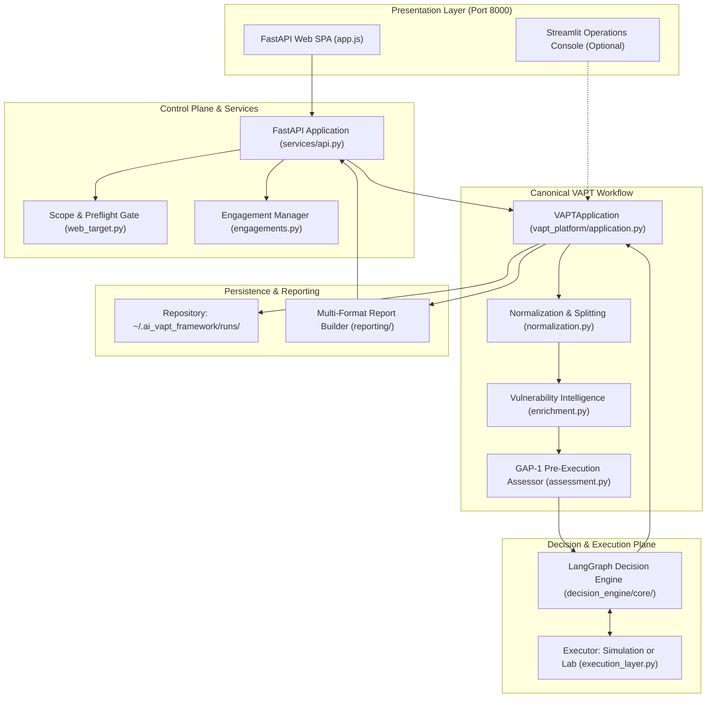
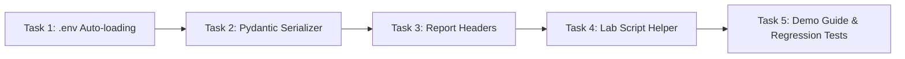

# Master Roadmap & Implementation Plan: Mid-Semester Prototype to Modular AI VAPT Platform

**Document:** `docs/project_management/MIDSEM_PROTOTYPE_IMPLEMENTATION_PLAN.md`  
**Working Title:** *An Autonomous AI Framework for Vulnerability Assessment: Integrating Exploit Quality Scoring and Dynamic Decision-Pivoting*  
**Date:** October 22, 2026  
**Status:** IMPLEMENTATION READY  

---

## 1. Research Problem and Objectives

### 1.1 Core Research Questions
Modern Vulnerability Assessment and Penetration Testing (VAPT) workflows suffer from two primary inefficiencies during validation phases:
1. **Inefficient Ordering & False Priorities (GAP-1):** Static CVSS/severity-based prioritization often attempts unstable, unverified, or unfeasible exploit paths first, wasting limited testing windows. GAP-1 investigates pre-execution exploit quality assessment—evaluating the expected usability, reliability, and prerequisite clarity of a candidate vulnerability before execution to optimize ranking.
2. **Persistent Route Lock & Wasted Attempts (GAP-2):** Naive penetration testing agents often persist in failed exploit routes indefinitely or prematurely abort on transient network timeouts. GAP-2 investigates threshold-based dynamic failure pivoting—bounding repeated attempts on a failing candidate and pivoting intelligently to alternative viable attack paths without prematurely abandoning recoverable candidates.

### 1.2 Mid-Semester Demonstration Objective
The mid-semester deliverable is a reliable, end-to-end demonstrable prototype that clearly shows:
- The single canonical assessment workflow operating from UI initiation to multi-format evidence reporting.
- Transparent GAP-1 candidate quality scoring (deterministic and AI modes with explicit fallback provenance).
- Real GAP-2 threshold-based retry, failure tracking, and dynamic route pivoting.
- Strict scope enforcement, RoE validation, and fail-closed safety preflights.
- Honest reporting of evidence tiers (`SIMULATED`, `OBSERVED_LOCAL`, `OBSERVED_EXTERNAL`).

---

## 2. Prototype Scope & Explicit Exclusions

### 2.1 In Scope for Mid-Semester Prototype
- **Execution Modes:** Full simulation mode (ground-truth scenarios) and controlled local lab execution mode (Docker lab / loopback socket).
- **Primary Interface:** FastAPI Web SPA (`frontend/web/`) on port 8000 as the designated security operations console.
- **Provider Paths:** Deterministic baseline, local Ollama (with truthful fallback logging when offline), and OpenRouter hosted API (via runtime header).
- **Scanner Ingestion:** Nmap discovery and Nuclei vulnerability scan results normalized into `CanonicalFinding`.
- **Reporting:** Consistent export in JSON, HTML, Markdown, and TXT formats.
- **Scope & RoE:** Configured target allowlists, explicit external target acknowledgement, and resilient profile persistence outside git.

### 2.2 Explicit Exclusions (Deferred to Future Phases)
- **External Framework Integration:** Do NOT integrate Strix, Shannon, HexStrike, CyberStrike, or vapt-agents during the mid-semester prototype.
- **Unbounded Offensive Tools:** No weaponized exploit execution or destructive payload delivery.
- **Non-Web Domains:** Mobile, cloud infrastructure, firmware, and binary analysis are deferred to the post-midsem roadmap.
- **Research Core Changes:** Zero modifications to `decision_engine/core/`, `decision_engine/benchmarks/`, or `experiments/`.

---

## 3. Current System Architecture

---

## 4. GAP-1 & GAP-2 Implementation Specification

### 4.1 GAP-1: Pre-Execution Usability Assessment
- **Order of Operations:** Candidate findings are assessed *before* priority scoring and candidate graph generation.
- **Assessment Functions:**
  - `deterministic`: Computes rank from rule heuristics, CVE flags, and EPSS score.
  - `ai` (Ollama / OpenRouter): Prompts LLM for exploit usability score (HIGH, MEDIUM, LOW) and structured rationale.
- **Truthful Provenance:** If an AI provider is unreachable or misconfigured, the framework executes deterministic fallback, sets `fallback=True`, records the provider/model, and captures the exact error in `AssessmentResult.error`.
- **Ranking:** Candidates are sorted into final queue order based on `priority_score = f(probability, quality_rank)`.

### 4.2 GAP-2: Dynamic Threshold Pivoting
- **State Tracking:** Per-candidate attempt counters are tracked strictly in engine state (`attempt_count`).
- **Bounded Threshold:** Configurable `max_attempts` (default: 2).
- **Execution Rules:**
  - Outcome `SUCCESS`: Advances candidate immediately; no unnecessary retries or pivots.
  - Outcome `FAIL_TIMEOUT` / `FAIL_ERROR`:
    - If `attempts < max_attempts`: Retries candidate route.
    - If `attempts >= max_attempts`: Emits `[Pivot]` event, records abandonment in decision trace, and dynamically pivots to the next candidate.
- **Honesty Guarantee:** In web assessment-only runs where no validator exists (`executor=None`), GAP-2 execution is completely bypassed (`_run_assessment_only`), producing zero fabricated attempts or pivot events.

---

## 5. Module-by-Module Implementation Tasks (Mid-Semester Scope)

### Task 1: Scope Environment Variable Auto-Loading (P0)
- **Target File:** `services/api.py`, `vapt_platform/web_target.py`
- **Action:** Add `dotenv.load_dotenv(find_dotenv())` at module initialization.
- **Outcome:** Guarantees `VAPT_AUTHORIZED_WEB_SCOPES` and `AI_VAPT_AUTHORIZED_WEB_PORTS` are active across all startup methods (Uvicorn CLI, scripts, debugger).

### Task 2: Pydantic Serializer Warning Clean-up (P1)
- **Target File:** `services/schemas.py`
- **Action:** Update `ExecutionResultSchema.execution_outcome` typing to handle `Outcome` enum and string representations cleanly.
- **Outcome:** Silences the 3 `PydanticSerializationUnexpectedValue` warnings during test runs and API queries.

### Task 3: Reporting Provenance Header Alignment (P1)
- **Target File:** `vapt_platform/reporting/renderers.py`
- **Action:** Add `Run ID` (`report.metadata.run_id`) to the Run Metadata table in `HTMLRenderer` and `MarkdownRenderer`.
- **Outcome:** Ensures 100% metadata parity between JSON, HTML, Markdown, and TXT exports.

### Task 4: Docker Lab Preflight & Helper Script (P0)
- **Target File:** `scripts/start_lab.sh`, `scripts/start_demo.sh`
- **Action:** Provide a safe script to start and verify the Docker lab containers (`vuln-emulator` and `vuln-executor`).
- **Outcome:** Enables the operator to turn all 7 skipped docker lab tests green when Docker is running.

### Task 5: Mentor Demonstration Playbook & Authority Alignment (P0)
- **Target File:** `docs/project_management/MENTOR_DEMO_COMPREHENSIVE_GUIDE.md`, `README.md`
- **Action:** Update instructions with verified commands, designated Web SPA port 8000, and clear simulation/lab walkthrough steps.
- **Outcome:** Frictionless, predictable live demonstration for evaluators.

---

## 6. Implementation Dependency Ordering

---

## 7. Future Modular Architecture & External Repository Integration

### 7.1 Multi-Domain VAPT Roadmap (Post-Midsem)

1. **Domain 1 — Web Applications & APIs:** Current baseline (Nmap, Nuclei, OWASP Juice Shop, API targets).
2. **Domain 2 — Source Code & Dependencies:** Static analysis and SBOM ingestion (candidate integration: Shannon evaluation).
3. **Domain 3 — Network & Infrastructure Services:** Active service scanning, TLS evaluation, port enumeration (candidate tool: `subfinder`, `nmap` NSE).
4. **Domain 4 — Container & Cloud Configurations:** Kubernetes/Docker misconfiguration scanning.
5. **Domain 5 — Mobile Applications:** Android APK / iOS IPA manifest and permission auditing.

### 7.2 Governed Third-Party Repository Policies
As established in `docs/project_management/EXTERNAL_VAPT_INTEGRATION_PLAN.md`:
- **Strix:** Evaluate in later phases as an optional, scope-constrained exploratory worker with hard request limits.
- **Shannon:** Evaluate as an independent source-aware static audit worker outside live penetration workflows.
- **HexStrike AI:** Reject the unsafe RPC server; consider wrapping standalone CLI utilities (`ffuf`) with strict parameter sanitization.
- **Decepticon:** Adapt RoE boundary validation and prompt sanitization concepts into internal governance without copying AGPLv3 code.
- **CyberStrike / CyberStrikeAI / vapt-agents:** Excluded from integration due to unverified execution safety, license concerns, or architectural overlap.

---

## 8. Mid-Semester Acceptance Criteria

1. **Clean Startup:** Launching `./scripts/start_demo.sh` starts the backend and Web SPA with no missing dependencies or environment errors.
2. **Deterministic & AI GAP-1:** Running an assessment demonstrates assess-before-rank ordering. Offline Ollama displays truthful fallback without crash.
3. **GAP-2 Pivot Trace:** `failure_pivot` scenario clearly records attempt counters, retry decisions, and dynamic pivot events in UI and reports.
4. **Safety Preflight:** Entering an unauthorized target produces an immediate red rejection alert before any network request occurs.
5. **Report Traceability:** Exported Markdown and HTML reports contain matching Run IDs, Evidence Tiers, and accurate attempt counts.
6. **Zero Research Drift:** Frozen research paths remain 100% byte-identical to `v1.0.1-thesis`.
