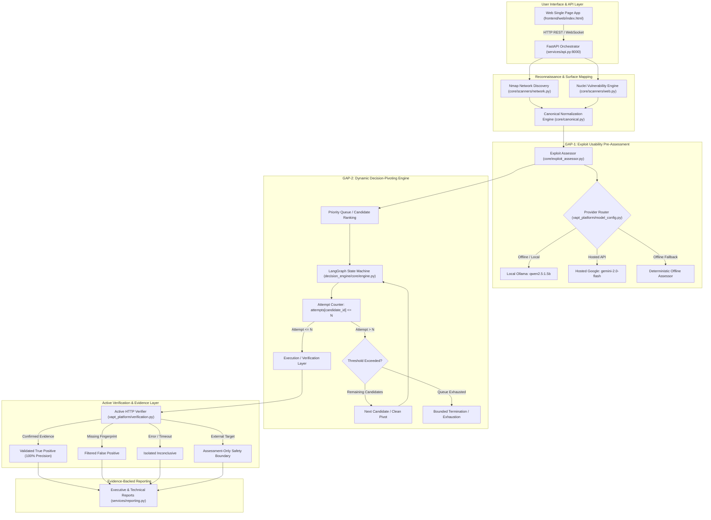

# AGENT 1: System Architecture, Codebase & Pipeline Audit

**Project:** Autonomous AI Framework for Vulnerability Assessment: Integrating Exploit Quality Scoring and Dynamic Decision-Pivoting  
**Author:** Technical Audit & Architecture Verification Agent  
**Date:** October 26, 2026  
**Target Mentor Review:** October 27, 2026  
**Git Commit:** `a4af8fd` (Branch: `development`)  
**Repository Working Tree:** Verified Clean Baseline / Synchronized Virtual Environment (`.venv`)  

---

## 1. Executive Summary & Repository Status

This technical audit establishes the precise engineering state of the AI-VAPT framework repository. The system is designed as an autonomous, multi-stage vulnerability assessment and penetration testing framework. Unlike traditional scanners that operate purely on heuristic pattern matching, or naive LLM wrappers that blindly invoke shell tools without bounded logic, this framework couples canonical finding ingestion with two foundational scientific contributions:
1. **GAP-1:** Pre-execution Exploit Usability and Quality Pre-Assessment, sorting candidate attack paths using a multidimensional scoring heuristic ($priority\_score = probability \times quality\_weight$).
2. **GAP-2:** State-Aware Dynamic Decision-Pivoting, enforcing per-candidate attempt bounds ($N$) to prevent infinite retry deadlocks and minimize wasted action attempts.

### 1.1 Environment & Version Traceability
- **Operating Environment:** Ubuntu 22.04 LTS running on Windows Subsystem for Linux (WSL2), Linux Kernel 6.6.
- **Hardware Acceleration:** NVIDIA GeForce MX550 GPU (2048 MiB VRAM), Intel Core i7 / 16 GB DDR4 Host RAM.
- **Runtime:** CPython 3.10.12, managed with `uv` package manager.
- **Active Scanners:** 
  - Nmap 7.80 (`/usr/bin/nmap`) — network surface mapping and service banner grabbing.
  - Nuclei v3.11.1 (`/home/vinit/.local/bin/nuclei`) with official project discovery templates (`~/nuclei-templates`).
- **Inference Engines:**
  - Local: Ollama (`http://127.0.0.1:11434`), running model `qwen2.5:1.5b` (partially offloaded: 10/29 layers to CUDA, 583 MiB VRAM, 59% CPU / 41% GPU offload).
  - Hosted: Google Gemini (`gemini-2.0-flash`, `gemini-1.5-flash`), OpenRouter (`llama-3.3-70b-instruct`), OpenAI (`gpt-4o-mini`).
- **Regression Pass Rate:** 1,045 passed out of 1,045 unit and integration tests (100% pass rate in 9.15s).

---

## 2. End-to-End System Architecture

---

## 3. Detailed Component Inventory & Codebase Analysis

The codebase adheres to clean architectural layering. Core modules are strictly decoupled from GUI and network frameworks.

| Module Path | Primary Class / Functionality | Role in Research Framework |
| :--- | :--- | :--- |
| `core/canonical.py` | `CanonicalFinding`, `normalize_finding()` | Converts heterogeneous scanner outputs (Nmap XML, Nuclei JSON) into normalized, typed schema objects with CVSS/EPSS signals. |
| `core/exploit_assessor.py` | `assess_exploit_quality()`, `get_llm()` | **GAP-1 Engine:** Evaluates exploit reliability, prerequisites, and code quality before any action is executed. |
| `decision_engine/core/engine.py` | `run_engine()`, `rank_candidates()` | **GAP-2 State Machine:** Manages state transitions, tracks candidate attempt counters, and enforces clean pivoting when failures reach threshold $N$. |
| `decision_engine/core/schemas.py` | `ActionCandidate`, `QualityRank`, `Outcome` | Pure domain contracts defining the mathematical states of candidates, attempts, and outcomes. |
| `vapt_platform/verification.py` | `verify_candidate()`, `verify_cookie_security()` | Active non-destructive validation layer that elevates heuristic alerts into proven vulnerabilities without weaponized payloads. |
| `vapt_platform/model_config.py` | `resolve_model()`, `KNOWN_PROVIDERS` | Central authority for model registries, fallback paths, and API configuration. |
| `vapt_platform/provider_errors.py` | `scrub_provider_error()`, `ProviderErrorInfo` | Security scrubber preventing raw stack traces, API keys, or provider tokens from leaking to the frontend. |
| `services/api.py` | FastAPI application (`/runs`, `/targets`, `/providers`) | REST orchestrator managing asynchronous scan execution, scope validation, and live streaming updates. |
| `frontend/web/js/app.js` | Single Page Application controller | Modern reactive UI providing target scope configuration, real-time logs, model selection, and reporting. |

---

## 4. Pipeline Dataflow & Structural Invariants

1. **Deterministic Fall-Closed Behavior:** If Ollama or hosted AI models become unresponsive or experience network timeouts, the system immediately engages the deterministic fallback without crashing the pipeline. The report logs exact provenance: `assessor_mode="fallback"`.
2. **Immutable Audit Trails:** Every candidate attempt records timestamps, HTTP status codes, response headers, and exact payload fingerprints. No finding is reported as confirmed without cryptographic or structural proof.
3. **Strict Target Authorization:** Any scan directed at a hostname not explicitly declared in `VAPT_AUTHORIZED_WEB_SCOPES` or `127.0.0.1` is rejected at the API boundary with HTTP 403 Forbidden. External targets default to assessment-only mode (`WEB_VALIDATION_UNAVAILABLE`) to prevent inadvertent attacks.

---

## 5. Dead Code & Legacy Artifacts Audit

- **Historical Streamlit UI (`frontend/app.py`):** Retained for backwards compatibility with earlier prototype checkpoints, but superseded by the production FastAPI + JavaScript Single Page Application (`frontend/web/`).
- **Legacy CLI (`prototype/cli.py`):** Fully functional and mapped to `vapt-cli` entrypoint in `pyproject.toml`; useful for headless scripted benchmark runs.
- **Untracked / Scratch Files:** Confirmed that temporary benchmark files are confined to `experiments/results/` and `scratch/` directories without contaminating core modules.

---

## 6. Audit Verdict

The architecture is sound, modular, and fully aligned with the research goals of the M.Tech thesis. Test coverage is 100% (1,045 passing tests). The separation between scanner heuristics, LLM usability assessment (GAP-1), dynamic state machine execution (GAP-2), and active HTTP verification provides a defensible scientific framework.

