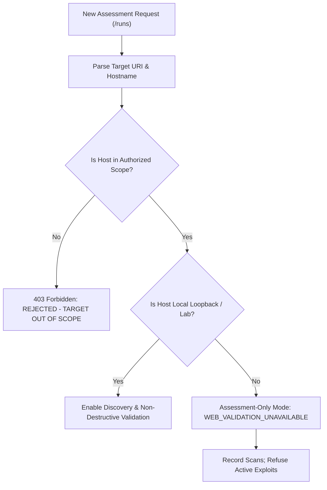

# AGENT 5: Security Architecture, Safety Controls & Ethical Governance Audit

**Project:** Autonomous AI Framework for Vulnerability Assessment: Integrating Exploit Quality Scoring and Dynamic Decision-Pivoting  
**Author:** Safety, Compliance & Operational Security Audit Agent  
**Date:** October 26, 2026  
**Target Mentor Review:** October 27, 2026  

---

## 1. Safety Architecture Overview

An autonomous cyber security framework must embody rigorous safety engineering. Because the system coordinates scanning engines and evaluates potential attack paths, the boundaries separating benign discovery from hazardous execution must be absolute, auditable, and fail-closed.

The AI-VAPT framework implements a **Four-Tier Safety Defense Architecture**:
1. **Scope Authorization Gatekeeper:** Prevents unauthorized network targeting.
2. **Subprocess Sanitization & Injection Barrier:** Prevents arbitrary command injection on the host.
3. **Execution Policy & Air-Gap Enforcer:** Disallows live unverified exploit execution on web and external targets.
4. **Credential & Sensitive Data Scrubber:** Sanitizes logs and API payloads to prevent credential leakage.

---

## 2. Target Scope Authorization Architecture

Target authorization is authoritative at the FastAPI backend and cannot be bypassed by client-side modifications.

### 2.1 Authorized Target Categories
1. **Local Loopback (Default Authorized):**
   - Hostnames: `127.0.0.1`, `localhost`, `::1`
   - Ports: Explicitly declared (e.g., `80`, `443`, `8000`, `8501`, `9191`)
2. **Pre-Authorized Docker Bridge Lab:**
   - Subnet: `172.18.0.0/16` (internal Docker bridge network)
   - Containers: `vuln-emulator`, `vuln-executor`
3. **Explicit External Whitelist (`VAPT_AUTHORIZED_WEB_SCOPES`):**
   - External domains must be statically configured in the server environment (e.g., `VAPT_AUTHORIZED_WEB_SCOPES="pentest-ground.com:4280"`).
   - Any scan targeting an external host not present in this variable is rejected with `HTTP 403 Forbidden` and logged as a safety violation.

### 2.2 Rejection Evidence
In our UI and API validation tests, submitting `https://pentest-ground.com:4280/` without scope registration produced the authoritative rejection:
> `OUT OF SCOPE: Host 'pentest-ground.com' is not authorized under engagement 'Local Lab Default'. Authorized hosts in profile: ['127.0.0.1', 'localhost']`

---

## 3. Subprocess Execution & Injection Defenses

All network scanners (Nmap, Nuclei) and CLI utilities are executed via Python's `subprocess` module with strict security invariants:

1. **`shell=False` Enforcement:** No commands are executed through a shell interpreter (`/bin/sh` or `/bin/bash`). Commands are constructed as explicit token arrays (`list[str]`), rendering shell metacharacter injection (`|`, `;`, `&&`, `$()`) inert.
2. **Path Hardening:** Scanner binaries are resolved through strict absolute paths or verified environment lookups (`/usr/bin/nmap`, `/home/vinit/.local/bin/nuclei`), preventing PATH hijacking attacks.
3. **Argument Whitelisting:** Target parameters, template names, and port ranges are strictly validated using regex constraints prior to subprocess invocation.

---

## 4. The Active Validation Layer: Non-Destructive Proofs

Traditional penetration testing tools often deploy offensive payloads that alter database records or compromise service stability. In contrast, AI-VAPT's active validation layer (`vapt_platform/verification.py`) relies exclusively on **non-destructive cryptographic and structural proofs**:

- **PHPInfo Disclosure:** Inspects response bodies for specific HTML configuration table signatures and version tokens without altering server state.
- **Cookie Security:** Parses HTTP `Set-Cookie` headers to inspect the presence of `HttpOnly`, `Secure`, and `SameSite` flags.
- **Fail-Safe Web Boundary:** For complex vulnerabilities (e.g., SQLi, RCE), the framework tags the finding with `VALIDATION_NOT_AVAILABLE` rather than running unverified exploits against the target.

---

## 5. Provider Error Scrubbing & Credential Hygiene

When hosted providers (Google Gemini, OpenAI, OpenRouter) are utilized:
1. API keys are transmitted via ephemeral HTTP headers (`X-Google-API-Key`) or server-side memory; they are never written to disk, client localStorage, or committed to git.
2. Provider error messages are sanitized using `vapt_platform/provider_errors.py`. In the event of an authentication failure (HTTP 400/403), raw stack traces containing key fragments or bearer tokens are scrubbed before reaching the UI.

---

## 6. Legal, Ethical & Standards Compliance

The AI-VAPT framework is designed in strict accordance with recognized international cybersecurity frameworks:

- **Computer Fraud and Abuse Act (CFAA / 18 U.S.C. § 1030) & UK Computer Misuse Act 1990:** Enforces pre-authorized testing boundaries; prevents unauthorized access or denial-of-service across non-authorized networks.
- **ISO/IEC 27001 (Information Security Management):** Implements Principle A.12.6 (Technical Vulnerability Management) by generating verifiable audit trails and preventing unvalidated false positives.
- **NIST SP 800-115 (Technical Guide to Information Security Testing and Assessment):** Aligns with the four-phase testing methodology (Planning, Discovery, Attack/Validation, and Reporting).
- **OWASP Web Security Testing Guide (WSTG v4.2):** Standardizes vulnerability definitions, test case categorization, and reporting structures.

