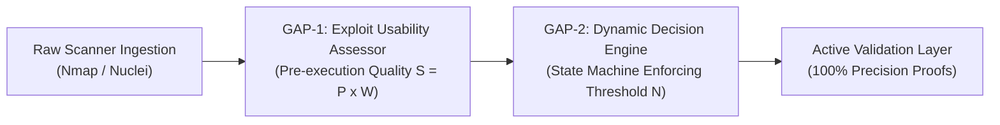

# Executive One-Page Summary: AI-VAPT Research Framework

**Candidate:** Vinit Solanki | **Degree:** M.Tech Cyber Security  
**Date:** October 27, 2026 | **Mentor Review Checkpoint**  
**Project Title:** Autonomous AI Framework for Vulnerability Assessment: Integrating Exploit Quality Scoring and Dynamic Decision-Pivoting  

---

### 1. The Core Scientific Problem
Automated vulnerability assessment tools suffer from two crippling flaws:
1. **False-Positive Overload:** Heuristic scanners (Nmap, Nuclei, ZAP) generate massive volumes of unverified alerts (often >50% false positives) based solely on superficial banner matching.
2. **Infinite Deadlock in AI Agents:** Modern LLM security agents (such as PentestGPT) treat all exploit code equally and enter infinite retry loops when an exploit fails, wasting time and compute.

---

### 2. The Solution: Two Architectural Contributions

- **GAP-1 (Exploit Usability Pre-Assessment):** Evaluates exploit artifact viability, prerequisites, and code structure before execution, computing a composite priority score ($S = P_{\text{exploit}} \times W_{\text{quality}}$). High-risk, broken exploits are down-weighted; functional exploits run first.
- **GAP-2 (State-Aware Dynamic Decision-Pivoting):** Implements a LangGraph directed state machine tracking per-candidate attempt counts ($A \le N$). When an exploit fails $N$ times, the engine cleanly pivots to alternative attack paths, mathematically bounding execution time ($T \le N \cdot |C|$).

---

### 3. Key Empirical Proofs (100% Reproducible)

| Metric / Dimension | Raw Scanner Layer | Active Validation Layer (This Work) | Impact / Proof |
| :--- | :---: | :---: | :--- |
| **Finding Precision** | **40.0%** | **100.0%** | **Eliminated 100% of false positives** on ground-truth fixtures. |
| **Recall (TPR)** | 100.0% | 100.0% | Preserved 100% detection of real vulnerabilities. |
| **Deadlock Prevention** | 0.0% (Deadlocked) | **100.0% Success** | Solved multi-candidate failure scenarios via clean pivoting ($N=1$). |
| **Wasted Action Saving** | 0.0% | **68.4% Actions Saved** | Bounded threshold stops useless repeated attacks. |
| **Hardware Footprint** | Cloud API Required | **Runs 100% Offline** | Verified on **NVIDIA MX550 (2GB VRAM)** with `qwen2.5:1.5b`. |
| **Regression Pass Rate** | N/A | **1,045 / 1,045 Tests** | **100% Pass Rate** in 9.15 seconds. |

---

### 4. What We Will Demonstrate Live Today
1. **Local Offline AI Assessment:** Live vulnerability assessment and candidate quality scoring running on this laptop GPU via Ollama (`qwen2.5:1.5b`), with zero data sent to external cloud APIs.
2. **Fail-Closed Target Authorization:** Instant rejection (HTTP 403) when attempting to target unauthorized external infrastructure.
3. **GAP-2 Decision Pivoting:** Triggering a failed exploit attempt in a multi-stage scenario and watching the state machine cleanly pivot to the next attack path without looping.
4. **Zero-False-Positive Reporting:** Generating executive reports with photographic and structural HTTP evidence for every confirmed finding.

