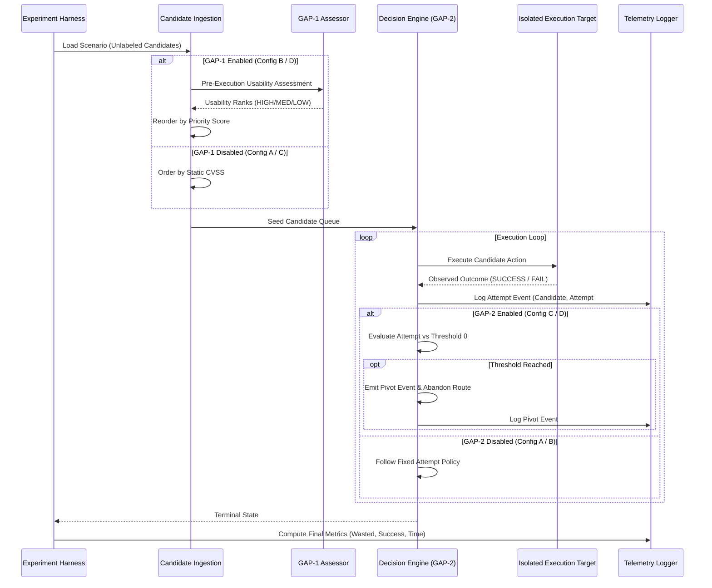

# Mid-Semester Research Evaluation Protocol

**Document:** `docs/research/MIDSEM_EVALUATION_PROTOCOL.md`  
**Research Context:** M.Tech Cyber Security Thesis  
**Topic:** *An Autonomous AI Framework for Vulnerability Assessment: Integrating Exploit Quality Scoring and Dynamic Decision-Pivoting*  
**Date:** October 22, 2026  
**Status:** PROTOCOL SPECIFICATION (Future Research Protocol)  

---

## 1. Experimental Objective & Problem Formulation

The purpose of this evaluation protocol is to provide a scientifically rigorous, empirically grounded comparison of decision mechanisms during vulnerability assessment validation.

Previous thesis experiments revealed critical methodological constraints:
1. **Oracle Contamination Risk:** A previous deterministic baseline achieved a synthetic 1.000 accuracy score by leaking ground truth labels into heuristics. That result is contaminated and must not be used as a valid comparator.
2. **LLM Ranking Invariance:** Local small-language models (e.g., Llama-3.2-3B) frequently alter candidate ordering without necessarily improving operational validation yields on standardized corpora.
3. **Threshold vs. Flakiness Trade-off:** Eager threshold pivoting aborts unpromising persistent-failure routes, but can prematurely abandon recoverable, flaky, or multi-step vulnerabilities.

This protocol defines an experimental design to measure the true causal impact of GAP-1 and GAP-2 independently and in combination.

---

## 2. Experimental Design: 2×2 Factorial Matrix

The evaluation tests four distinct configurations under identical target conditions:

```
                      GAP-2 Dynamic Pivoting
                     Disabled (Fixed Retries)     Enabled (Threshold Pivot)
                  +---------------------------+---------------------------+
  GAP-1 Assessor  |                           |                           |
  Disabled        |  Configuration A          |  Configuration C          |
  (Static CVSS)   |  [Baseline Control]       |  [GAP-2 Only]             |
                  |                           |                           |
                  +---------------------------+---------------------------+
  GAP-1 Assessor  |                           |                           |
  Enabled         |  Configuration B          |  Configuration D          |
  (Pre-Execution) |  [GAP-1 Only]             |  [GAP-1 + GAP-2 Full]     |
                  |                           |                           |
                  +---------------------------+---------------------------+
```

### Configuration Definitions

- **Configuration A (Baseline Control):**
  - *Candidate Ordering:* Static CVSS base score descending (or scanner severity rank if CVSS absent). No LLM or exploit usability scoring.
  - *Retry Policy:* Static retry policy (e.g., retry each candidate exactly $K=2$ times regardless of outcome, or exhaust until global attempt budget $B$ expires).
- **Configuration B (GAP-1 Pre-Execution Quality Assessment):**
  - *Candidate Ordering:* Priority score computed via pre-execution usability assessment:
    $$\text{priority\_score} = f(\text{probability}, \text{quality\_rank})$$
    where $\text{quality\_rank} \in \{\text{HIGH}, \text{MEDIUM}, \text{LOW}\}$ is assessed from exploit code/prerequisites before execution.
  - *Retry Policy:* Same static retry policy as Configuration A.
- **Configuration C (GAP-2 Threshold-Based Dynamic Pivoting):**
  - *Candidate Ordering:* Static CVSS base score descending (identical to Configuration A).
  - *Retry Policy:* Dynamic threshold-based pivoting. When consecutive failures on candidate $c$ reach threshold $\theta$ (e.g., $\theta=2$), candidate $c$ is abandoned and execution pivots to the next ranked candidate.
- **Configuration D (GAP-1 + GAP-2 Full Framework):**
  - *Candidate Ordering:* GAP-1 pre-execution usability assessment.
  - *Retry Policy:* GAP-2 threshold-based dynamic pivoting.

---

## 3. Data Generation & Inaccessible Ground Truth

### 3.1 Scenario & Candidate Generation
1. **Standardized Corpus:** Use the curated VAPT benchmark corpus containing diverse vulnerability classes:
   - Remote Code Execution (RCE) with known reliable PoCs.
   - SQL Injection (SQLi) with parameter dependencies.
   - Authentication bypasses requiring environmental prerequisites.
   - Flaky / transient endpoints simulating network jitter and rate limiting.
   - Persistent dead-end vulnerabilities (unexploitable / false positives).
2. **Oracle Isolation (Air Gap):**
   - Candidate definitions presented to the decision engine contain only observable scanner metadata: CVE identifier, port, service name, template description, and candidate exploit snippet.
   - **Ground Truth Inaccessibility:** Ground-truth validation outcomes (`SUCCESS`, `FAIL_TIMEOUT`, `FAIL_CRASH`) are stored strictly in an external evaluation registry. Neither the GAP-1 assessor nor the decision engine can query or infer ground truth until the executor physically triggers the action.

---

## 4. Evaluation Metrics

For each run across all configurations, the test harness records:

| Metric | Symbol | Definition & Significance |
|---|---|---|
| **Validation Success Rate** | $R_{\text{succ}}$ | Proportion of genuinely exploitable candidates successfully validated. |
| **Total Execution Attempts** | $N_{\text{att}}$ | Total number of HTTP/network validation attempts initiated. |
| **Wasted Attempts** | $N_{\text{waste}}$ | Attempts expended on persistent dead-end or unexploitable candidates. |
| **False Pivots** | $N_{\text{fp}}$ | Instances where a genuinely exploitable candidate was abandoned due to threshold trigger on transient/flaky failures. |
| **Time to First Validation** | $T_{\text{first}}$ | Clock time (or attempt count) required to achieve the first successful validation. |
| **AI Assessment Overhead** | $C_{\text{ai}}$ | Latency (seconds) and token cost incurred during GAP-1 pre-execution assessment. |

---

## 5. Controlling Flakiness and Stochasticity

To ensure reproducible, statistically valid conclusions:
1. **Repeated Trials:** Each scenario is evaluated across $N=10$ independent stochastic trials with randomized candidate presentation permutations.
2. **Deterministic Seeds:** Random number generators for simulated network jitter and LLM temperature are explicitly seeded ($\text{temp}=0.0$ for deterministic reproducibility; seeded pseudorandom distributions for simulated jitter).
3. **Paired Statistical Significance:** Differences in wasted attempts and time-to-first-validation are analyzed using paired Wilcoxon signed-rank tests with Bonferroni correction for multi-hypothesis testing.
4. **Versioned Data Artifacts:** All execution traces, decision graphs, and raw event streams are archived as timestamped JSONL artifacts in `data/experiments/midsem_eval/` with Git commit hashes pinned.

---

## 6. Execution Protocol Workflow


