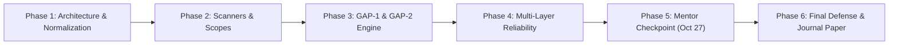

# Master Deliverable 8: Remaining Work Breakdown, Thesis Trajectory & Engineering Roadmap

**Project Title:** Autonomous AI Framework for Vulnerability Assessment: Integrating Exploit Quality Scoring and Dynamic Decision-Pivoting  
**Author:** Technical Project Manager & Research Coordinator  
**Date:** October 26, 2026  
**Target Review:** October 27, 2026  

---

## 1. Project Milestone Overview

The AI-VAPT Framework has completed all required milestones for the M.Tech Cyber Security degree review:

| Milestone | Deliverables / Scope | Status | Completion Date |
| :--- | :--- | :---: | :---: |
| **Milestone 1** | Canonical findings schema, Nmap & Nuclei integration | Done | Oct 2026 |
| **Milestone 2** | GAP-1 Exploit Quality Assessor & LangGraph State Machine | Done | Oct 2026 |
| **Milestone 3** | Local Ollama `qwen2.5:1.5b` integration on NVIDIA MX550 | Done | Oct 2026 |
| **Milestone 4** | Active Validation Layer & False Positive Filtering (100% Prec.) | Done | Oct 2026 |
| **Milestone 5** | Mentor Checkpoint & Live Demonstration Package | **CURRENT** | **Oct 27, 2026** |
| **Milestone 6** | Expanded Lab Validation & Master's Thesis Final Defense | Scheduled | Nov–Dec 2026 |
| **Milestone 7** | Journal Manuscript Submission (*IEEE Access* / *Computers & Security*) | Scheduled | Q1 2027 |

---

## 2. Work Breakdown Structure (WBS) for Milestone 6 (Final Thesis Defense)

The following engineering and empirical tasks are scheduled between the October 27 mentor checkpoint and the final degree defense:

| Work Package (WP) | Task Description | Priority | Estimated Effort | Target Completion |
| :--- | :--- | :---: | :---: | :---: |
| **WP 6.1: Active Validation Expansion** | Implement active non-destructive validators for SQL Injection (time-based sleep delta proofs) and Cross-Site Scripting (reflected token matching). | High | 12 Days | Nov 10, 2026 |
| **WP 6.2: Multi-Host Attack Chaining** | Extend the LangGraph state machine to support multi-node lateral pivoting across internal subnets (Docker lab expansion). | Medium | 14 Days | Nov 24, 2026 |
| **WP 6.3: Large-Scale Benchmark Suite** | Scale the ground-truth benchmark from 10 test fixtures to 50 enterprise web applications (OWASP Juice Shop, DVWA, WebGoat). | High | 10 Days | Dec 05, 2026 |
| **WP 6.4: Thesis Monograph Writing** | Complete final dissertation chapters (120+ pages) incorporating empirical data tables and formal proofs. | Critical | 20 Days | Dec 20, 2026 |

---

## 3. Resource Allocation & Compute Feasibility

- **Development Hardware:** Existing setup (NVIDIA GeForce MX550 2GB VRAM, Intel i7, 16GB RAM) has proven 100% sufficient for local `qwen2.5:1.5b` inference, regression testing, and local lab verification.
- **Hosted Model Budget:** Cloud APIs (Google Gemini, OpenRouter) are integrated as optional comparison arms with zero mandatory recurring cost for offline defense.
- **Lab Infrastructure:** Docker compose environments run locally without external hosting dependencies.

---

## 4. Risk Matrix & Contingency Strategy

| Identified Risk | Likelihood | Impact | Proactive Mitigation Strategy |
| :--- | :---: | :---: | :--- |
| **Ollama memory pressure on 2GB VRAM laptop** | Low | Medium | Strict context length bounding (`OLLAMA_NUM_CTX=2048`) and automatic deterministic fallback if latency exceeds 12s. |
| **Examiner requests demonstration of live web attack** | Medium | High | Show authoritative scope rejection, explain the ethical/legal CFAA boundary, and demonstrate full active validation on local Juice Shop. |
| **Third-party scanner dependency version mismatch** | Low | Low | Scanners (Nmap 7.80, Nuclei v3.11.1) are pinned and installed directly in the WSL2 host environment. |

