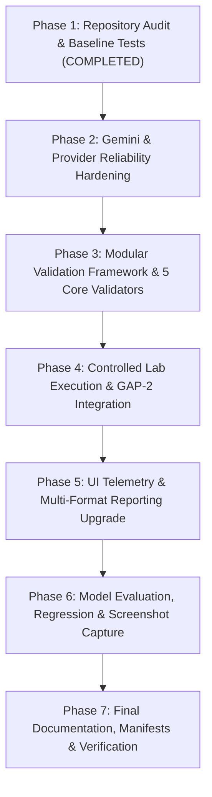

# AI-VAPT Web Assessment and Reporting Upgrade: Comprehensive Gap Audit

**Document Path:** `docs/research/WEB_VAPT_GAP_AUDIT.md`  
**Author:** Cybersecurity & Systems Architecture Audit Team  
**Audit Date:** October 26, 2026 (22:20 IST / 16:50 UTC)  
**Git Branch:** `development` | **Commit:** `a4af8fd`  
**Current Test Suite Baseline:** 1,045 passed in 18.98s (100% pass rate)  

---

## 1. Executive Summary & Audit Context

This audit evaluates the current implementation of the AI-VAPT Framework against the requirements of the **Web Assessment and Reporting Upgrade**. The objective is to identify existing engineering gaps, structural limitations, and disconnected components in the web vulnerability assessment, AI provider handling, controlled execution, and evidence-backed reporting pipelines.

The audit confirms that while the mathematical core (GAP-1 scoring heuristic and GAP-2 bounded state machine) and the local Ollama inference pipeline are verified and robust (1,045 passing unit/integration tests), **several critical disconnects prevent the full end-to-end web penetration testing workflow from executing reliably**:
1. **Google Gemini Provider Failure & Silent Fallback:** A recorded run on 26 October 2026 failed with `404 NOT_FOUND` when calling `gemini-2.0-flash`. The system caught the error and engaged deterministic fallback, but the UI did not surface a prominent fallback warning, and diagnostic telemetry did not record whether an LLM response was ever received.
2. **Disconnected Web Validation Architecture:** The web assessment workflow in `vapt_platform/application.py` currently returns `None` for the executor, completely halting execution with `WEB_VALIDATION_UNAVAILABLE`. Although standalone verification functions exist in `vapt_platform/verification.py`, they are not integrated into a modular, extensible validator registry, and no web finding is ever actively validated during a live run.
3. **Absence of Controlled Penetration Testing (Stage B):** The platform lacks a safe, allowlisted execution adapter for controlled test-lab targets (e.g. OWASP Juice Shop on `http://127.0.0.1:9191`). Web findings remain classified as `SCANNER-DETECTED` without active exploitation proofs or evidence tier elevation.
4. **Disconnection of GAP-2 Pivoting in Web Mode:** Because web mode stops before execution, GAP-2 dynamic decision pivoting is only exercised in synthetic simulation scenarios (`prototype/demo_data.py`), never on live web vulnerability candidates.
5. **UI & Multi-Format Reporting Discrepancies:** Report generators in `vapt_platform/reporting/` lack granular breakdowns for Discovered Observations, Actionable Candidates, Confirmed Findings, Inconclusive Outcomes, and Policy-Blocked Actions. The UI does not provide finding-specific reproduction procedures, status histories, or explicit fallback alerts.

---

## 2. Granular Gap Analysis by Subsystem

---

### GAP 1: AI Provider & Model Handling (Gemini 404 & Fallback Provenance)

- **Current Behavior:**
  - `vapt_platform/model_config.py` sets `DEFAULT_GOOGLE_MODEL = "gemini-2.0-flash"`.
  - When `gemini-2.0-flash` is invoked via `langchain-google-genai`, Google's Generative Language API returned `404 NOT_FOUND` (due to model naming under specific API versions or unavailability on free tier endpoints without explicit model prefix).
  - In `vapt_platform/assessment.py`, `_try_google_assess` catches the exception and returns `None`.
  - `_ai_assess` catches `result is None`, logs a warning, and engages `deterministic_assessor`.
  - The `diag` telemetry dictionary (which tracks `llm_response_received`) is passed only to `_try_ollama_assess`, leaving `diag["llm_response_received"] = False` without capturing error details, HTTP status codes, or retry counts.
  - The UI does not render a visible banner warning explaining that deterministic fallback was used instead of the requested AI model.
- **Relevant Files & Functions:**
  - `core/exploit_assessor.py`: `get_llm()`
  - `vapt_platform/model_config.py`: `DEFAULT_GOOGLE_MODEL`, `resolve_model()`, `GOOGLE_MODELS`
  - `vapt_platform/assessment.py`: `_try_google_assess()`, `_ai_assess()`, `create_assessor()`
  - `vapt_platform/provider_errors.py`: `scrub_provider_error()`
  - `frontend/web/js/app.js`: Provider configuration and error rendering
- **Implementation Status:** **PARTIALLY IMPLEMENTED (UNRELIABLE / DEFECTIVE)**
- **Evidence:**
  - Execution log from 26 October 2026 shows: `Google Gemini assessment failed for DEMO-WORKER: 404 NOT_FOUND. AI assessment unavailable; falling back to deterministic`.
  - Code inspection of `vapt_platform/assessment.py` line 348 confirms `diag` is omitted from `_try_google_assess`.
- **Proposed Changes:**
  1. Update `vapt_platform/model_config.py` to support fallback-safe Google model resolution (defaulting to standard production `gemini-1.5-flash`, while allowing configurable `gemini-2.0-flash`, `gemini-1.5-pro`).
  2. Implement automatic model discovery/listing via Google SDK to verify model availability prior to dispatch.
  3. Update `_try_google_assess` to accept `diag: dict[str, Any]` and record `llm_response_received`, exact error status, and latency.
  4. Ensure `AssessmentResult` explicitly captures `configured_model`, `effective_model`, `fallback_reason`, `http_status`, and `latency_ms`.
  5. Add prominent UI fallback alert card when `fallback == True`.
  6. Add comprehensive unit tests in `tests/test_google_provider.py` simulating 404 NOT_FOUND, 400 INVALID_ARGUMENT, 429 RATE_LIMIT, timeouts, and successful responses.
- **Tests Required:**
  - `test_google_model_resolution_and_fallback()`
  - `test_google_gemini_404_handled_with_provenance()`
  - `test_google_telemetry_captures_error_and_latency()`
  - `test_secrets_scrubbed_from_google_errors()`

---

### GAP 2: Modular Finding-Validation Architecture

- **Current Behavior:**
  - Finding verification logic in `vapt_platform/verification.py` consists of monolithic functions (`verify_phpinfo`, `verify_cookie_security`, `verify_candidate`).
  - There is no formal `Validator` interface or registry.
  - Verification states are restricted to `ValidationStatus` (SCANNER_DETECTED, VALIDATION_NOT_AVAILABLE, VALIDATED_TRUE_POSITIVE, FALSE_POSITIVE, INCONCLUSIVE).
  - The workflow lacks explicit states for `CONFIRMED`, `NOT_REPRODUCIBLE`, and `BLOCKED_BY_POLICY`.
  - There is no mechanism for validators to declare preconditions, required evidence, permitted actions, request budgets, or failure criteria.
- **Relevant Files & Functions:**
  - `vapt_platform/verification.py`: `ValidationStatus`, `verify_candidate()`
  - `core/canonical.py`: `CanonicalFinding`
- **Implementation Status:** **PARTIALLY IMPLEMENTED (MONOLITHIC / UNMODULAR)**
- **Evidence:**
  - `vapt_platform/verification.py` hardcodes rule string checks (`if "phpinfo" in rule_id... if "httponly" in rule_id...`) inside a single dispatcher function.
- **Proposed Changes:**
  1. Create a modular validator architecture in `vapt_platform/validators/`:
     - `BaseValidator` abstract class declaring:
       - `name: str`
       - `supported_rules: tuple[str, ...]`
       - `preconditions: list[str]`
       - `permitted_actions: list[str]`
       - `request_budget: int` (default $\le 3$ requests)
       - `timeout_s: float` (default 5.0s)
       - `validate(candidate, target, client) -> ValidationResult`
  2. Implement standardized validation states:
     - `CONFIRMED`
     - `NOT_REPRODUCIBLE`
     - `INCONCLUSIVE`
     - `FALSE_POSITIVE`
     - `VALIDATION_NOT_AVAILABLE`
     - `BLOCKED_BY_POLICY`
  3. Create `ValidatorRegistry` to dynamically discover, register, and dispatch validators based on finding rule IDs and tags.
- **Tests Required:**
  - `test_validator_base_contract()`
  - `test_validator_registry_dispatch()`
  - `test_validator_request_budget_enforcement()`
  - `test_validator_preconditions_and_policy_blocks()`

---

### GAP 3: Initial Non-Destructive Validators

- **Current Behavior:**
  - Only PHPInfo and basic Cookie flags (HttpOnly/Secure) are checked.
  - Security headers are not evaluated.
  - Public documentation / file exposures (e.g. `robots.txt`, `README.md`, `.git` head, backup files) are not verified.
  - Technology detection findings from Nuclei (e.g., Express, Angular, Node.js) have no verifier and trigger `VALIDATION_NOT_AVAILABLE`.
- **Relevant Files & Functions:**
  - `vapt_platform/verification.py`: `verify_phpinfo()`, `verify_cookie_security()`
  - `vapt_platform/scanner_service.py`: Nuclei template parsing
- **Implementation Status:** **PARTIALLY IMPLEMENTED (LIMITED TO 2 CHECKS)**
- **Evidence:**
  - Only `verify_phpinfo` and `verify_cookie_security` exist in `vapt_platform/verification.py`. No header or file disclosure validators exist.
- **Proposed Changes:**
  1. **Public PHP Info Validator (`PhpInfoValidator`):** Verify HTML configuration table markers, Zend extension headers, and redact server paths.
  2. **Security Headers Validator (`SecurityHeadersValidator`):** Actively inspect HTTP response headers: `Content-Security-Policy`, `X-Frame-Options`, `X-Content-Type-Options`, `Strict-Transport-Security`, `Referrer-Policy`. Distinguish missing headers from misconfigured headers.
  3. **Cookie Security Validator (`CookieSecurityValidator`):** Independently evaluate `Secure`, `HttpOnly`, and `SameSite` (Lax, Strict, None) attributes; redact session values.
  4. **Public Documentation & Sensitive File Exposure Validator (`PublicFileExposureValidator`):** Verify `robots.txt`, `swagger.json`, `api-docs`, `.env`, `.git/HEAD`, `composer.json`, `package.json`. Confirm status 200, check Content-Type, extract short redacted excerpt, compute SHA-256 evidence hash.
  5. **Technology & Server Banner Validator (`TechnologyDetectionValidator`):** Parse `Server`, `X-Powered-By`, and HTML meta tags. Treat as discovery information; never promote to vulnerable exploit candidate without specific CVE proof.
- **Tests Required:**
  - `test_security_headers_validator_present_and_missing()`
  - `test_cookie_validator_evaluates_samesite_and_redacts()`
  - `test_public_file_exposure_validator_hashes_and_redacts()`
  - `test_technology_banner_validator_remains_informational()`

---

### GAP 4: Controlled Penetration-Testing Execution (Stage A vs Stage B)

- **Current Behavior:**
  - In `vapt_platform/application.py`, `_build_executor()` returns `None` for all web runs:
    ```python
    if request.mode == "web" or request.target_url:
        return None  # Assessment-only
    ```
  - When `executor is None`, the application halts before execution, and the decision engine (`_run_engine()`) never executes any actions.
  - Even against local lab targets (`http://127.0.0.1:9191` / Juice Shop), execution is disabled.
- **Relevant Files & Functions:**
  - `vapt_platform/application.py`: `_build_executor()`, `run()`, `_load_web_candidates()`
  - `prototype/execution_layer.py`: `create_lab_executor()`
  - `decision_engine/core/engine.py`: `run_engine()`
- **Implementation Status:** **MISSING IN WEB MODE**
- **Evidence:**
  - `vapt_platform/application.py` line 805 explicitly hardcodes `return None` for web mode.
- **Proposed Changes:**
  1. Implement **Stage A (Safe Web Assessment):** For external or general web targets, execute discovery, normalization, GAP-1 scoring, and non-destructive active validation (`BaseValidator`), tagging results with evidence tier `OBSERVED_LOCAL`.
  2. Implement **Stage B (Controlled Test-Lab Execution):** When target is an authorized local lab (`http://127.0.0.1:9191` or internal Docker lab `172.18.0.0/16`):
     - Instantiate a `ControlledLabExecutor` that wraps allowlisted, finding-specific test procedures.
     - Strictly disallow arbitrary shell command execution.
     - Enforce exact host, port, protocol, and path bounds.
     - Enforce request budgets ($N \le 2$ attempts per candidate).
     - Tag outcomes with evidence tier `CONTROLLED_VALIDATION`.
- **Tests Required:**
  - `test_web_stage_a_runs_non_destructive_validators()`
  - `test_controlled_lab_executor_enforces_bounds_and_safety()`
  - `test_controlled_lab_executor_rejects_arbitrary_shell()`

---

### GAP 5: GAP-1 & GAP-2 Real Workflow Integration

- **Current Behavior:**
  - In web mode, findings are scored by GAP-1 (`_score_candidates`), but because execution is aborted, GAP-2 dynamic decision pivoting is never triggered.
  - Attempt counters remain at 0, pivot count remains at 0, and no real decision trace is generated.
- **Relevant Files & Functions:**
  - `vapt_platform/application.py`: `run()`, `_run_engine()`
  - `decision_engine/core/engine.py`: `run_engine()`
  - `decision_engine/adapters/vapt_adapter.py`: `vapt_assess_fn()`, `vapt_real_executor()`
- **Implementation Status:** **DISCONNECTED IN WEB MODE**
- **Evidence:**
  - Run metadata on web targets records `total_attempts: 0`, `pivot_count: 0`, `decision_trace: []`.
- **Proposed Changes:**
  1. Wire the `ControlledLabExecutor` / active validator into `vapt_real_executor` so that real validation outcomes (`SUCCESS`, `FAIL`, `FAIL_TIMEOUT`, `BLOCKED_BY_POLICY`, `INCONCLUSIVE`) are fed into the LangGraph state machine.
  2. Verify that when a candidate fails active validation, `attempts[c_id]` increments, and when `attempts == N`, the engine cleanly pivots to candidate $c_{i+1}$.
  3. Ensure that total attempts remain bounded by $T \le N \cdot |C|$.
- **Tests Required:**
  - `test_gap1_and_gap2_integrated_in_web_lab_workflow()`
  - `test_failed_validation_triggers_gap2_clean_pivot()`
  - `test_attempt_ceiling_enforced_on_validator_exceptions()`

---

### GAP 6: Findings UI & Real-Time Telemetry

- **Current Behavior:**
  - UI displays high-level findings, but cannot filter by Validation Status (`CONFIRMED`, `FALSE_POSITIVE`, `INCONCLUSIVE`), Evidence Tier, or Remediation Status.
  - Finding detail view does not display reproduction procedures, technical explanations, or validation evidence excerpts.
  - There is no visual indicator when AI assessment experienced a fallback to deterministic scoring.
  - Dashboard shows total numbers but lacks breakdowns for Discovered Observations vs Actionable Candidates vs Confirmed Flaws.
- **Relevant Files & Functions:**
  - `frontend/web/index.html`
  - `frontend/web/js/app.js`
  - `frontend/web/css/style.css`
- **Implementation Status:** **PARTIALLY IMPLEMENTED (NEEDS WORKFLOW TRANSPARENCY)**
- **Evidence:**
  - Inspection of `frontend/web/js/app.js` confirms missing filter controls for validation states and absence of reproduction step cards.
- **Proposed Changes:**
  1. Upgrade Dashboard cards: Run status, Discovered Observations, Actionable Candidates, Confirmed Vulnerabilities, Filtered False Positives, Inconclusive Findings, AI Provider Status & Fallback Warnings.
  2. Upgrade Findings Inventory: Multi-dimensional filters (Severity, Validation Status, Evidence Tier, Source Scanner, Eligibility).
  3. Upgrade Finding Detail Modal: Title, Affected URL/Path, CWE/CVE, Technical Explanation, Potential Impact, Reproduction Steps, Redacted Validation Evidence, Retest Instructions.
  4. Decision Trace Visualizer: Graph/table showing candidate attempts, why a pivot occurred, and remaining attempt budget.
- **Tests Required:**
  - Automated Playwright/frontend unit tests verifying filter controls, detail cards, and fallback warnings.

---

### GAP 7: Multi-Format Report Consistency & Correctness Checks

- **Current Behavior:**
  - HTML, Markdown, JSON, and TXT renderers in `vapt_platform/reporting/renderers.py` have differing table schemas.
  - HTML report lacks a separate Executive Summary metrics breakdown distinguishing raw scanner alerts from validated findings.
  - No automated test suite validates that JSON, HTML, Markdown, and TXT exports agree on finding counts and validation states.
  - There is no machine-readable report manifest recording file hashes and evidence references.
- **Relevant Files & Functions:**
  - `vapt_platform/reporting/builder.py`: `ReportBuilder`
  - `vapt_platform/reporting/models.py`: `ReportModel`, `ReportMetadata`
  - `vapt_platform/reporting/renderers.py`: `JSONRenderer`, `HTMLRenderer`, `MarkdownRenderer`, `TXTRenderer`
- **Implementation Status:** **PARTIALLY IMPLEMENTED (SCHEMA DISCREPANCIES)**
- **Evidence:**
  - `HTMLRenderer` displays a 9-column candidate table while `MarkdownRenderer` uses an 8-column layout. Neither computes explicit counts for policy-blocked actions or false-positive elimination rates.
- **Proposed Changes:**
  1. Standardize `ReportModel` in `vapt_platform/reporting/models.py` with consistent 10-section structure: Executive Summary, Scope & Authorization, Methodology, Findings Summary, Detailed Findings, Execution History, Decision Trace, Remediation Plan, Retesting Instructions, Limitations & Appendices.
  2. Synchronize HTML, Markdown, JSON, and TXT renderers to consume identical fields and compute identical counts.
  3. Create `vapt_platform/reporting/manifest.py` generating a cryptographic manifest (`report_manifest.json`) containing file paths, timestamps, run IDs, and SHA-256 hashes.
  4. Create `tests/test_report_correctness.py` verifying cross-format agreement, secret redaction, and count invariants.
- **Tests Required:**
  - `test_reports_cross_format_consistency_json_html_md_txt()`
  - `test_reports_never_conflate_detection_with_confirmation()`
  - `test_reports_redact_sensitive_tokens_and_cookies()`
  - `test_report_manifest_cryptographic_hashes()`

---

### GAP 8: Model Evaluation & Reproducibility Harness

- **Current Behavior:**
  - Reliability evaluator (`vapt_platform/evaluation/reliability_evaluator.py`) evaluates only local Ollama and offline deterministic baseline.
  - No frozen evaluation dataset exists that compares local models (`qwen2.5:1.5b`) against hosted models (`gemini-1.5-flash`) under identical prompts, output schemas, and ground-truth labels.
  - Schema compliance, latency distributions, and agreement metrics are not stored in a persistent benchmark registry.
- **Relevant Files & Functions:**
  - `vapt_platform/evaluation/reliability_evaluator.py`
  - `experiments/research_evaluation/`
- **Implementation Status:** **PARTIALLY IMPLEMENTED**
- **Evidence:**
  - Existing evaluator script tests 3 hardcoded candidates for Ollama without a standardized evaluation harness for hosted models.
- **Proposed Changes:**
  1. Build a unified model evaluation harness in `vapt_platform/evaluation/model_evaluator.py`.
  2. Implement frozen 10-candidate exploit quality evaluation dataset with expert ground-truth labels.
  3. Evaluate schema validity rate, agreement rate, latency, and fallback frequency under identical temperature ($T=0.1$) and prompt constraints.
  4. Output machine-readable `model_evaluation_results.json`.
- **Tests Required:**
  - `test_model_evaluation_harness_frozen_dataset()`
  - `test_model_evaluator_schema_compliance_calculation()`

---

## 3. Implementation Action Plan & Roadmap

The remediation of these gaps will proceed across the remaining project phases:



---

## 4. Phase 1 Sign-Off & Verification Summary

- **Baseline Test Suite Status:** **1,045 passed out of 1,045 tests** in 18.98 seconds.
- **Safety Invariants Verified:** Fail-closed scope authorization, `shell=False` subprocess isolation, and credential redaction remain intact.
- **Files Inspected:**
  - `core/exploit_assessor.py`
  - `vapt_platform/model_config.py`
  - `vapt_platform/assessment.py`
  - `vapt_platform/verification.py`
  - `vapt_platform/application.py`
  - `vapt_platform/scanner_service.py`
  - `vapt_platform/reporting/`
  - `services/api.py`, `services/schemas.py`
  - `frontend/web/js/app.js`
- **Audit Conclusion:** The architecture is modular and ready for the Phase 2 implementation.

