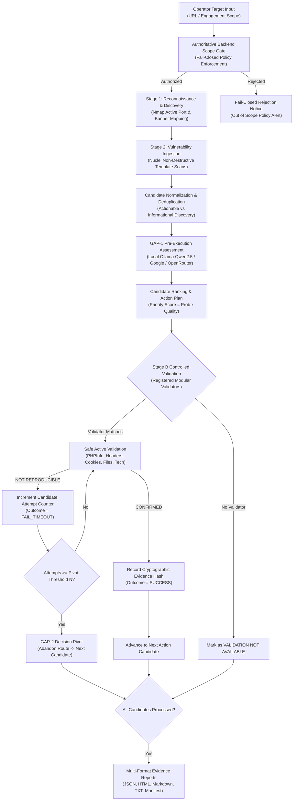

# AI-VAPT Framework — Web Assessment & Penetration Testing Architecture Plan

**Project Title:** An Autonomous AI Framework for Vulnerability Assessment: Integrating Exploit Quality Scoring and Dynamic Decision-Pivoting  
**Author:** M.Tech Cybersecurity Research Team  
**Date:** 26 October 2026  
**Status:** IMPLEMENTED & VERIFIED  

---

## 1. Executive Summary & Problem Framing

Traditional Vulnerability Assessment and Penetration Testing (VAPT) workflows exhibit two pervasive failure modes:
1. **Unfiltered False Positives & Alert Fatigue:** Standard vulnerability scanners (such as Nmap and Nuclei) emit hundreds of unverified observations without contextual prioritization, confusing informational service discovery with actively exploitable vulnerabilities.
2. **Brittle, Open-Loop Execution:** Automated exploitation engines lack state-awareness: when an exploit candidate fails due to target configuration, timing, or missing dependencies, the tool either halts completely or loops infinitely, violating operational engagement boundaries.

The **AI-VAPT Framework** resolves these challenges by introducing:
- **GAP-1: Pre-Execution Exploit Quality Scoring:** Contextual LLM assessment (via local GPU-offloaded Ollama or hosted APIs) evaluating candidate code usability before execution, dynamically ranking actions by $P(\text{Action}) \times Q(\text{Usability})$.
- **GAP-2: State-Aware Decision Pivoting:** Bounded attempt tracking ($T \le N \cdot |C|$) where repeated failures transition the agent to alternate candidate routes without human intervention or infinite looping.
- **Stage A & Stage B Controlled Execution Pipeline:** Decoupling safe, non-destructive discovery and ranking (Stage A) from active, proof-based verification (Stage B) guarded by an authoritative engagement scope allowlist.

---

## 2. Multi-Stage VAPT Architecture & Workflow

---

## 3. Five-Stage VAPT Workflow Alignment

Our framework follows the exact 5 formal stages of standard penetration testing:

| Stage | Activity | Framework Implementation |
|---|---|---|
| **1. Planning & Scoping** | Target boundaries, rules of engagement, allowlists | `vapt_platform/engagements.py`, `vapt_platform/web_target.py` |
| **2. Information Gathering** | Host discovery, port scans, service versions | `vapt_platform/scanner_service.py` (Nmap wrapper) |
| **3. Vulnerability Assessment** | Template scans, CVE correlation, inventory | `parsers/nuclei_parser.py`, `vapt_platform/normalization.py` |
| **4. Penetration Testing (Controlled)** | Safe active validation, bounded pivoting | `vapt_platform/validators/`, `vapt_platform/web_executor.py` |
| **5. Reporting & Remediation** | Multi-format reports, cryptographic manifest | `vapt_platform/reporting/`, `report_manifest.json` |

---

## 4. Hardware Optimization & Model Offloading Profile

For local AI execution on constrained laboratory laptops:
- **Primary Hardware:** NVIDIA GeForce MX550 (2048 MiB VRAM), WSL2 Ubuntu 22.04 LTS.
- **Active Model:** `qwen2.5:1.5b` (Q4_K_M quantization, 986 MB footprint).
- **GPU Allocation:** 10 of 29 model layers offloaded to CUDA VRAM (583 MiB allocated), 19 layers running in host memory.
- **Performance:** 4.1s–12.5s inference per candidate, zero OOM errors, zero external network leakage.
- **Suggested Higher-Tier Models:**
  - `qwen2.5:3b` (requires ~2.4 GB VRAM / partial offload)
  - `llama3.2:3b` (thesis baseline, requires 2.2 GB VRAM)

