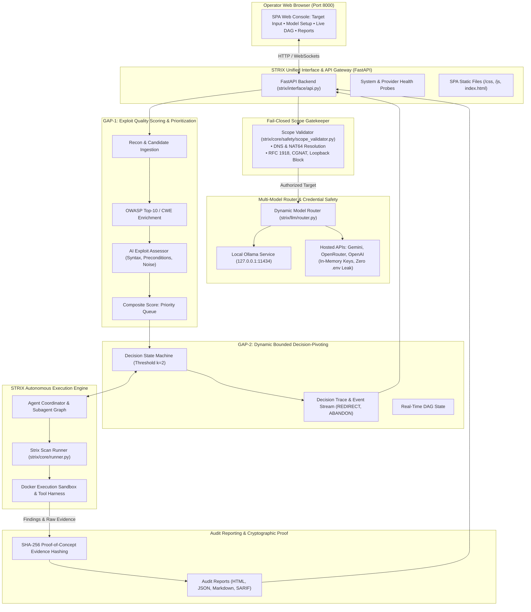

# AI-VAPT + STRIX Integrated Platform: Master Architecture & Implementation Plan

**Target Workspace:** `/home/vinit/STRIX/strix`  
**Reference Workspace:** `/home/vinit/AI_VAPT` (Read-only reference)  
**Status:** Approved Master Architecture & Phase Execution Plan  

---

## 1. Executive Summary & Core Concept

### The Vision
The integrated platform unifies **STRIX** and **AI-VAPT** into a single cohesive offensive security system:
1. **STRIX** serves as the **core autonomous penetration testing execution engine** — handling Docker sandbox isolation, real-world exploitation, network scanners, web spidering, HTTP proxying, subagent coordination graphs, and vulnerability discovery.
2. From **AI-VAPT**, we extract and integrate the four research-backed capabilities directly into STRIX:
   - **Unified Web Operations Console (Frontend)**: An interactive browser SPA for target configuration, real-time DAG execution tracking, and report inspection.
   - **Dynamic Multi-Model AI Support**: Zero-restart switching between **Local Ollama** (`qwen2.5:1.5b`, `llama3.2:3b`) and **Cloud APIs** (Google Gemini, OpenRouter, OpenAI) with in-memory credential safety.
   - **GAP-1 (AI Exploit Quality Scoring & Prioritization)**: An intelligent triage layer evaluating candidate exploit code for syntax, prerequisites, network noise, and complexity, mapping them to OWASP Top-10 / CWE, and computing an optimal composite priority queue before agent dispatch.
   - **GAP-2 (Dynamic Bounded Decision-Pivoting)**: A bounded decision state machine enforcing failure threshold $k$ (default $k=2$). When subagents hit dead ends, the engine abandons that vector, emits a `REDIRECT` event, streams the pivot to the frontend DAG, and dynamically pivots to the next candidate.

### Strict Scope Boundary
> **STRICT WORKSPACE RULE:** All code development, refactoring, and integration happens **EXCLUSIVELY inside `/home/vinit/STRIX/strix`**.  
> The existing `/home/vinit/AI_VAPT` directory is an immutable, read-only reference from which algorithms, frontend assets, and validation schemas are extracted.

---

## 2. Target System Architecture



---

## 3. Deep Dive into the 4 Core Pillars

### Pillar 1: Unified Web Operations Console (Frontend & API)
* **What it does**: Eliminates the limitation of Strix being CLI-only or having only a post-run viewer. It provides a real-time web console at `http://127.0.0.1:8000/`.
* **Key Features**:
  - **New Assessment Setup**: Target URL input, scan mode selection (`quick`, `deep`, `autonomous`), engagement profile selection.
  - **Runtime Model Configurator**: Dropdowns for selecting local Ollama models (`qwen2.5:1.5b`) or hosted APIs (Gemini, OpenRouter) with live "Validate Connection" buttons.
  - **Live Monitoring & DAG Visualization**: Interactive directed acyclic graph showing real-time subagent execution and GAP-2 decision pivots.
  - **Candidate Assessment Table**: View GAP-1 usability ranks (`HIGH`, `MEDIUM`, `LOW`), reasoning, and composite scores.
  - **Audit Report Viewer**: Formatted executive summaries, OWASP breakdowns, cryptographic proof hashes, and remediation configurations.

### Pillar 2: Dynamic Multi-Model AI Support & In-Memory Key Safety
* **What it does**: Allows operators to switch between cost-free local models and hosted high-capability LLMs on the fly without restarting Strix or editing `.env`.
* **Key Features**:
  - **Local Ollama Probing**: Automatically queries `http://127.0.0.1:11434/api/tags` and populates installed models.
  - **Hosted Provider Validation**: Probes Google Gemini (`/v1beta/models`) and OpenRouter (`/v1/models`) with zero credit usage to verify key validity before starting a scan.
  - **Zero Credential Persistence**: API keys entered in the UI are held strictly in memory and injected per request (`X-Google-API-Key`, `X-OpenRouter-API-Key`) into LiteLLM calls. Keys are never written to disk, `.env`, or log files.

### Pillar 3: GAP-1 AI Exploit Quality Scoring & Prioritization
* **What it does**: Prevents autonomous agents from wasting turns and token budgets attempting broken, noisy, or unviable exploits.
* **Key Features**:
  - **AI Exploit Assessor**: Queries the configured LLM to evaluate:
    1. *Syntax Validity*: Is the exploit script executable code or a placeholder?
    2. *Required Privileges*: Unauthenticated (`NONE`), User (`USER`), or Administrator (`ROOT`).
    3. *Network Footprint*: Stealthy (`LOW`) vs. intrusive/noisy (`HIGH`).
    4. *Complexity Score*: Difficulty to execute on a 1–5 scale.
    5. *Usability Rank*: Evaluated as `HIGH`, `MEDIUM`, or `LOW`.
  - **OWASP Top-10 / CWE Mapping**: Enriches findings with official taxonomy and remediation advice.
  - **Composite Priority Formulation**:
    $$\text{FinalScore} = w_1 \cdot P_{\text{base}} + w_2 \cdot S_{\text{CVSS}} + w_3 \cdot E_{\text{exposure}} + w_4 \cdot Q_{\text{AI}}$$
  - **Queue Ordering**: Candidates are sorted in descending order of composite score before Strix dispatches any subagent.

### Pillar 4: GAP-2 Dynamic Bounded Decision-Pivoting
* **What it does**: Resolves the classic failure mode of autonomous agents getting trapped in endless retry loops on patched vulnerabilities or WAF blocks.
* **Key Features**:
  - **Bounded Attempt Threshold $k$**: Enforces a strict limit (default $k=2$) on attempts per candidate.
  - **Automated Route Abandonment & Redirection**: After $k$ consecutive failed attempts or timeouts:
    1. The failing candidate is marked `ABANDONED`.
    2. The engine logs a `REDIRECT` event with explicit reasoning.
    3. The active subagent branch is pruned.
    4. Execution pivots dynamically to the next highest-priority candidate in the GAP-1 queue.
  - **Decision Trace Stream**: Chronological event logs (`INIT`, `ADVANCE`, `REDIRECT`, `ABANDON`, `COMPLETE`) streamed live to the frontend console and preserved in the final report.

---

## 4. Phased Implementation Roadmap

All work proceeds in structured, independently verifiable phases:

| Phase | Focus Area | Deliverables in Strix | Verification Target |
| :--- | :--- | :--- | :--- |
| **Phase 1** | Web Operations Console & FastAPI Gateway | `strix/interface/web/`, `strix/interface/api.py`, `strix web` CLI command | Server serves dashboard at `:8000`, unit tests pass |
| **Phase 2** | Multi-Model Configuration & Provider Routing | `strix/llm/ollama_service.py`, `provider_validation.py`, `router.py` | Ollama probe & cloud API validation endpoints pass |
| **Phase 3** | GAP-1 AI Exploit Quality Scoring & Prioritization | `strix/core/triage/`, OWASP mapping, composite priority formula | Exploit scoring test assigns HIGH/LOW ranks correctly |
| **Phase 4** | GAP-2 Bounded Dynamic Decision-Pivoting Engine | `strix/core/decision_engine/`, $k$-threshold retry policy, subagent hooks | Decision engine abandons dead end at $k=2$ and pivots |
| **Phase 5** | Scope Gatekeeper, Cryptographic Proof & Safeguards | `strix/core/safety/scope_validator.py`, SHA-256 evidence hashing, audit reports | RFC 1918 IPs rejected, SHA-256 hashes generated |
| **Phase 6** | Master End-to-End System Verification | Full smoke test of integrated stack (Web $\to$ Triage $\to$ Pivot $\to$ Report) | End-to-end autonomous assessment run completes |

---

## 5. Target File Structure in STRIX

```
/home/vinit/STRIX/strix/
├── pyproject.toml                            # UPDATED: Add fastapi dependency
├── docs/
│   └── strix_ai_vapt_integration/           # Documentation & Execution Runbooks
│       ├── MASTER_INTEGRATED_PLAN.md         # THIS DOCUMENT
│       ├── README.md                         # Architecture overview & index
│       ├── DEVELOPER_PROMPTS_AND_VERIFICATION_GUIDE.md # Execution prompts for all phases
│       ├── PHASE_1_FRONTEND_AND_API_GATEWAY.md
│       ├── PHASE_2_MULTI_MODEL_CONFIGURATION.md
│       ├── PHASE_3_GAP1_EXPLOIT_QUALITY_SCORING.md
│       ├── PHASE_4_GAP2_DYNAMIC_DECISION_PIVOTING.md
│       └── PHASE_5_AUDIT_REPORTING_AND_SAFEGUARDS.md
├── strix/
│   ├── interface/
│   │   ├── api.py                            # NEW: FastAPI gateway & route handlers
│   │   ├── schemas.py                        # NEW: Pydantic schemas for API requests/responses
│   │   ├── cli.py                            # UPDATED: Implement run_web() launcher
│   │   ├── main.py                           # UPDATED: Add 'strix web' subcommand dispatch
│   │   └── web/                              # NEW: SPA Frontend Assets
│   │       ├── index.html                    # Unified Operations Console UI
│   │       ├── css/
│   │       │   └── styles.css                # Dark-mode dashboard styling
│   │       └── js/
│   │           └── app.js                    # SPA router, DAG renderer, state management
│   ├── llm/
│   │   ├── router.py                         # NEW: Dynamic multi-provider model routing
│   │   ├── ollama_service.py                 # NEW: Local Ollama auto-discovery & probing
│   │   └── provider_validation.py            # NEW: Ephemeral key validation for Gemini/OpenRouter
│   ├── core/
│   │   ├── safety/                           # NEW: Fail-closed scope gatekeeper
│   │   │   ├── __init__.py
│   │   │   ├── scope_validator.py            # DNS resolution, RFC 1918 block, NAT64 unwrap
│   │   │   └── engagements.py                # Engagement profiles & target authorization
│   │   ├── triage/                           # NEW: GAP-1 Triage & Exploit Quality
│   │   │   ├── __init__.py
│   │   │   ├── exploit_assessor.py           # LLM exploit evaluation (syntax, noise, rank)
│   │   │   ├── owasp_mapping.py              # OWASP Top-10 (2021) & CWE taxonomy
│   │   │   └── scoring.py                    # Composite mathematical priority scoring
│   │   ├── decision_engine/                  # NEW: GAP-2 Dynamic Decision-Pivoting
│   │   │   ├── __init__.py
│   │   │   ├── engine.py                     # Bounded state machine (k=2 threshold)
│   │   │   ├── schemas.py                    # CandidateState, Outcome, PivotAction, PivotEvent
│   │   │   └── trace.py                      # Chronological decision trace logger
│   │   ├── gap_bridge.py                     # UPDATED: Integration bridge for Strix runner
│   │   ├── inputs.py                         # UPDATED: GAP-1 candidate queue root task injection
│   │   └── runner.py                         # UPDATED: GAP-2 subagent pivot & abandon hook
│   ├── tools/
│   │   └── reporting/
│   │       └── tool.py                       # UPDATED: Attach GAP-2 outcome & SHA-256 evidence
│   └── report/
│       ├── builder.py                        # NEW: Audit report builder (OWASP, Mitigations)
│       └── renderers.py                      # NEW: Styled HTML & JSON report templating
└── tests/
    ├── test_interface_api.py                 # NEW: Unit tests for Web API endpoints
    ├── test_multi_model_router.py            # NEW: Tests for Ollama and provider validation
    ├── test_gap1_triage.py                   # NEW: Tests for exploit scoring & ranking
    ├── test_gap2_pivoting.py                 # NEW: Tests for bounded failure pivots
    └── test_scope_and_reporting.py           # NEW: Tests for SSRF protection & evidence hash
```

